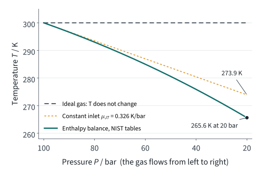
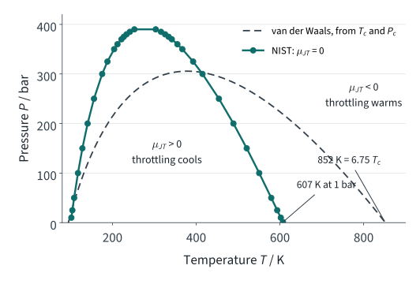
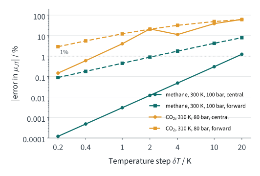
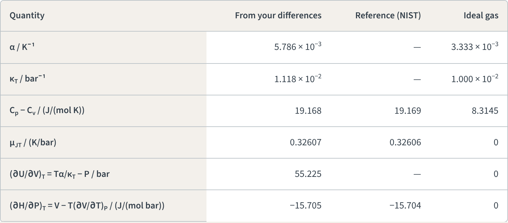

## Where this session sits {#course-map}

::: {.coursemap}
::: {.half}
[Before the midterm · 7 sessions]{.label}
[P1 · Framework]{.cm .now} [P2 · PVT and equations of state]{.cm} [P3 · Residual properties]{.cm} [P4 · Pure-component equilibrium and fugacity]{.cm} [P5 · Mixtures]{.cm} [P6 · Excess properties and activity]{.cm} [P7 · Choosing a property model]{.cm}
:::
::: {.half}
[After the midterm · 7 sessions]{.label}
[1 · VLE and flash]{.cm} [2 · Experimental VLE]{.cm} [3 · Liquid stability and LLE]{.cm} [4 · Solids and adsorption]{.cm} [5 · Chemical equilibrium]{.cm} [6 · Electrochemical equilibrium]{.cm} [7 · Choosing a model from evidence]{.cm}
:::
:::

::: {.bridge}
Every later session needs properties that nobody measures directly: H, S, G, μ, fugacity. Today: how all of them follow from what can be measured, **PVT data and Cp**, and why equilibrium at fixed T and P means **minimum G**.
:::

## Why this matters: a valve on a gas line {#why}

:::: {.columns}
::: {.column width="56%"}
{.fig-pxy fig-alt="Outlet temperature of methane throttled from 300 K and 100 bar, against pressure: the ideal gas stays at 300 K, a constant inlet Joule–Thomson coefficient reaches 273.9 K, and the enthalpy balance from the NIST tables reaches 265.6 K at 20 bar"}
:::
::: {.column width="42%" .why-notes}
Methane at 300 K and 100 bar passes a valve to 20 bar. No heat, no work: Hout = Hin.

An ideal gas leaves at **300 K**. The real gas leaves at **265.6 K**, 34 K colder, near the hydrate and brittle-steel range of a gas plant.

Using the inlet slope all the way gives 273.9 K, still 8 K off.

By the end of today you can compute all three, and say which data each needs.

[NIST Chemistry WebBook, SRD 69: methane from the Setzmann and Wagner (1991) reference equation of state. Lab P1 B.]{.source}
:::
::::

## By the end of today you can {#outcomes}

[Where you show it]{.where-head}

1. **Write** the fundamental relation, its Legendre transforms and the Gibbs–Duhem equation, and say which potential is minimal under which constraints. [Concepts]{.where}
2. **Derive** Maxwell relations and express any derivative in α, κT and Cp. [Activity 1]{.where}
3. **Compute** Cp − Cv, μJT and the internal pressure from tabulated PVT data, and judge the finite-difference error. [Activity 2, Lab P1 A]{.where}
4. **Predict** a throttling temperature from H(T, P), and explain why the ideal gas and a constant μJT fail. [Demo, Lab P1 B]{.where}

## The 180-minute route {#route}

::: {.route}
::: {.seg .concept style="flex:30"}
[0–30]{.t} **Essential concepts** [potentials, Maxwell, measurables]{.d}
:::
::: {.seg .act style="flex:10"}
[30–40]{.t} **Activity 1** [a derivative in measurables]{.d}
:::
::: {.seg .demo style="flex:20"}
[40–60]{.t} **Demo** [Lab P1]{.d}
:::
::: {.seg .break style="flex:10"}
[60–70]{.t} **Break**
:::
::: {.seg .act style="flex:70"}
[70–140]{.t} **Activity 2 · pair investigation** [a valve, a near-critical fluid]{.d}
:::
::: {.seg .wrap style="flex:40"}
[140–180]{.t} **Discussion and exit ticket** [answer the session question]{.d}
:::
:::

::: {.route-question}
[Session question]{.label} How do we obtain the properties a process needs, such as H, S and the Joule–Thomson coefficient, from what can be measured, and what does equilibrium require?
:::

::: {.beforeafter}
::: {}
[Before class · 15–20 min]{.label}
Review the first and second laws and partial derivatives (chain rule, triple product). Bring one question.
:::
::: {}
[After class · 30–40 min]{.label}
Finish Lab P1: all six states, then A–C in the Graduate view. Submit the study file with your name and ID.
:::
:::

::: {.selfstudy}
**Studying on your own?** Follow the same order. Turn on narration or captions at the bottom left, and pause at each activity slide.
:::

## One fundamental relation holds everything {#fundamental}

:::: {.columns}
::: {.column width="50%"}
First and second laws for a reversible change of an open, single-phase system:

$$dU=T\,dS-P\,dV+\sum_i\mu_i\,dn_i$$

U(S, V, n) is a **fundamental relation**: it contains every equilibrium property. Integrating at fixed intensive state (Euler):

$$U=TS-PV+\sum_i\mu_in_i$$
:::
::: {.column width="48%" .rule-notes}
Subtracting the differential of the Euler form from dU gives the **Gibbs–Duhem equation**:

$$S\,dT-V\,dP+\sum_in_i\,d\mu_i=0$$

T, P and the μi of a phase are not independent. Session 2 uses this to test measured activity coefficients.

μi is the **chemical potential** of i: (∂U/∂ni) at fixed S, V and the other nj.
:::
::::

## Legendre transforms: change the variables you control {#legendre}

:::: {.columns}
::: {.column width="56%"}
::: {.lever-box}
[Four potentials, fixed amounts]{.label}

| Potential | Natural variables | Differential |
|---|---|---|
| U | S, V | dU = T dS − P dV |
| H = U + PV | S, P | dH = T dS + V dP |
| A = U − TS | T, V | dA = −S dT − P dV |
| **G = H − TS** | **T, P** | **dG = −S dT + V dP** |
:::
:::
::: {.column width="42%" .rule-notes}
Each transform swaps one variable for its conjugate without losing information.

In a lab or a plant we fix **T and P**, so G is the useful one:

$$\mu_i=\Big(\frac{\partial G}{\partial n_i}\Big)_{T,P,n_{j\neq i}}$$

For a pure substance μ = G/n, the molar Gibbs energy.
:::
::::

## Why equilibrium means minimum G {#equilibrium}

:::: {.columns}
::: {.column width="50%"}
Clausius: for any real change of a closed system, T dS ≥ δQ. With dU = δQ − P dV at fixed T and P:

$$dG=dU+P\,dV-T\,dS\le0$$

G can only fall. At equilibrium it is a **minimum** over all internal changes.
:::
::: {.column width="48%" .rule-notes}
**Consequences** for phases α and β in contact:

$$T^\alpha=T^\beta,\qquad P^\alpha=P^\beta,\qquad \mu_i^\alpha=\mu_i^\beta$$

The last is the condition for every phase-equilibrium problem in this course (P4, Session 1).

**Stability** of a single phase needs Cv &gt; 0 and κT &gt; 0. An equation-of-state loop where κT &lt; 0 is unstable (P2).
:::
::::

## Maxwell relations {#maxwell}

:::: {.columns}
::: {.column width="50%"}
The mixed second derivatives of a potential are equal. From dG and dA:

$$\Big(\frac{\partial S}{\partial P}\Big)_T=-\Big(\frac{\partial V}{\partial T}\Big)_P\qquad \Big(\frac{\partial S}{\partial V}\Big)_T=\Big(\frac{\partial P}{\partial T}\Big)_V$$

Entropy cannot be measured directly. These relations replace its derivatives by PVT derivatives.
:::
::: {.column width="48%"}
::: {.lever-box}
[Methane, 300 K, 100 bar · NIST tables]{.label}

| | J/(mol K bar) |
|---|---:|
| (∂S/∂P)T from the isotherm | −0.123485 |
| −(∂V/∂T)P from the isobar | −0.123485 |

The tables come from one fundamental equation, so they satisfy Maxwell **by construction**. Data from two laboratories would not agree this well.
:::
:::
::::

## A toolkit for any derivative {#toolkit}

:::: {.columns}
::: {.column width="50%"}
**Rules** for x, y, z related by one equation:

$$\Big(\frac{\partial x}{\partial y}\Big)_z\Big(\frac{\partial y}{\partial z}\Big)_x\Big(\frac{\partial z}{\partial x}\Big)_y=-1$$

$$\Big(\frac{\partial x}{\partial y}\Big)_z=\Big(\frac{\partial x}{\partial w}\Big)_z\Big(\frac{\partial w}{\partial y}\Big)_z$$
:::
::: {.column width="48%" .rule-notes}
**Method:** to express a derivative in measurables,

1. bring in T and P as the independent variables;
2. remove S derivatives with Maxwell and (∂S/∂T)P = Cp/T;
3. write the PVT derivatives as α and κT.

Example: (∂P/∂T)V = −(∂V/∂T)P/(∂V/∂P)T = α/κT. With step 2 this gives Cp − Cv on the next slide.
:::
::::

## Three measurable coefficients {#measurables}

:::: {.columns}
::: {.column width="50%"}
$$\alpha=\frac{1}{V}\Big(\frac{\partial V}{\partial T}\Big)_P\qquad \kappa_T=-\frac{1}{V}\Big(\frac{\partial V}{\partial P}\Big)_T$$

$$C_p=T\Big(\frac{\partial S}{\partial T}\Big)_P$$

$$C_p-C_v=\frac{TV\alpha^2}{\kappa_T}$$

Ideal gas: α = 1/T, κT = 1/P, so Cp − Cv = R.
:::
::: {.column width="48%"}
::: {.lever-box}
[Methane, 300 K · NIST tables]{.label}

| | 1 bar | 100 bar | ideal gas |
|---|---:|---:|---:|
| Z | 0.998 | 0.856 | 1 |
| α / 10⁻³ K⁻¹ | 3.354 | 5.786 | 3.333 |
| κTP | 1.002 | 1.118 | 1 |
| Cp − Cv / (J/(mol K)) | 8.39 | 19.17 | 8.31 |

At 100 bar the dense gas expands 74% more on heating than an ideal gas.
:::
:::
::::

## Any property from PVT data and Cp {#any-property}

:::: {.columns}
::: {.column width="52%"}
With T and P as variables, Maxwell gives

$$dH=C_p\,dT+\Big[V-T\Big(\frac{\partial V}{\partial T}\Big)_P\Big]dP$$

$$dS=\frac{C_p}{T}\,dT-\Big(\frac{\partial V}{\partial T}\Big)_P\,dP$$

The brackets need only PVT data. For an ideal gas the dP term of dH is zero: H depends on T alone.
:::
::: {.column width="46%" .rule-notes}
**The plan for P2 and P3:** integrate dP at low pressure, where the gas is ideal and Cp is the ideal-gas Cpig(T), then along the real isotherm with an equation of state.

The second step is the **residual property**: H − Hig at the same T and P.

Methane at 300 K and 100 bar: (∂H/∂P)T = −15.70 J/(mol bar). Over 80 bar that is about 1.3 kJ/mol, the energy behind the 34 K drop.
:::
::::

## The Joule–Thomson coefficient {#jt}

:::: {.columns}
::: {.column width="50%"}
At constant H, dH = 0 in the previous slide:

$$\mu_{JT}=\Big(\frac{\partial T}{\partial P}\Big)_H=\frac{T(\partial V/\partial T)_P-V}{C_p}$$

$$\mu_{JT}=\frac{V(T\alpha-1)}{C_p}$$

A pressure drop cools the fluid where Tα &gt; 1 and warms it where Tα &lt; 1. Ideal gas: Tα = 1 exactly, μJT = 0.
:::
::: {.column width="48%"}
::: {.lever-box}
[μJT from the NIST tables]{.label}

| State | Tα | μJT / (K/bar) |
|---|---:|---:|
| CO₂, 300 K, 10 bar | 1.185 | +1.080 |
| methane, 300 K, 100 bar | 1.736 | +0.326 |
| nitrogen, 300 K, 50 bar | 1.110 | +0.175 |
| liquid water, 298.15 K, 1 bar | 0.077 | −0.0221 |

Liquids warm on throttling: 100 bar warms water by 2.2 K.
:::
:::
::::

## Where throttling stops cooling: the inversion curve {#inversion}

:::: {.columns}
::: {.column width="56%"}
{.fig-pxy fig-alt="Joule–Thomson inversion curve of nitrogen from the NIST tables, a dome reaching about 390 bar with the upper branch at 607 K at 1 bar, and the van der Waals curve, a lower dome reaching 306 bar with 852 K at low pressure"}
:::
::: {.column width="42%" .concept-notes}
Inside the curve μJT &gt; 0. Nitrogen at 1 bar stops cooling above **607 K**.

[Van der Waals, from Tc and Pc only]{.q} Predicts 6.75Tc = **852 K** (+40%) and no inversion above 9Pc = 306 bar. The tables show inversion up to about **390 bar**.

A two-parameter cubic gets the shape and misses the numbers. P2 asks why, and what better equations add.
:::
::::

## Derivatives from tables: the step matters {#differences}

:::: {.columns}
::: {.column width="56%"}
{.fig-pxy fig-alt="Absolute error in the Joule–Thomson coefficient against the temperature step on log axes: for dense methane the central difference stays below 1 percent up to 10 K, for CO2 at 310 K and 80 bar the central difference needs 0.4 K and the forward difference never reaches 1 percent"}
:::
::: {.column width="42%" .concept-notes}
Forward error ∝ δT·V″; central error ∝ δT²·V‴.

[Methane, 300 K, 100 bar]{.q} Central, δT = 10 K: within **0.3%**.

[CO₂, 310 K, 80 bar]{.q} Close to the critical point (304.1 K, 73.8 bar) V(T) bends sharply. Central, δT = 1 K: **+4.0%**; forward: **−12.2%**. Central, 0.2 K: +0.15%.

A step that is safe in one state is not safe in another. Check it.
:::
::::

## A derivative in measurables {#activity-1 .activity}

[Activity 1 · 10 minutes · alone, then with a partner]{.act-label}

::: {.prompt}
Express (∂U/∂V)T and (∂H/∂P)T in T, P, V, α and κT. Evaluate both for an ideal gas, and for liquid water at 298.15 K and 1 bar: V = 18.07 cm³/mol, α = 2.573 × 10⁻⁴ K⁻¹, κT = 4.525 × 10⁻⁵ bar⁻¹.
:::

Start from dU = T dS − P dV and dH = T dS + V dP, and use one Maxwell relation for each. Compare your expressions with your partner before you put in numbers.

::: {.selfstudy}
**On your own:** pause here and write your answer. In place of a partner, compare it with the next slide and write one sentence on any difference and its cause.
:::

## Activity 1: check your answer {#activity-1-debrief}

:::: {.columns}
::: {.column width="52%"}
$$\Big(\frac{\partial U}{\partial V}\Big)_T=T\Big(\frac{\partial P}{\partial T}\Big)_V-P=\frac{T\alpha}{\kappa_T}-P$$

$$\Big(\frac{\partial H}{\partial P}\Big)_T=V-T\Big(\frac{\partial V}{\partial T}\Big)_P=V(1-T\alpha)$$

Ideal gas: Tα/κT = P and Tα = 1, so **both are zero**.
:::
::: {.column width="46%"}
::: {.lever-box}
[Liquid water, 298.15 K, 1 bar]{.label}

Tα = 0.0767

(∂U/∂V)T = 0.0767/(4.525 × 10⁻⁵) − 1 = **1694 bar** = 169 MPa

(∂H/∂P)T = 18.07 × 0.923 = 16.68 cm³/mol = **1.668 J/(mol bar)** (1 cm³ bar = 0.1 J)

So μJT = −1.668/75.33 = −0.0221 K/bar.
:::
:::
::::

The internal pressure of water is about 1700 times the outside pressure: the cohesion that the ideal gas leaves out.

## Demonstration · Lab P1 {#demo-lab}

:::: {.columns}
::: {.column width="44%"}
1. **Methane, 300 K, 100 bar**, central, δT = 1 K. Compare Cp − Cv and μJT with the ideal gas and the reference.
2. **Liquid water.** Read the sign of μJT and the internal pressure.
3. **CO₂, 310 K, 80 bar.** Switch central to forward. Then δT = 0.2 K.
4. Graduate view, **B**: the methane valve, four outlet temperatures.

[Open Lab P1 in the Graduate view →](../preview-2027/measurable.html?mode=graduate){.lab-button target="_blank"}
:::
::: {.column width="54%"}
{.lab-shot fig-alt="Lab P1 results for methane at 300 K and 100 bar, showing the properties from finite differences next to the NIST reference and the ideal gas"}

::: {.expect}
[Lab P1 should report]{.label}
Methane, 100 bar: Cp − Cv = 19.17 J/(mol K) · μJT = 0.3261 K/bar · water: μJT = −0.0221 K/bar · valve: 265.6 K
:::
:::
::::

## Four common mistakes {#mistakes}

::: {.mistakes}
::: {}
**Cp − Cv = R for a dense gas.** Methane at 100 bar: 19.2 J/(mol K), not 8.3. The ideal-gas identities hold only where α = 1/T and κT = 1/P.
:::
::: {}
**One μJT for a large pressure drop.** μJT changes with T and P along the path. The methane valve: 8 K error. Use the enthalpy balance.
:::
::: {}
**A forward difference near the critical point.** CO₂ at 310 K and 80 bar: −12% with δT = 1 K. Use central differences and check the step.
:::
::: {}
**Mixing units in PV terms.** 1 L bar = 100 J and 1 cm³ bar = 0.1 J. Most wrong μJT values are off by a power of ten.
:::
:::

## Break · 10 minutes {#break .breakslide}

::: {.break-next}
[Next]{.label}
Activity 2: a pair investigation in Lab P1, 70 minutes.

Before you leave your seat, check that Lab P1 opens on your device and that the methane case is saved.
:::

## Activity 2 · a valve and a near-critical fluid {#activity-2 .activity}

[Activity 2 · 70 minutes · in pairs: one drives Lab P1, one checks by hand, then swap]{.act-label}

::: {.a2grid}
::: {}
[20 min · by hand]{.label}
From the Lab P1 rows for methane at 100 bar (Step 2, paper check), compute α, κT, Cp − Cv and μJT. Then estimate the valve outlet with a constant μJT.
:::
::: {}
[20 min · the valve]{.label}
Lab P1 B: compare the four outlet temperatures for methane and nitrogen. Why does one integration step already do well?
:::
::: {}
[15 min · near critical]{.label}
Lab P1 A on CO₂ at 310 K and 80 bar: the largest δT that keeps μJT within 1%, central and forward.
:::
::: {}
[15 min · explain]{.label}
Two sentences with numbers answering the session question. Download the study file with your names and IDs.
:::
:::

::: {.selfstudy}
**On your own:** do both roles yourself: work in Lab P1, then check one value by hand before you trust it. Pause the slides while you work; the next slide lists what to hand in.
:::

## Activity 2 · what to hand in {#activity-2-check}

:::: {.columns}
::: {.column width="48%"}
1. Lab P1 study file with the six states, A and B, your name and student ID.
2. Your hand calculation of the four methane properties.
3. Two sentences answering the session question with numbers.

[Graduate extension]{.label}
Lab P1 C: compare the nitrogen inversion curve with van der Waals. Which feature of a real fluid does a two-parameter equation miss?
:::
::: {.column width="50%"}
::: {.lever-box}
[Check your results]{.label}

| | methane valve | nitrogen |
|---|---:|---:|
| inlet | 300 K, 100 bar | 300 K, 200 bar |
| outlet P | 20 bar | 1 bar |
| ideal gas / K | 300 | 300 |
| constant inlet μJT / K | 273.9 | 285.8 |
| one integration step / K | 266.6 | 269.5 |
| enthalpy balance / K | **265.6** | **269.2** |

CO₂, 310 K, 80 bar: central needs δT ≤ 0.4 K for 1%; forward never reaches 1% in the table.
:::
:::
::::

## Discussion: what did the tables show? {#discussion}

:::: {.columns}
::: {.column width="58%"}
{.fig-pxy fig-alt="The methane valve again: ideal gas, constant inlet Joule–Thomson coefficient and enthalpy balance"}
:::
::: {.column width="40%" .concept-notes}
[Discuss in pairs, then with the class. On your own: write two or three sentences for each question.]{.q}

1. Methane at 1 bar has Z = 0.998 but μJT = 0.43 K/bar. Why is Z close to 1 not enough to call every property ideal?
2. The Maxwell check agreed to six digits. What does that prove, and what does it not?
3. Which data would you need to compute the valve outlet if no table existed?
:::
::::

## Summary {#summary}

::: {.summary3}
::: {}
[Framework]{.label}
dU = T dS − P dV + Σμidni; Legendre transforms give H, A, G. At fixed T and P, G is minimal and μi is equal in every phase.
:::
::: {}
[Measurables]{.label}
Maxwell relations turn S derivatives into PVT derivatives. α, κT and Cp then give Cp − Cv, μJT and (∂H/∂P)T.
:::
::: {}
[Numbers]{.label}
A derivative from a table is only as good as its step; near a critical point the step must be small.
:::
:::

**Session question:** with dH = CpdT + [V − T(∂V/∂T)P]dP, PVT data and Cp give every property. The methane valve leaves at 265.6 K, not the 300 K of an ideal gas.

[Next session]{.label} P2: where the PVT data come from when there is no table, the equations of state.

## Exit ticket · 5 minutes {#exit-ticket .activity}

[Exit ticket and feedback · alone · 5 minutes · anonymous]{.act-label}

:::: {.columns}
::: {.column width="64%"}
::: {.prompt}
Methane leaves a valve 34 K colder than it entered, but an ideal gas would leave at the same temperature. Which term of dH carries the difference, and which two measured properties do you need to evaluate it?
:::

Scan the code or open the link. The same form asks three short questions about today: pace, confidence and whether the lab worked.

No name or student ID is recorded. Wait for **"Response received."**
:::
::: {.column width="32%" .qr-col}
{.qr fig-alt="QR code for the Session P1 exit ticket and feedback form"}

[Open the Session P1 form](exit.html?p=1){target="_blank"}
:::
::::

## After class {#after-class}

::: {.summary3}
::: {}
[Hand in · this week]{.label}
Your Lab P1 study file with the six states, A and B, name and student ID. Upload it to **myCourseVille**, in the assignment for that lab.
:::
::: {}
[Prepare · Session P2]{.label}
Read the [Session P2 pre-class note](note-p02.html){target="_blank"}. About 20 minutes.
:::
::: {}
[Optional · graduate]{.label}
Lab P1 C: the nitrogen inversion curve against van der Waals.
:::
:::

[Open Lab P1 in the Graduate view →](../preview-2027/measurable.html?mode=graduate#graduate-investigation){.lab-button target="_blank"}

[Starts at **4. Investigate what the tables can support**. **A**: first button **Run the step-size study**. **B**: **Compare the outlet temperatures**. **C**: **Find the inversion temperatures**.]{.howto}
