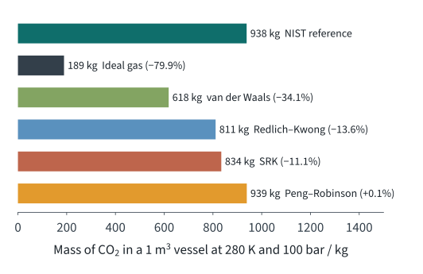
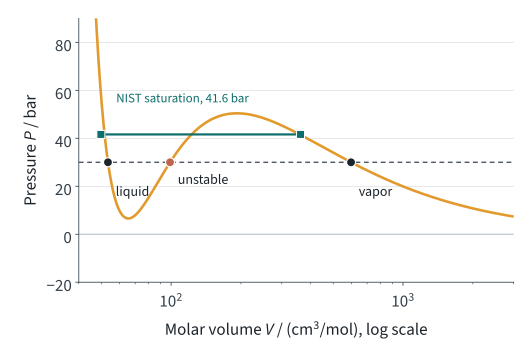
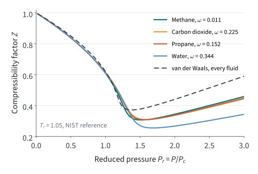
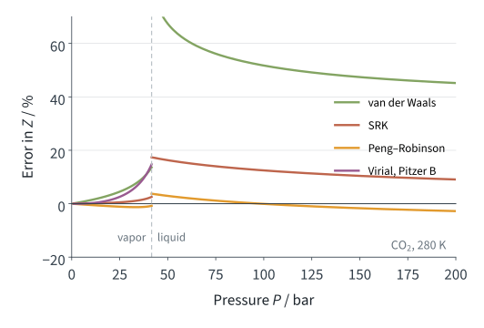
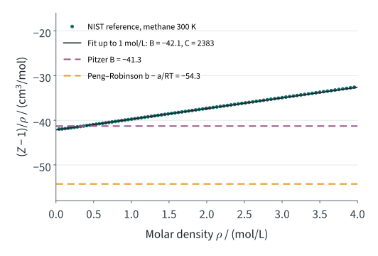
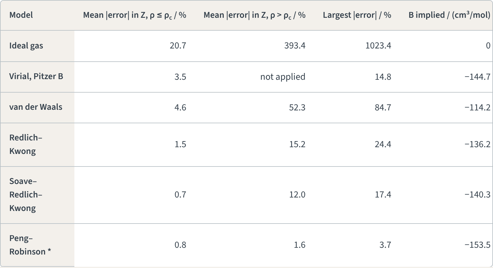

## Where this session sits {#course-map}

::: {.coursemap}
::: {.half}
[Before the midterm · 7 sessions]{.label}
[P1 · Framework]{.cm} [P2 · PVT and equations of state]{.cm .now} [P3 · Residual properties]{.cm} [P4 · Pure-component equilibrium and fugacity]{.cm} [P5 · Mixtures]{.cm} [P6 · Excess properties and activity]{.cm} [P7 · Choosing a property model]{.cm}
:::
::: {.half}
[After the midterm · 7 sessions]{.label}
[1 · VLE and flash]{.cm} [2 · Experimental VLE and consistency]{.cm} [3 · Liquid stability and LLE]{.cm} [4 · Solids and adsorption]{.cm} [5 · Chemical equilibrium]{.cm} [6 · Electrochemical equilibrium]{.cm} [7 · Choosing a model from evidence]{.cm}
:::
:::

::: {.bridge}
P1 showed that PVT data and Cp give every property. Most fluids and mixtures have no reference table, so the PVT data come from an **equation of state**. Today: the virial and cubic equations, which root to use, and **how large their errors are** against reference data.
:::

## Why this matters: how much CO₂ is in the tank? {#why}

:::: {.columns}
::: {.column width="58%"}
{.fig-pxy fig-alt="Mass of CO2 in a 1 cubic metre vessel at 280 K and 100 bar: NIST reference 938 kg, ideal gas 189 kg, van der Waals 618 kg, Redlich–Kwong 811 kg, SRK 834 kg, Peng–Robinson 939 kg"}
:::
::: {.column width="40%" .why-notes}
A 1 m³ buffer vessel holds CO₂ at 280 K and 100 bar, a compressed liquid.

The reference holds **938 kg**. The ideal gas predicts 189 kg. Four cubic equations, each built from Tc and Pc, give 618 to 939 kg.

Peng–Robinson is within 0.1% here, and **23% off** for liquid water at 500 K.

By the end of today you can compute each bar and say when to trust it.

[NIST Chemistry WebBook, SRD 69; CO₂ from the Span and Wagner (1996) reference equation of state. Lab P2.]{.source}
:::
::::

## By the end of today you can {#outcomes}

[Where you show it]{.where-head}

1. **Relate** the second virial coefficient B to the low-density limit of Z, extract it from data and estimate it with the Pitzer correlation. [Concepts, Lab P2 A]{.where}
2. **Set up** a cubic equation of state from Tc, Pc and ω, solve it for Z and **choose the correct root**. [Activity 1, Lab P2]{.where}
3. **Use** corresponding states and the acentric factor, and say where they fail. [Lab P2 B]{.where}
4. **Judge** the error of each equation against reference data, separately for the gas and the dense region. [Activity 2, Lab P2 C]{.where}

## The 180-minute route {#route}

::: {.route}
::: {.seg .concept style="flex:30"}
[0–30]{.t} **Essential concepts** [virial, cubics, roots, ω]{.d}
:::
::: {.seg .act style="flex:10"}
[30–40]{.t} **Activity 1** [Peng–Robinson by hand]{.d}
:::
::: {.seg .demo style="flex:20"}
[40–60]{.t} **Demo** [Lab P2]{.d}
:::
::: {.seg .break style="flex:10"}
[60–70]{.t} **Break**
:::
::: {.seg .act style="flex:70"}
[70–140]{.t} **Activity 2 · pair investigation** [eight isotherms, roots, B]{.d}
:::
::: {.seg .wrap style="flex:40"}
[140–180]{.t} **Discussion and exit ticket** [answer the session question]{.d}
:::
:::

::: {.route-question}
[Session question]{.label} When no reference table exists, which equation of state gives the PVT data a calculation needs, and how do we know how wrong it is?
:::

::: {.beforeafter}
::: {}
[Before class · 20 min]{.label}
Read the [Session P2 pre-class note](note-p02.html){target="_blank"} and answer its three questions.
:::
::: {}
[After class · 40 min]{.label}
Finish Lab P2: all eight isotherms with Peng–Robinson, then A–C in the Graduate view. Submit the study file with your name and ID.
:::
:::

::: {.selfstudy}
**Studying on your own?** Follow the same order. Turn on narration or captions at the bottom left, and pause at each activity slide.
:::

## What an equation of state must describe {#pvt}

:::: {.columns}
::: {.column width="50%"}
The compressibility factor measures the departure from the ideal gas:

$$Z=\frac{PV}{RT}$$

An equation of state must give

- Z → 1 as P → 0, with slope B/RT;
- a steep liquid branch, V close to its limit;
- the critical point, where (∂P/∂V)T = (∂²P/∂V²)T = 0;
- two phases below Tc.
:::
::: {.column width="48%"}
::: {.lever-box}
[Critical compressibility Zc = PcVc/RTc]{.label}

| | Zc |
|---|---:|
| methane · CO₂ · propane (NIST) | 0.286 · 0.275 · 0.276 |
| water (NIST) | 0.229 |
| van der Waals | 0.375 |
| Redlich–Kwong, SRK | 0.333 |
| Peng–Robinson | 0.307 |

A two-constant cubic fixes Zc. Every one is too large, so the dense region is where to expect errors.
:::
:::
::::

## The virial equation: exact at low density {#virial}

:::: {.columns}
::: {.column width="52%"}
$$Z=1+\frac{B}{V}+\frac{C}{V^2}+\dots\qquad Z\approx1+\frac{BP}{RT}$$

B(T) comes from interactions of molecule pairs, C(T) from triples. B is negative at low T (attraction wins) and positive at high T.

**Pitzer correlation** (nonpolar gases):

$$\frac{BP_c}{RT_c}=B^0+\omega B^1$$

B⁰ = 0.083 − 0.422/Tr1.6, B¹ = 0.139 − 0.172/Tr4.2
:::
::: {.column width="46%" .rule-notes}
**Use the truncated form** where BP/RT is small, roughly Vr = V/Vc &gt; 2. It has no liquid branch.

[Methane, 300 K:]{.q} Pitzer B = −41.3 cm³/mol; from the NIST data −42.2 (2% apart).

At 100 bar the truncated equation gives Z = 0.834 against 0.856 (−2.5%). Up to the critical density (about 211 bar) the mean error is 5.7%: the C/V² terms matter.

The ideal gas is within 1% of Z only up to **6 bar** for methane at 300 K.
:::
::::

## One family of cubic equations {#cubic}

$$P=\frac{RT}{V-b}-\frac{a(T)}{(V+\varepsilon b)(V+\sigma b)}\qquad a=\Omega_a\frac{R^2T_c^2}{P_c}\alpha(T_r,\omega),\quad b=\Omega_b\frac{RT_c}{P_c}$$

::: {.lever-box}
| Equation | Ωa | Ωb | α(Tr) | ε, σ | Zc |
|---|---:|---:|---|---|---:|
| van der Waals (1873) | 27/64 | 1/8 | 1 | 0, 0 | 0.375 |
| Redlich–Kwong (1949) | 0.42748 | 0.08664 | Tr−1/2 | 0, 1 | 0.333 |
| Soave–Redlich–Kwong (1972) | 0.42748 | 0.08664 | [1 + m(1 − Tr1/2)]² | 0, 1 | 0.333 |
| Peng–Robinson (1976) | 0.45724 | 0.07780 | [1 + m(1 − Tr1/2)]² | 1 − √2, 1 + √2 | 0.307 |

SRK: m = 0.480 + 1.574ω − 0.176ω² · PR: m = 0.37464 + 1.54226ω − 0.26992ω²
:::

[Ωa and Ωb follow from the two critical conditions. SRK and PR fitted m(ω) to vapor pressures of nonpolar fluids, not to densities.]{.howto}

## Three roots: which one is the fluid? {#roots}

:::: {.columns}
::: {.column width="56%"}
{.fig-pxy fig-alt="Peng–Robinson isotherm of CO2 at 280 K on a log volume axis. A line at 30 bar cuts it at the liquid, an unstable middle and the vapor root. The NIST saturation line at 41.6 bar spans from the saturated liquid to the saturated vapor volume"}
:::
::: {.column width="42%" .concept-notes}
With A = aP/(RT)² and B = bP/RT the equation is a cubic in Z:

(Z − B)(Z + εB)(Z + σB) − (Z + εB)(Z + σB) + A(Z − B) = 0

[CO₂, 280 K, 30 bar · Peng–Robinson]{.q} Z = 0.0689 (liquid), 0.128, **0.769** (vapor; reference 0.779).

The middle root has (∂P/∂V)T &gt; 0, so κT &lt; 0: unstable (P1). Of the outer two, the stable one has the lower G (P4). Keep only real roots with Z &gt; B.
:::
::::

## Corresponding states and the acentric factor {#csp}

:::: {.columns}
::: {.column width="56%"}
{.fig-pxy fig-alt="Compressibility factor against reduced pressure at reduced temperature 1.05 for methane, CO2, propane and water from NIST, and the single van der Waals curve. The three nonpolar fluids nearly coincide; water lies lower above P_r = 1.3; van der Waals lies well above all four at high pressure"}
:::
::: {.column width="42%" .concept-notes}
Two-parameter idea: at the same Tr and Pr, every fluid has the same Z. A cubic with Ωa, Ωb gives exactly one curve.

**Acentric factor** (Pitzer): ω = −1 − log₁₀(Psatr) at Tr = 0.7.

[At Tr = 1.05, Pr = 2]{.q} Methane, CO₂, propane: Z = 0.344, 0.336, 0.338. Water: **0.267**. Van der Waals: 0.440.

For CO₂, 0.7Tc is below the triple point: ω = 0.225 needs an extrapolated vapor pressure.
:::
::::

## How good is each equation? {#how-good}

:::: {.columns}
::: {.column width="52%"}
{.fig-pxy fig-alt="Error in Z along the CO2 isotherm at 280 K: in the vapor all models are within a few percent; on the liquid branch van der Waals is 45 to 60 percent high, SRK 10 to 17 percent high, Peng–Robinson within 4 percent"}
:::
::: {.column width="46%"}
::: {.lever-box}
[Mean |error| in Z, ρ &gt; ρc · NIST reference]{.label}

| Isotherm | SRK | PR |
|---|---:|---:|
| methane, 300 K | 4.5 | 2.3 |
| CO₂, Tr = 1.05 | 15.4 | 5.3 |
| propane, 300 K, liquid | 7.3 | 5.1 |
| CO₂, 280 K, liquid | 12.0 | 1.6 |
| water, 500 K, liquid | 39.4 | 23.0 |

Below ρc both are within 0.2–4.3% on all eight isotherms.
:::
:::
::::

## Vapor pressure right, liquid volume wrong {#liquid}

:::: {.columns}
::: {.column width="50%"}
The cubic has its own vapor pressure: the pressure where the liquid and vapor roots have equal G (P4).

::: {.lever-box}
[Peng–Robinson against NIST]{.label}

| | Psat | VL sat |
|---|---:|---:|
| CO₂, 280 K | −0.1% | +3.7% |
| propane, 300 K | −0.0% | −3.8% |
| water, 500 K | +0.9% | +23.0% |
:::
:::
::: {.column width="48%" .rule-notes}
α(Tr, ω) was fitted to vapor pressures, so Psat is good. Densities were not in the fit.

**Volume translation** (Péneloux): V = VEOS − c. A constant c changes no phase equilibrium, because it shifts both phases equally.

[Water, 500 K:]{.q} c = 5.0 cm³/mol makes the saturated liquid exact and the liquid branch error 0.2%. For CO₂ the same correction raises the liquid error from 1.6% to 4.4%: c repairs one volume, not the compressibility.
:::
::::

## B from the data: a sharper test {#bdata}

:::: {.columns}
::: {.column width="56%"}
{.fig-pxy fig-alt="(Z − 1)/ρ against density for methane at 300 K: the NIST points fall on a straight line with intercept −42.1 cm³/mol; the Pitzer value −41.3 is close; the Peng–Robinson value −54.3 is far below"}
:::
::: {.column width="42%" .concept-notes}
From Z = 1 + Bρ + Cρ²: (Z − 1)/ρ = B + Cρ. The intercept is B.

A cubic implies B = b − a/RT.

[Methane, 300 K]{.q} Data −42.1, Pitzer −41.3, **PR −54.3 (−29%)**, SRK −41.5.

[Water, 500 K]{.q} Data −170.1, Pitzer −166.2.

PR predicts Z at 100 bar to 2.5% and misses the low-density slope by 29%. Fitting a model on one property does not validate it on another.
:::
::::

## Peng–Robinson by hand {#activity-1 .activity}

[Activity 1 · 10 minutes · alone, then with a partner]{.act-label}

::: {.prompt}
Methane at 300 K and 100 bar: Tc = 190.564 K, Pc = 45.992 bar, ω = 0.0114. Compute α, a, b, A and B for Peng–Robinson. Then find the vapor root with the iteration Z ← 1 + B − A(Z − B)/(Z² + 2BZ − B²), starting from Z = 1. Compare with the truncated virial equation and the reference Z = 0.8556.
:::

Use SI units: Pc in Pa, R = 8.314 J/(mol K). Three or four iterations are enough to see where it converges.

::: {.selfstudy}
**On your own:** pause here and write your answer. In place of a partner, compare it with the next slide and write one sentence on any difference and its cause.
:::

## Activity 1: check your answer {#activity-1-debrief}

:::: {.columns}
::: {.column width="50%"}
Tr = 1.5743, m = 0.3922, α = **0.8102**

a = 0.45724 R²Tc²/Pc × α = **0.2022 Pa m⁶/mol²**

b = 0.07780 RTc/Pc = **2.680 × 10⁻⁵ m³/mol**

A = 0.3250, B = 0.1075
:::
::: {.column width="48%"}
::: {.lever-box}
[Iteration from Z = 1]{.label}

| Step | 1 | 2 | 3 | 4 | converged |
|---|---:|---:|---:|---:|---:|
| Z | 0.8664 | 0.8409 | 0.8354 | 0.8342 | **0.8339** |

Reference 0.8556: PR −2.5%. Virial with Pitzer B: 0.8344, also −2.5%.

Here the cubic has one real root (T &gt; Tc), so the iteration cannot pick a wrong one.
:::
:::
::::

## Demonstration · Lab P2 {#demo-lab}

:::: {.columns}
::: {.column width="44%"}
1. **Methane, 300 K**, Peng–Robinson. Read the error table and the B column.
2. **CO₂, 280 K.** Inspection pressure 30 bar: three roots. Switch the rule to "always the largest root".
3. Shift the volume so the saturated liquid is exact. Watch the liquid errors.
4. Graduate view, **A**: B for all eight isotherms.

[Open Lab P2 in the Graduate view →](../preview-2027/eos.html?mode=graduate){.lab-button target="_blank"}
:::
::: {.column width="54%"}
{.lab-shot fig-alt="Lab P2 error table for CO2 at 280 K: mean errors in Z of each model below and above the critical density and the implied second virial coefficient"}

::: {.expect}
[Lab P2 should report]{.label}
CO₂, 280 K, PR: 0.8% below ρc, 1.6% above · roots at 30 bar 0.0689, 0.128, 0.769 · methane B from data −42.1 cm³/mol
:::
:::
::::

## Four common mistakes {#mistakes}

::: {.mistakes}
::: {}
**Taking the wrong root.** The middle root is not a phase, and the real part of a complex root is not a root. Sort the real roots with Z &gt; B; below Tc, the stable one has the lower G.
:::
::: {}
**Truncated virial for a dense fluid.** Z = 1 + BP/RT has no liquid branch and fails near ρc: 12% mean error for methane at Tr = 1.05 although B is within 2%.
:::
::: {}
**Trusting a cubic liquid density.** PR is within 2% for liquid CO₂ at 280 K and 23% off for water at 500 K. Check against data or apply a volume shift.
:::
::: {}
**Pressure in bar inside A and B.** A = aP/(RT)² needs P in Pa when a is in Pa m⁶/mol². A factor of 10⁵ makes every root wrong.
:::
:::

## Break · 10 minutes {#break .breakslide}

::: {.break-next}
[Next]{.label}
Activity 2: a pair investigation in Lab P2, 70 minutes.

Before you leave your seat, check that Lab P2 opens on your device and that the methane case is saved.
:::

## Activity 2 · eight isotherms, three roots and B {#activity-2 .activity}

[Activity 2 · 70 minutes · in pairs: one drives Lab P2, one checks by hand, then swap]{.act-label}

::: {.a2grid}
::: {}
[20 min · the error map]{.label}
Calculate all eight isotherms with Peng–Robinson. Record the error below and above ρc, and repeat two of them with SRK. Where would you trust each equation?
:::
::: {}
[15 min · roots]{.label}
CO₂ at 280 K: compare the three root rules with PR and with van der Waals. Where does "lower G" pick a different phase from the reference, and why?
:::
::: {}
[20 min · B and the liquid]{.label}
Lab P2 A: B from the data against Pitzer and PR. Lab P2 C: the equation's own vapor pressure, liquid volume and the shift c.
:::
::: {}
[15 min · explain]{.label}
Two sentences with numbers answering the session question. Download the study file with your names and IDs.
:::
:::

::: {.selfstudy}
**On your own:** do both roles yourself: work in Lab P2, then check one Z by hand with the iteration from Activity 1. Pause the slides while you work; the next slide lists what to hand in.
:::

## Activity 2 · what to hand in {#activity-2-check}

:::: {.columns}
::: {.column width="46%"}
1. Lab P2 study file with the eight isotherms, A–C, your name and student ID.
2. Your hand calculation of one Peng–Robinson Z.
3. Two sentences answering the session question with numbers.

[Graduate extension]{.label}
Lab P2 B: at Tr = 1.05, how far does two-parameter corresponding states hold, and why does water depart?
:::
::: {.column width="52%"}
::: {.lever-box}
[Check your results · mean |error| in Z / %]{.label}

| Isotherm | PR ρ ≤ ρc | PR ρ &gt; ρc | B data / PR |
|---|---:|---:|---:|
| methane, 300 K | 2.0 | 2.3 | −42.1 / −54.3 |
| CO₂, Tr = 1.05 | 1.9 | 5.3 | −104.9 / −117.4 |
| water, Tr = 1.05 | 2.7 | 34.5 | −70.5 / −82.7 |
| CO₂, 280 K | 0.8 | 1.6 | −142.0 / −153.5 |
| propane, 300 K | 0.2 | 5.1 | −385.4 / −401.9 |
| water, 500 K | 1.0 | 23.0 | −170.1 / −157.4 |

B in cm³/mol, fitted up to 1 mol/L.
:::
:::
::::

## Discussion: what did the reference data show? {#discussion}

:::: {.columns}
::: {.column width="56%"}
{.fig-pxy fig-alt="The CO2 280 K error plot again: small errors in the vapor, large and model-dependent errors on the liquid branch"}
:::
::: {.column width="42%" .concept-notes}
[Discuss in pairs, then with the class. On your own: write two or three sentences for each question.]{.q}

1. PR gives the vapor pressure of water at 500 K within 1% and its liquid volume 23% too large. What was α(T) fitted to?
2. PR misses B of methane by 29% but Z at 100 bar by 2.5%. How can both be true?
3. Up to what pressure would you accept the ideal gas for methane at 300 K, and what decides it?
:::
::::

## Summary {#summary}

::: {.summary3}
::: {}
[Virial]{.label}
Exact as ρ → 0. B from data or the Pitzer correlation (1–3% for nonpolar gases). The truncated form only where BP/RT is small; no liquid.
:::
::: {}
[Cubics]{.label}
Tc, Pc and ω set a, b and α(T). Choose real roots with Z &gt; B; below Tc, the lower-G root. Gas Z within 0.2–4%; dense fluid 2–47%.
:::
::: {}
[Evidence]{.label}
A good vapor pressure does not imply a good density, and a good Z does not imply a good B. Test the property the calculation uses.
:::
:::

**Session question:** for gases, Peng–Robinson or SRK give Z within a few percent; for liquids and near-critical fluids, check against data or shift the volume. The CO₂ tank: 938 kg, not 189.

[Next session]{.label} P3: from Z to H, S and G, the residual properties.

## Exit ticket · 5 minutes {#exit-ticket .activity}

[Exit ticket and feedback · alone · 5 minutes · anonymous]{.act-label}

:::: {.columns}
::: {.column width="64%"}
::: {.prompt}
Peng–Robinson gives the vapor pressure of water at 500 K within 1% but its liquid volume 23% too large. What was the equation tuned to, and what would you check before using it to size a liquid storage tank?
:::

Scan the code or open the link. The same form asks three short questions about today: pace, confidence and whether the lab worked.

No name or student ID is recorded. Wait for **"Response received."**
:::
::: {.column width="32%" .qr-col}
{.qr fig-alt="QR code for the Session P2 exit ticket and feedback form"}

[Open the Session P2 form](exit.html?p=2){target="_blank"}
:::
::::

## After class {#after-class}

::: {.summary3}
::: {}
[Hand in · this week]{.label}
Your Lab P2 study file with the eight isotherms, A–C, name and student ID. Upload it to **myCourseVille**, in the assignment for that lab.
:::
::: {}
[Prepare · Session P3]{.label}
Read the [Session P3 pre-class note](note-p03.html){target="_blank"}. About 20 minutes.
:::
::: {}
[Optional · graduate]{.label}
Lab P2 E: write a Peng–Robinson solver with an AI assistant and check it against the lab.
:::
:::

[Open Lab P2 in the Graduate view →](../preview-2027/eos.html?mode=graduate#graduate-investigation){.lab-button target="_blank"}

[Starts at **4. Investigate what an equation of state can support**. **A**: **Fit B for every isotherm**. **B**: **Compare at the same Tr**. **C**: **Compare the phase boundaries**. **E**: **Download the reference isotherms (CSV)**.]{.howto}
