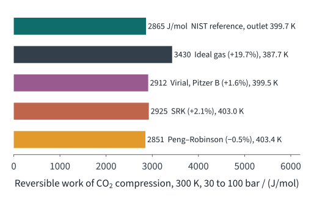
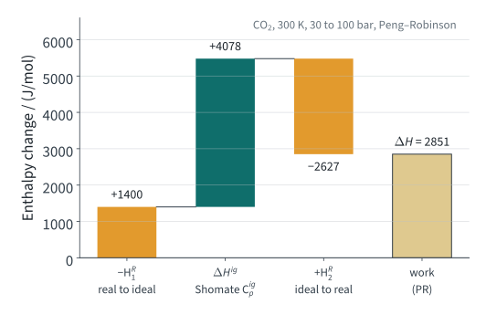
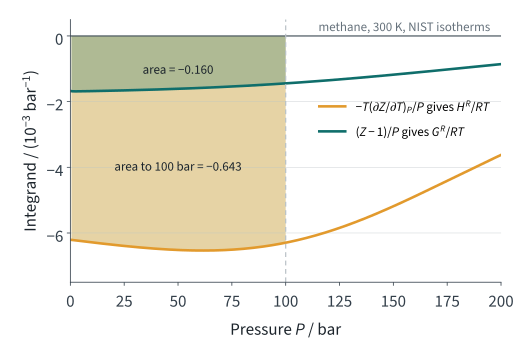
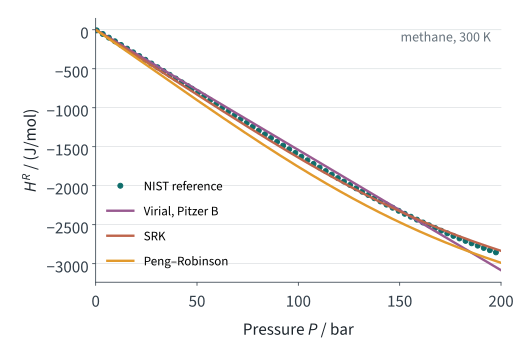
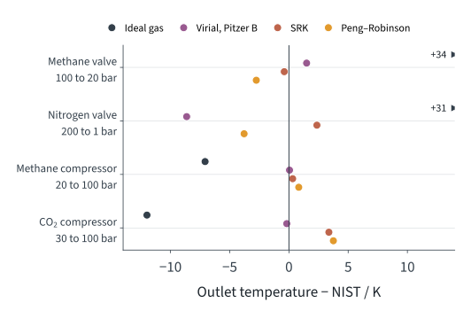
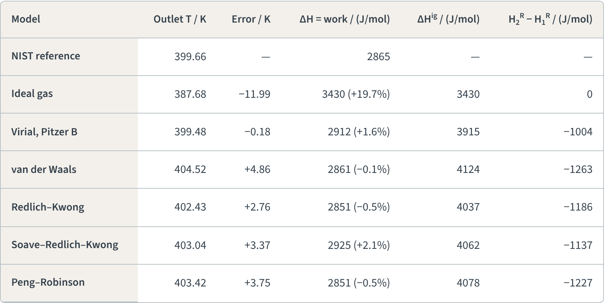

## Where this session sits {#course-map}

::: {.coursemap}
::: {.half}
[Before the midterm · 7 sessions]{.label}
[P1 · Framework]{.cm} [P2 · PVT and equations of state]{.cm} [P3 · Residual properties]{.cm .now} [P4 · Pure-component equilibrium and fugacity]{.cm} [P5 · Mixtures]{.cm} [P6 · Excess properties and activity]{.cm} [P7 · Choosing a property model]{.cm}
:::
::: {.half}
[After the midterm · 7 sessions]{.label}
[1 · VLE and flash]{.cm} [2 · Experimental VLE and consistency]{.cm} [3 · Liquid stability and LLE]{.cm} [4 · Solids and adsorption]{.cm} [5 · Chemical equilibrium]{.cm} [6 · Electrochemical equilibrium]{.cm} [7 · Choosing a model from evidence]{.cm}
:::
:::

::: {.bridge}
P2 gave Z from an equation of state, with its error. An energy balance needs H and S. Today: the **residual properties** HR, SR and GR, which carry the real-fluid part of every enthalpy and entropy change, and the GR that becomes the fugacity in P4.
:::

## Why this matters: sizing a CO₂ compressor {#why}

:::: {.columns}
::: {.column width="58%"}
{.fig-pxy fig-alt="Reversible work of compressing CO2 from 30 to 100 bar at 300 K: NIST 2865 J/mol with outlet 399.7 K, ideal gas 3430 J/mol and 387.7 K, virial 2912, SRK 2925, Peng–Robinson 2851 J/mol"}
:::
::: {.column width="40%" .why-notes}
CO₂ at 300 K is compressed from 30 to 100 bar, reversibly and adiabatically, as in a capture and storage train.

The reference work is **2865 J/mol**. The ideal gas asks for 3430 J/mol, **20% more**, and predicts the wrong outlet temperature.

Peng–Robinson gives 2851 J/mol. The difference is two residual enthalpies.

By the end of today you can compute each bar from Z and Cpig.

[NIST Chemistry WebBook, SRD 69 (Span and Wagner CO₂ equation); Shomate Cpig from the NIST gas-phase data. Lab P3.]{.source}
:::
::::

## By the end of today you can {#outcomes}

[Where you show it]{.where-head}

1. **Define** HR, SR and GR, and write any change of H or S as an ideal-gas change plus two residuals. [Concepts]{.where}
2. **Derive** residuals from PVT data, from the virial equation and from a cubic equation of state. [Activity 1, Lab P3 A]{.where}
3. **Compute** a valve outlet and the work of a compressor with an equation of state and Cpig(T). [Demo, Lab P3]{.where}
4. **Judge** which property an equation predicts well, and split a process error into its sources. [Activity 2, Lab P3 B, C]{.where}

## The 180-minute route {#route}

::: {.route}
::: {.seg .concept style="flex:30"}
[0–30]{.t} **Essential concepts** [residuals from PVT, virial, cubics]{.d}
:::
::: {.seg .act style="flex:10"}
[30–40]{.t} **Activity 1** [virial residuals by hand]{.d}
:::
::: {.seg .demo style="flex:20"}
[40–60]{.t} **Demo** [Lab P3]{.d}
:::
::: {.seg .break style="flex:10"}
[60–70]{.t} **Break**
:::
::: {.seg .act style="flex:70"}
[70–140]{.t} **Activity 2 · pair investigation** [two valves, two compressors]{.d}
:::
::: {.seg .wrap style="flex:40"}
[140–180]{.t} **Discussion and exit ticket** [answer the session question]{.d}
:::
:::

::: {.route-question}
[Session question]{.label} How do we get the enthalpy and entropy changes of a real fluid from an equation of state, and how much does the choice of equation change a process energy balance?
:::

::: {.beforeafter}
::: {}
[Before class · 20 min]{.label}
Read the [Session P3 pre-class note](note-p03.html){target="_blank"} and answer its three questions.
:::
::: {}
[After class · 40 min]{.label}
Finish Lab P3: four processes and five states, then A–C in the Graduate view. Submit the study file with your name and ID.
:::
:::

::: {.selfstudy}
**Studying on your own?** Follow the same order. Turn on narration or captions at the bottom left, and pause at each activity slide.
:::

## Residual properties: the real fluid minus the ideal gas {#residual}

:::: {.columns}
::: {.column width="52%"}
{.fig-pxy fig-alt="Waterfall of the enthalpy change of the CO2 compressor with Peng–Robinson: plus 1400 J/mol to turn the real inlet into an ideal gas, plus 4078 J/mol for the ideal-gas compression, minus 2627 J/mol to return to the real outlet, giving 2851 J/mol"}
:::
::: {.column width="46%" .rule-notes}
At the same T and P:

$$M^R=M(T,P)-M^{\text{ig}}(T,P)$$

for M = V, U, H, S or G.

Any change follows a path through the ideal gas:

$$\Delta H=H_2^R-H_1^R+\int_{T_1}^{T_2}C_p^{\text{ig}}\,dT$$

$$\Delta S=S_2^R-S_1^R+\int_{T_1}^{T_2}\frac{C_p^{\text{ig}}}{T}\,dT-R\ln\frac{P_2}{P_1}$$

The ideal-gas step needs Cpig(T) only. The residual steps need only PVT data.
:::
::::

## Residuals from PVT data alone {#from-pvt}

:::: {.columns}
::: {.column width="52%"}
At constant T, from dG = V dP and the Gibbs–Helmholtz relation:

$$\frac{G^R}{RT}=\int_0^P(Z-1)\frac{dP}{P}$$

$$\frac{H^R}{RT}=-T\int_0^P\Big(\frac{\partial Z}{\partial T}\Big)_P\frac{dP}{P}$$

$$\frac{S^R}{R}=\frac{H^R}{RT}-\frac{G^R}{RT}$$
:::
::: {.column width="46%"}
{.fig-pxy fig-alt="The two integrands for methane at 300 K from the NIST isotherms: (Z − 1)/P near −1.6 × 10⁻³ per bar and −T(∂Z/∂T)/P near −6 × 10⁻³ per bar; the shaded areas to 100 bar are −0.160 and −0.643"}

[Methane, 300 K, 100 bar: integrating the NIST Z gives HR/RT = −0.64295; the tabulated H gives −0.64291.]{.howto}
:::
::::

## The virial equation: residuals in one line {#virial}

:::: {.columns}
::: {.column width="50%"}
With Z = 1 + BP/RT, the integrals are exact:

$$\frac{G^R}{RT}=\frac{BP}{RT}\qquad \frac{H^R}{RT}=\frac{P}{R}\Big(\frac{B}{T}-\frac{dB}{dT}\Big)$$

$$\frac{S^R}{R}=-\frac{P}{R}\frac{dB}{dT}$$

Pitzer: dB0/dTr = 0.675/Tr2.6, dB1/dTr = 0.722/Tr5.2.
:::
::: {.column width="48%" .rule-notes}
GR needs B; **HR and SR need dB/dT**, which no measurement at one temperature gives.

B &lt; 0 and dB/dT &gt; 0 for most gases below the Boyle temperature, so HR &lt; 0: the real gas has less enthalpy than the ideal gas at the same T and P.

The virial residuals carry the same density limit as Z in P2: dense fluids and liquids are out of range.
:::
::::

## Cubic equations: closed forms {#cubic}

:::: {.columns}
::: {.column width="50%"}
With β = bP/RT, q = a(T)/(bRT), I = ln[(Z + σβ)/(Z + εβ)]/(σ − ε):

$$\frac{G^R}{RT}=Z-1-\ln(Z-\beta)-qI$$

$$\frac{H^R}{RT}=Z-1+\Big[\frac{d\ln\alpha}{d\ln T_r}-1\Big]qI$$

$$\frac{S^R}{R}=\ln(Z-\beta)+\frac{d\ln\alpha}{d\ln T_r}\,qI$$
:::
::: {.column width="48%"}
[van der Waals: I = β/Z. d ln α/d ln Tr: vdW 0; RK −½; SRK, PR −m√Tr/[1 + m(1 − √Tr)]. Z uses a(T) at one T; HR and SR also use **da/dT**, which α(Tr, ω) was never fitted to.]{.howto}

::: {.lever-box}
[Methane, 300 K, 100 bar · error against NIST]{.label}

| | Z | HR | SR |
|---|---:|---:|---:|
| NIST | 0.8556 | −1604 J/mol | −4.020 J/(mol K) |
| SRK | +1.8% | −2.2% | −4.8% |
| PR | −2.5% | **−9.6%** | −5.5% |
:::
:::
::::

## The ideal-gas part: Cpig(T) {#ideal-gas}

:::: {.columns}
::: {.column width="50%"}
Shomate form (NIST WebBook), t = T/1000:

$$C_p^{\text{ig}}=A+Bt+Ct^2+Dt^3+E/t^2$$

Hig and S°ig are its integrals; at pressure P:

$$S^{\text{ig}}(T,P)=S^{\circ}(T)-R\ln\frac{P}{1\,\text{bar}}$$
:::
::: {.column width="48%"}
::: {.lever-box}
[Cpig / (J/(mol K)): Shomate against the NIST 0.001 bar isobar]{.label}

| | 250 K | 300 K | 400 K |
|---|---:|---:|---:|
| methane | 34.71 / 34.27 | 35.71 / 35.78 | 40.50 / 40.61 |
| CO₂ | 34.63 / 34.84 | 37.22 / 37.23 | 41.34 / 41.33 |
| nitrogen | 29.11 / 29.11 | 29.13 / 29.13 | 29.25 / 29.17 |

The methane and CO₂ fits start at 298 K. At 250 K they are extrapolated, and methane is 1.3% high.
:::
:::
::::

## Which property does an equation get right? {#how-good}

:::: {.columns}
::: {.column width="54%"}
{.fig-pxy fig-alt="Residual enthalpy of methane at 300 K against pressure: the virial and SRK curves follow the NIST points closely, Peng–Robinson lies below them by about 10 percent"}
:::
::: {.column width="44%" .concept-notes}
[Methane, 300 K]{.q} SRK and the virial equation follow the reference HR. PR is about **10% too negative**, the same bias as its B in P2.

[CO₂, 300 K, 30 bar]{.q} PR HR = −1400 J/mol, reference −1398. SRK −1361.

[Liquid CO₂, 100 bar]{.q} PR Z +5.5%, HR +2.7%. The virial equation: +62%.

The best model changes with the property and the state. P2 tested Z; an energy balance tests HR and SR.
:::
::::

## Four processes, one method {#processes}

:::: {.columns}
::: {.column width="54%"}
{.fig-pxy fig-alt="Outlet temperature error against NIST for the methane and nitrogen valves and the methane and CO2 compressors: the ideal gas is 31 to 34 K off for the valves and 7 to 12 K off for the compressors; virial, SRK and PR are within about 4 K except the virial for the nitrogen valve at −8.6 K"}
:::
::: {.column width="44%" .concept-notes}
**Valve**, ΔH = 0: ΔHig = −(H₂R − H₁R). The ideal gas cannot cool at all.

**Compressor**, ΔS = 0: the outlet T comes from S; the work is ΔH.

[Methane valve, 100 → 20 bar]{.q} NIST 265.6 K; SRK 265.2; PR 262.9; virial 267.1.

[CO₂ compressor]{.q} The ideal gas is 12 K low and its work 20% high.
:::
::::

## GR is small where HR is large {#gr}

:::: {.columns}
::: {.column width="50%"}
::: {.lever-box}
[Liquid CO₂, 300 K, 100 bar · NIST]{.label}

| | kJ/mol |
|---|---:|
| HR | −10.85 |
| TSR | −9.07 |
| GR = HR − TSR | **−1.78** |

PR: HR −10.56, GR −1.82.
:::
:::
::: {.column width="48%" .rule-notes}
Condensation releases energy (HR &lt; 0) and orders the molecules (SR &lt; 0). In G the two nearly cancel.

That cancellation is why a liquid can coexist with its vapor: at Psat the two phases have **equal GR** (P4).

For a pure fluid GR/RT = ln φ, the fugacity coefficient. A 3% error in HR can be a much larger relative error in GR.
:::
::::

## Virial residuals by hand {#activity-1 .activity}

[Activity 1 · 10 minutes · alone, then with a partner]{.act-label}

::: {.prompt}
Methane at 300 K and 20 bar: Tc = 190.564 K, Pc = 45.992 bar, ω = 0.0114. With the Pitzer correlation, compute B and dB/dT, then HR, SR and GR. Compare with the reference: HR = −314 J/mol, SR = −0.766 J/(mol K).
:::

Work in SI: B in m³/mol, P in Pa. Check that GR = HR − TSR.

::: {.selfstudy}
**On your own:** pause here and write your answer. In place of a partner, compare it with the next slide and write one sentence on any difference and its cause.
:::

## Activity 1: check your answer {#activity-1-debrief}

:::: {.columns}
::: {.column width="50%"}
Tr = 1.5743: B⁰ = −0.1212, B¹ = 0.1134, **B = −41.3 cm³/mol**

dB⁰/dTr = 0.2075, dB¹/dTr = 0.0682

dB/dT = (R/Pc)(0.2075 + 0.0114 × 0.0682) = **0.376 cm³/(mol K)**
:::
::: {.column width="48%"}
::: {.lever-box}
[Residuals at 20 bar]{.label}

| | virial | NIST |
|---|---:|---:|
| HR = P(B − T dB/dT) / (J/mol) | −308.5 | −314 |
| SR = −P dB/dT / (J/(mol K)) | −0.753 | −0.766 |
| GR = BP / (J/mol) | −82.6 | −84 |

At 20 bar the virial equation is within 2%: this is its range.
:::
:::
::::

## Demonstration · Lab P3 {#demo-lab}

:::: {.columns}
::: {.column width="44%"}
1. **Methane valve.** Read the residual table at 100 bar and the outlet of each model.
2. **CO₂ compressor.** Compare ΔHig with H₂R − H₁R for the ideal gas and PR.
3. Switch the ideal gas from Shomate to the NIST 0.001 bar table. How much does the outlet move?
4. Graduate view, **A**: residuals from the NIST isotherms alone.

[Open Lab P3 in the Graduate view →](../preview-2027/residual.html?mode=graduate){.lab-button target="_blank"}
:::
::: {.column width="54%"}
{.lab-shot fig-alt="Lab P3 table for the CO2 compressor: outlet temperature, error, work, ideal-gas enthalpy change and residual difference for NIST and six models"}

::: {.expect}
[Lab P3 should report]{.label}
CO₂ compressor: NIST 399.66 K, 2865 J/mol · ideal gas 387.68 K, 3430 J/mol · PR 403.42 K, 2851 J/mol · methane valve: NIST 265.63 K, PR 262.87 K
:::
:::
::::

## Four common mistakes {#mistakes}

::: {.mistakes}
::: {}
**Sign of the residual.** MR = M − Mig. For an attracting gas HR &lt; 0. Leaving the real fluid adds −H₁R.
:::
::: {}
**Dropping the pressure term of Sig.** Sig(T, P) = S°(T) − R ln(P/P°). Without it the CO₂ compressor outlet comes out at 348 K instead of 403 K (PR).
:::
::: {}
**HR with a constant a.** For SRK and PR, a depends on T. With PR the d ln α/d ln Tr term is 27% of HR for methane at 100 bar and 50% for nitrogen at 200 bar.
:::
::: {}
**Using Cpig outside its range.** The Shomate fits for methane and CO₂ start at 298 K. Check the range before a valve outlet at 265 K.
:::
:::

## Break · 10 minutes {#break .breakslide}

::: {.break-next}
[Next]{.label}
Activity 2: a pair investigation in Lab P3, 70 minutes.

Before you leave your seat, check that Lab P3 opens on your device and that the methane valve is saved.
:::

## Activity 2 · two valves, two compressors {#activity-2 .activity}

[Activity 2 · 70 minutes · in pairs: one drives Lab P3, one checks by hand, then swap]{.act-label}

::: {.a2grid}
::: {}
[20 min · the processes]{.label}
Calculate the four processes. For each, record the outlet of the ideal gas, the virial equation, SRK and PR, and the work of the compressors.
:::
::: {}
[15 min · the states]{.label}
Residuals at the five states. Find one state where the model best for Z is not the best for HR (Lab P3 C).
:::
::: {}
[20 min · sources of error]{.label}
Lab P3 A: residuals from the NIST isotherms. Lab P3 B: how much of each outlet error comes from Cpig?
:::
::: {}
[15 min · explain]{.label}
Two sentences with numbers answering the session question. Download the study file with your names and IDs.
:::
:::

::: {.selfstudy}
**On your own:** do both roles yourself: work in Lab P3, then check one residual by hand. Pause the slides while you work; the next slide lists what to hand in.
:::

## Activity 2 · what to hand in {#activity-2-check}

:::: {.columns}
::: {.column width="44%"}
1. Lab P3 study file with the four processes, the five states, A–C, your name and student ID.
2. Your hand calculation of the virial residuals.
3. Two sentences answering the session question with numbers.

[Graduate extension]{.label}
Lab P3 E: write the CO₂ compressor calculation with an AI assistant and check it against the lab.
:::
::: {.column width="54%"}
::: {.lever-box}
[Check your results · outlet temperature / K]{.label}

| Process | NIST | ideal | virial | SRK | PR |
|---|---:|---:|---:|---:|---:|
| methane valve | 265.6 | 300.0 | 267.1 | 265.2 | 262.9 |
| nitrogen valve | 269.2 | 300.0 | 260.6 | 271.6 | 265.4 |
| methane compressor | 432.1 | 425.0 | 432.2 | 432.4 | 433.0 |
| CO₂ compressor | 399.7 | 387.7 | 399.5 | 403.0 | 403.4 |

Work, CO₂: NIST 2865, ideal 3430, PR 2851 J/mol. Cpig moves any outlet by 0.4 K or less.
:::
:::
::::

## Discussion: what did the residuals show? {#discussion}

:::: {.columns}
::: {.column width="54%"}
{.fig-pxy fig-alt="The outlet temperature errors of the four processes again"}
:::
::: {.column width="44%" .concept-notes}
[Discuss in pairs, then with the class. On your own: write two or three sentences for each question.]{.q}

1. PR gives Z of methane at 100 bar to 2.5% and HR to 10%. Which part of the equation sets HR but not Z?
2. The ideal gas misses the valve outlets by over 30 K and the compressor outlets by 7–12 K. Why the difference?
3. GR of liquid CO₂ is −1.8 kJ/mol while HR is −10.9. What does that mean for computing its fugacity?
:::
::::

## Summary {#summary}

::: {.summary3}
::: {}
[Definition]{.label}
MR = M − Mig at the same T and P. ΔM = M₂R − M₁R + ΔMig, with ΔMig from Cpig(T).
:::
::: {}
[Sources]{.label}
GR from Z alone; HR and SR also need (∂Z/∂T)P: dB/dT for the virial equation, da/dT for a cubic.
:::
::: {}
[Evidence]{.label}
Test the property the balance uses. PR: Z of methane to 2.5%, HR to 10%; outlets within 4 K; the ideal gas 7–34 K.
:::
:::

**Session question:** H and S of a real fluid are ideal-gas changes plus residuals from the equation of state. For the CO₂ compressor the residuals take the work from 3430 to 2851 J/mol (reference 2865).

[Next session]{.label} P4: GR becomes the fugacity, and equal fugacity gives the vapor pressure.

## Exit ticket · 5 minutes {#exit-ticket .activity}

[Exit ticket and feedback · alone · 5 minutes · anonymous]{.act-label}

:::: {.columns}
::: {.column width="64%"}
::: {.prompt}
An ideal-gas calculation overestimates the work of the CO₂ compressor by 20%. Write the work as an ideal-gas term plus residuals, and say why the residual correction lowers the work.
:::

Scan the code or open the link. The same form asks three short questions about today: pace, confidence and whether the lab worked.

No name or student ID is recorded. Wait for **"Response received."**
:::
::: {.column width="32%" .qr-col}
{.qr fig-alt="QR code for the Session P3 exit ticket and feedback form"}

[Open the Session P3 form](exit.html?p=3){target="_blank"}
:::
::::

## After class {#after-class}

::: {.summary3}
::: {}
[Hand in · this week]{.label}
Your Lab P3 study file with the four processes, the five states, A–C, name and student ID. Upload it to **myCourseVille**, in the assignment for that lab.
:::
::: {}
[Prepare · Session P4]{.label}
Read the [Session P4 pre-class note](note-p04.html){target="_blank"}. About 20 minutes.
:::
::: {}
[Optional · graduate]{.label}
Lab P3 E: the CO₂ compressor with an AI-written Peng–Robinson code, checked against the lab.
:::
:::

[Open Lab P3 in the Graduate view →](../preview-2027/residual.html?mode=graduate#graduate-investigation){.lab-button target="_blank"}

[Starts at **4. Investigate what the residuals can support**. **A**: **Integrate the isotherms**. **B**: **Split the process errors**. **C**: **Rank the models**.]{.howto}
