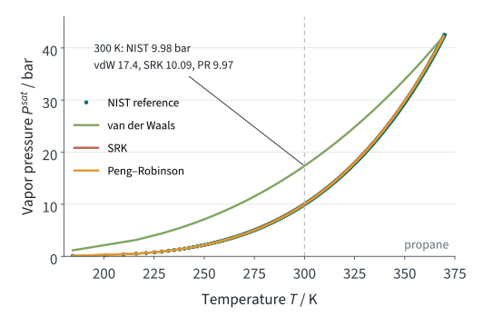
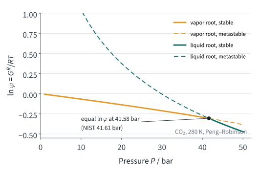
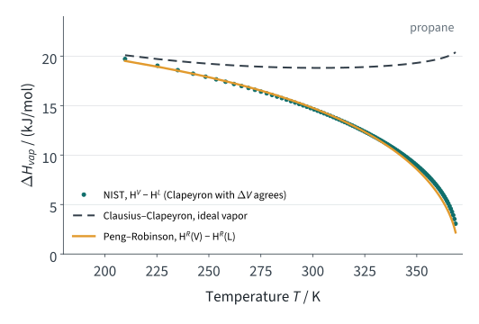
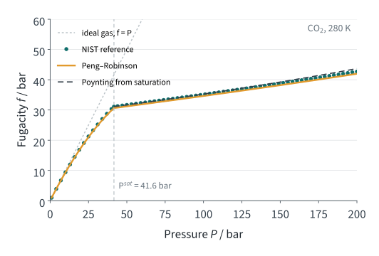
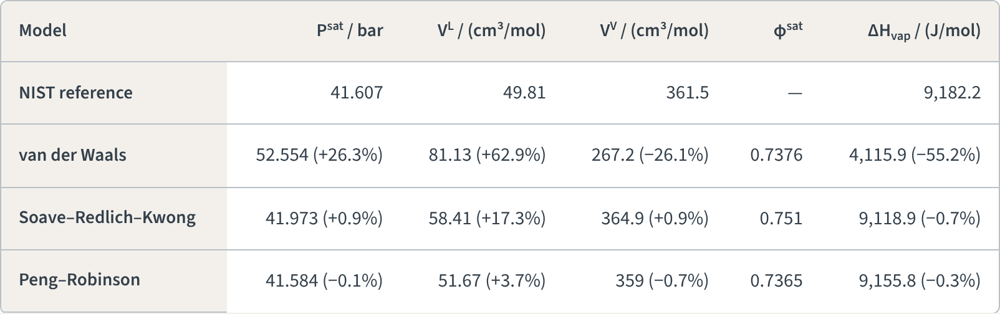

## Where this session sits {#course-map}

::: {.coursemap}
::: {.half}
[Before the midterm · 7 sessions]{.label}
[P1 · Framework]{.cm} [P2 · PVT and equations of state]{.cm} [P3 · Residual properties]{.cm} [P4 · Pure-component equilibrium and fugacity]{.cm .now} [P5 · Mixtures]{.cm} [P6 · Excess properties and activity]{.cm} [P7 · Choosing a property model]{.cm}
:::
::: {.half}
[After the midterm · 7 sessions]{.label}
[1 · VLE and flash]{.cm} [2 · Experimental VLE and consistency]{.cm} [3 · Liquid stability and LLE]{.cm} [4 · Solids and adsorption]{.cm} [5 · Chemical equilibrium]{.cm} [6 · Electrochemical equilibrium]{.cm} [7 · Choosing a model from evidence]{.cm}
:::
:::

::: {.bridge}
P1: at equilibrium μ is equal in every phase. P3: GR from an equation of state. Today the two meet: the **fugacity**, the vapor pressure of a pure fluid from **equal fugacity**, the Clapeyron equation, and the fugacity of a compressed liquid and of a solid. Session 1 after the midterm starts from these.
:::

## Why this matters: what pressure does the tank hold? {#why}

:::: {.columns}
::: {.column width="58%"}
{.fig-pxy fig-alt="Vapor pressure of propane from 184 K to the critical point: NIST points, SRK and Peng–Robinson on top of them, van der Waals far above. At 300 K: NIST 9.98 bar, van der Waals 17.4, SRK 10.09, Peng–Robinson 9.97"}
:::
::: {.column width="40%" .why-notes}
A propane tank sits at 300 K. Liquid and vapor coexist, so the pressure is the vapor pressure.

The reference gives **9.98 bar**. Van der Waals gives 17.4 bar (+74%); SRK 10.09; Peng–Robinson 9.97.

Each equation finds its own vapor pressure from one condition: **equal fugacity** in the two phases.

By the end of today you can compute it, and say what a correct vapor pressure does not guarantee.

[NIST Chemistry WebBook, SRD 69 (Lemmon, McLinden and Wagner propane equation). Lab P4.]{.source}
:::
::::

## By the end of today you can {#outcomes}

[Where you show it]{.where-head}

1. **Define** fugacity and the fugacity coefficient, and compute ln φ from data, the virial equation or a cubic. [Concepts, Activity 1]{.where}
2. **Find** the vapor pressure of an equation of state from equal fugacity, avoiding the trivial solution. [Demo, Lab P4]{.where}
3. **Use** the Clapeyron equation, and state when Clausius–Clapeyron fails. [Lab P4 B]{.where}
4. **Compute** the fugacity of a compressed liquid (Poynting) and of a solid relative to its subcooled liquid. [Activity 2, Lab P4 C]{.where}

## The 180-minute route {#route}

::: {.route}
::: {.seg .concept style="flex:30"}
[0–30]{.t} **Essential concepts** [fugacity, equal f, Clapeyron, Poynting]{.d}
:::
::: {.seg .act style="flex:10"}
[30–40]{.t} **Activity 1** [vapor and liquid fugacity by hand]{.d}
:::
::: {.seg .demo style="flex:20"}
[40–60]{.t} **Demo** [Lab P4]{.d}
:::
::: {.seg .break style="flex:10"}
[60–70]{.t} **Break**
:::
::: {.seg .act style="flex:70"}
[70–140]{.t} **Activity 2 · pair investigation** [vapor pressure, ΔvapH, liquids]{.d}
:::
::: {.seg .wrap style="flex:40"}
[140–180]{.t} **Discussion and exit ticket** [answer the session question]{.d}
:::
:::

::: {.route-question}
[Session question]{.label} What decides when two phases of a pure fluid coexist, and how well do an equation of state and the classical approximations reproduce the vapor pressure, the enthalpy of vaporization and the liquid fugacity?
:::

::: {.beforeafter}
::: {}
[Before class · 20 min]{.label}
Read the [Session P4 pre-class note](note-p04.html){target="_blank"} and answer its three questions.
:::
::: {}
[After class · 40 min]{.label}
Finish Lab P4: four fluids and three isotherms, then A–C in the Graduate view. Submit the study file with your name and ID.
:::
:::

::: {.selfstudy}
**Studying on your own?** Follow the same order. Turn on narration or captions at the bottom left, and pause at each activity slide.
:::

## Fugacity: a pressure that makes μ ideal {#fugacity}

:::: {.columns}
::: {.column width="50%"}
For an ideal gas at fixed T, dμ = RT d ln P. For any fluid, **define** f by

$$d\mu=RT\,d\ln f\quad(T\text{ fixed})$$

with f/P → 1 as P → 0. The fugacity coefficient φ = f/P:

$$\ln\varphi=\frac{G^R}{RT}=\int_0^P(Z-1)\frac{dP}{P}$$

f has units of pressure. For a pure fluid ln φ is the GR/RT of P3.
:::
::: {.column width="48%"}
::: {.lever-box}
[CO₂, 280 K, 30 bar (vapor)]{.label}

| Source | φ | f / bar |
|---|---:|---:|
| NIST | 0.8194 | 24.58 |
| virial, Pitzer B | 0.8299 | 24.90 |
| Peng–Robinson | 0.8090 | 24.27 |
| ideal gas | 1 | 30 |

The real gas behaves, for equilibrium, as an ideal gas at 24.6 bar.
:::
:::
::::

## Two phases coexist when their fugacities are equal {#equal-f}

:::: {.columns}
::: {.column width="54%"}
{.fig-pxy fig-alt="ln φ of the liquid and vapor roots of Peng–Robinson for CO2 at 280 K against pressure. The two curves cross at 41.58 bar, the vapor pressure of the equation; below it the vapor root is lower and stable, above it the liquid root"}
:::
::: {.column width="44%" .concept-notes}
μL = μV at the same T and P is the same as

$$f^L=f^V\iff\ln\varphi^L=\ln\varphi^V$$

The phase with the **lower** ln φ is stable; the crossing is the vapor pressure.

[CO₂, 280 K]{.q} Peng–Robinson crosses at **41.58 bar**; NIST 41.61. fsat = 31.1 bar in both phases.

Search between the spinodal pressures (6.6 and 50.4 bar). Outside them the cubic has one root, and ln φL = ln φV holds trivially.
:::
::::

## The vapor pressure of a cubic across the curve {#psat}

:::: {.columns}
::: {.column width="50%"}
::: {.lever-box}
[Psat error against NIST / %]{.label}

| | Tr | vdW | SRK | PR |
|---|---:|---:|---:|---:|
| methane | 0.6 | +218 | −2.3 | +0.7 |
| propane | 0.6 | +455 | −1.4 | +0.8 |
| propane | 0.9 | +31 | +1.4 | +0.5 |
| CO₂ | 0.9 | +35 | +0.8 | −0.3 |
| water | 0.6 | +1033 | −6.0 | −3.4 |
| water | 0.9 | +46 | +2.7 | +1.5 |
:::
:::
::: {.column width="48%" .rule-notes}
SRK and PR fitted m(ω) to vapor pressures, and ω itself is defined at Tr = 0.7. SRK is within 0.1% there for every fluid.

Van der Waals keeps a constant: its attraction does not grow as T falls, so the liquid is too unstable and Psat far too high.

A good Psat tests the fit. The liquid volume (P2) and ΔvapH (next slide) are independent tests.
:::
::::

## The Clapeyron equation {#clapeyron}

:::: {.columns}
::: {.column width="48%"}
Along the coexistence curve dμL = dμV, so

$$\frac{dP^{\text{sat}}}{dT}=\frac{\Delta_{\text{vap}}H}{T\,\Delta V}\quad\text{(exact)}$$

With VL ≪ VV = RT/P (ideal vapor), Clausius–Clapeyron:

$$\frac{d\ln P^{\text{sat}}}{dT}\approx\frac{\Delta_{\text{vap}}H}{RT^2}$$
:::
::: {.column width="50%"}
{.fig-pxy fig-alt="Enthalpy of vaporization of propane from 210 K to the critical point: NIST falls from 19.6 to 0 kJ/mol; Peng–Robinson follows within a few percent; Clausius–Clapeyron stays near 19 kJ/mol and is more than twice the true value near the critical point"}

[Clausius–Clapeyron error for propane: +3% at Tr = 0.6, +16% at 0.75, +40% at 0.85, +122% at 0.95. Clapeyron with the NIST ΔV: within 0.01%.]{.howto}
:::
::::

## Fugacity along an isotherm {#isotherm}

:::: {.columns}
::: {.column width="54%"}
{.fig-pxy fig-alt="Fugacity of CO2 at 280 K against pressure: it rises almost as P in the vapor to 31.1 bar at the vapor pressure of 41.6 bar, then slowly in the liquid to 42.7 bar at 200 bar. Peng–Robinson is slightly low; the Poynting curve from saturation is slightly high at 200 bar"}
:::
::: {.column width="44%" .concept-notes}
$$\Big(\frac{\partial\ln f}{\partial P}\Big)_T=\frac{V}{RT}$$

f is continuous at Psat because μ is. Its slope drops from VV/RT to VL/RT.

[CO₂, 280 K]{.q} f = 31.1 bar at 41.6 bar, **35.1 bar at 100 bar**, 42.7 bar at 200 bar.

Compressing the liquid fivefold raises its fugacity by 37%.
:::
::::

## The fugacity of a compressed liquid: Poynting {#poynting}

:::: {.columns}
::: {.column width="50%"}
Integrate (∂ ln f/∂P)T = VL/RT from saturation:

$$f^L(P)=\varphi^{\text{sat}}P^{\text{sat}}\,\mathcal{P}$$

$$\mathcal{P}=\exp\int_{P^{\text{sat}}}^{P}\frac{V^L}{RT}dP$$

$$\mathcal{P}\approx\exp\frac{V^L(P-P^{\text{sat}})}{RT}$$

$\mathcal{P}$ is the **Poynting factor**; Session 1 after the midterm writes it $\mathcal{P}_i$. For P − Psat = 1 bar at 300 K it is 1.0007 for water (18 cm³/mol) and 1.004 for a liquid of 100 cm³/mol.
:::
::: {.column width="48%"}
::: {.lever-box}
[Constant-VL Poynting against NIST]{.label}

| Liquid | P / bar | factor | error |
|---|---:|---:|---:|
| water, 500 K | 100 | 1.039 | +0.02% |
| water, 500 K | 200 | 1.095 | +0.08% |
| propane, 300 K | 100 | 1.384 | +0.8% |
| CO₂, 280 K | 100 | 1.133 | +0.4% |
| CO₂, 280 K | 200 | 1.403 | +2.3% |

Liquid CO₂ near its critical point is compressible, so a constant VL overestimates f.
:::
:::
::::

## Solids: fugacity relative to the subcooled liquid {#solid}

:::: {.columns}
::: {.column width="50%"}
Below the melting point Tm the stable phase is the solid. Neglecting ΔCp:

$$\ln\frac{f^{\text{s}}}{f^{\text{l}}}=-\frac{\Delta_{\text{fus}}H}{R}\Big(\frac{1}{T}-\frac{1}{T_m}\Big)$$

fl is the fugacity of the **subcooled liquid**, a metastable reference state. Session 4 after the midterm uses this for solubility and freezing.
:::
::: {.column width="48%"}
::: {.lever-box}
[Ice against supercooled water, ΔfusH = 6.01 kJ/mol]{.label}

| T / K | fs/fl measured | equation | error |
|---:|---:|---:|---:|
| 268.15 | 0.9526 | 0.9519 | −0.08% |
| 263.15 | 0.9073 | 0.9043 | −0.3% |
| 253.15 | 0.8227 | 0.8113 | −1.4% |
| 243.15 | 0.7463 | 0.7214 | −3.3% |

Measured: ratio of the vapor pressures of ice and supercooled water (Murphy and Koop, 2005). The error grows with the neglected ΔCp.
:::
:::
::::

## Vapor and liquid fugacity by hand {#activity-1 .activity}

[Activity 1 · 10 minutes · alone, then with a partner]{.act-label}

::: {.prompt}
CO₂ at 280 K. (a) Vapor at 30 bar: with B = −144.7 cm³/mol, compute ln φ = BP/RT, φ and f. (b) Liquid at 100 bar: with Psat = 41.61 bar, φsat = 0.7479 and VL = 49.81 cm³/mol, compute the Poynting factor and fL. Compare with NIST: 24.58 bar and 35.12 bar.
:::

Work in SI: B and VL in m³/mol, P in Pa, R = 8.314 J/(mol K).

::: {.selfstudy}
**On your own:** pause here and write your answer. In place of a partner, compare it with the next slide and write one sentence on any difference and its cause.
:::

## Activity 1: check your answer {#activity-1-debrief}

:::: {.columns}
::: {.column width="50%"}
(a) ln φ = (−144.7 × 10⁻⁶)(30 × 10⁵)/(8.314 × 280) = **−0.1865**

φ = 0.830, f = **24.90 bar** (NIST 24.58, +1.3%)

(b) VL(P − Psat)/RT = (49.81 × 10⁻⁶)(58.39 × 10⁵)/2328 = 0.1249

Poynting factor = **1.133**
:::
::: {.column width="48%"}
::: {.lever-box}
[Liquid at 100 bar]{.label}

fL = 0.7479 × 41.61 × 1.133 = **35.26 bar**

NIST 35.12 bar: +0.4%.

Without the Poynting factor, fL = φsatPsat = 31.12 bar: −11%.

With φ = 1 as well, fL = Psat = 41.61 bar: +18%.
:::
:::
::::

## Demonstration · Lab P4 {#demo-lab}

:::: {.columns}
::: {.column width="44%"}
1. **CO₂, 280 K.** Read the vapor pressure, volumes and ΔvapH of the three cubics.
2. Paper check: the two ln φ values at the equation's Psat.
3. Fugacity view: the bend at 41.6 bar and the Poynting curve.
4. **Propane at 200 K** with van der Waals. Graduate view, **A**: the whole curve.

[Open Lab P4 in the Graduate view →](../preview-2027/fugacity.html?mode=graduate){.lab-button target="_blank"}
:::
::: {.column width="54%"}
{.lab-shot fig-alt="Lab P4 saturation table for CO2 at 280 K: vapor pressure, liquid and vapor volumes, fugacity coefficient and enthalpy of vaporization from NIST, van der Waals, SRK and Peng–Robinson"}

::: {.expect}
[Lab P4 should report]{.label}
CO₂, 280 K: NIST 41.607 bar · PR 41.584 bar, VL 51.67 cm³/mol, φsat 0.7365, ΔvapH 9156 J/mol (NIST 9182) · vdW 52.55 bar
:::
:::
::::

## Four common mistakes {#mistakes}

::: {.mistakes}
::: {}
**The trivial solution.** Outside the spinodals a cubic has one root, so "ln φL = ln φV" holds for the same root. Bracket Psat between the spinodals and check ZL ≠ ZV.
:::
::: {}
**φsat = 1 at high pressure.** For CO₂ at 280 K φsat = 0.748. Setting it to 1 makes fsat 34% too high before any Poynting factor.
:::
::: {}
**Clausius–Clapeyron near Tc.** It assumes an ideal vapor and negligible VL. For propane at Tr = 0.95 it doubles ΔvapH. Use Clapeyron with ΔV.
:::
::: {}
**Poynting with P in place of P − Psat.** The exponent starts at saturation. A constant VL fails for a compressible liquid near Tc.
:::
:::

## Break · 10 minutes {#break .breakslide}

::: {.break-next}
[Next]{.label}
Activity 2: a pair investigation in Lab P4, 70 minutes.

Before you leave your seat, check that Lab P4 opens on your device and that the CO₂ case is saved.
:::

## Activity 2 · vapor pressure, ΔvapH and condensed phases {#activity-2 .activity}

[Activity 2 · 70 minutes · in pairs: one drives Lab P4, one checks by hand, then swap]{.act-label}

::: {.a2grid}
::: {}
[20 min · the vapor pressure]{.label}
Four fluids with three cubics at their starting temperatures, then Lab P4 A: the whole curve. Where is each equation worst?
:::
::: {}
[15 min · ΔvapH]{.label}
Lab P4 B: Clapeyron, Clausius–Clapeyron and the PR residuals against NIST. At what Tr does Clausius–Clapeyron pass 10% error?
:::
::: {}
[20 min · liquids and solids]{.label}
The fugacity view on the three isotherms, then Lab P4 C: Poynting and the ice/supercooled-water ratio.
:::
::: {}
[15 min · explain]{.label}
Two sentences with numbers answering the session question. Download the study file with your names and IDs.
:::
:::

::: {.selfstudy}
**On your own:** do both roles yourself: work in Lab P4, then check one Poynting factor by hand. Pause the slides while you work; the next slide lists what to hand in.
:::

## Activity 2 · what to hand in {#activity-2-check}

:::: {.columns}
::: {.column width="44%"}
1. Lab P4 study file with the four fluids, A–C, your name and student ID.
2. Your hand calculation of the vapor and liquid fugacity of CO₂.
3. Two sentences answering the session question with numbers.

[Graduate extension]{.label}
Lab P4 E: an equal-fugacity solver for propane written with an AI assistant, checked against the lab.
:::
::: {.column width="54%"}
::: {.lever-box}
[Check your results]{.label}

| Starting state | NIST Psat | PR Psat | PR VL | PR ΔvapH |
|---|---:|---:|---:|---:|
| CO₂, 280 K | 41.61 | −0.1% | +3.7% | −0.3% |
| propane, 300 K | 9.977 | −0.0% | −3.8% | +0.7% |
| water, 500 K | 26.39 | +0.9% | +23.0% | +3.3% |
| methane, 150 K | 10.40 | +0.7% | −7.9% | +0.0% |

Clausius–Clapeyron passes 10% near Tr = 0.7 (propane) to 0.72 (CO₂, water).
:::
:::
::::

## Discussion: what did equal fugacity show? {#discussion}

:::: {.columns}
::: {.column width="54%"}
{.fig-pxy fig-alt="The ln φ crossing of the Peng–Robinson roots for CO2 at 280 K again"}
:::
::: {.column width="44%" .concept-notes}
[Discuss in pairs, then with the class. On your own: write two or three sentences for each question.]{.q}

1. PR gives water's vapor pressure at 500 K within 1% and its liquid volume 23% too large. How can equal fugacity be right with the wrong liquid?
2. Why does Clausius–Clapeyron fail near Tc while the Clapeyron equation does not?
3. In a flash at 1 bar, which of φsat, the Poynting factor and the vapor φ can you set to 1, and why?
:::
::::

## Summary {#summary}

::: {.summary3}
::: {}
[Fugacity]{.label}
dμ = RT d ln f, f → P as P → 0. For a pure fluid ln φ = GR/RT. Two phases coexist when fL = fV.
:::
::: {}
[Vapor pressure]{.label}
A cubic's Psat is the crossing of ln φ of its two roots, between the spinodals. PR and SRK: within 1–6%; van der Waals: tens to hundreds of percent.
:::
::: {}
[Condensed phases]{.label}
fL = φsatPsat × Poynting. A solid: fs/fl from ΔfusH. Clapeyron is exact; Clausius–Clapeyron only far from Tc.
:::
:::

**Session question:** coexistence requires equal fugacity. PR reproduces the vapor pressures to about 1% because it was fitted to them; ΔvapH to 1–5% and the liquid volume to 4–23% test it independently.

[Next session]{.label} P5: mixtures, partial molar properties and the fugacity of a component in a mixture.

## Exit ticket · 5 minutes {#exit-ticket .activity}

[Exit ticket and feedback · alone · 5 minutes · anonymous]{.act-label}

:::: {.columns}
::: {.column width="64%"}
::: {.prompt}
At 280 K, CO₂ vapor and liquid coexist at 41.6 bar, and their molar volumes differ by a factor of seven. Name three quantities that are equal in the two phases, and give the fugacity at saturation if φsat = 0.748.
:::

Scan the code or open the link. The same form asks three short questions about today: pace, confidence and whether the lab worked.

No name or student ID is recorded. Wait for **"Response received."**
:::
::: {.column width="32%" .qr-col}
{.qr fig-alt="QR code for the Session P4 exit ticket and feedback form"}

[Open the Session P4 form](exit.html?p=4){target="_blank"}
:::
::::

## After class {#after-class}

::: {.summary3}
::: {}
[Hand in · this week]{.label}
Your Lab P4 study file with the four fluids, A–C, name and student ID. Upload it to **myCourseVille**, in the assignment for that lab.
:::
::: {}
[Prepare · Session P5]{.label}
Read the [Session P5 pre-class note](note-p05.html){target="_blank"}. About 20 minutes.
:::
::: {}
[Optional · graduate]{.label}
Lab P4 E: an equal-fugacity solver written with an AI assistant, checked against the lab.
:::
:::

[Open Lab P4 in the Graduate view →](../preview-2027/fugacity.html?mode=graduate#graduate-investigation){.lab-button target="_blank"}

[Starts at **4. Investigate what the equal-fugacity condition can support**. **A**: **Test the vapor-pressure curves**. **B**: **Compare the routes**. **C**: **Test the condensed-phase forms**.]{.howto}
