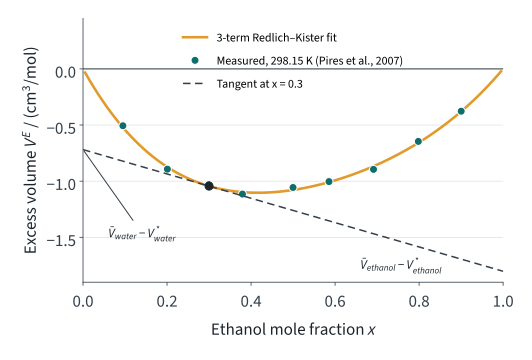
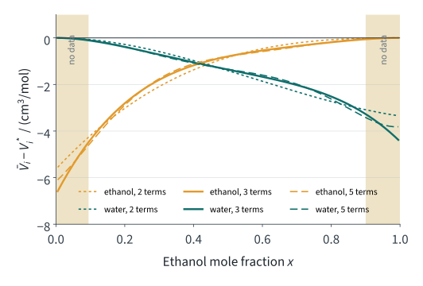
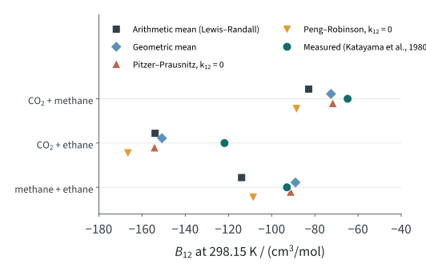
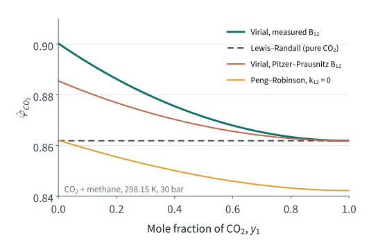
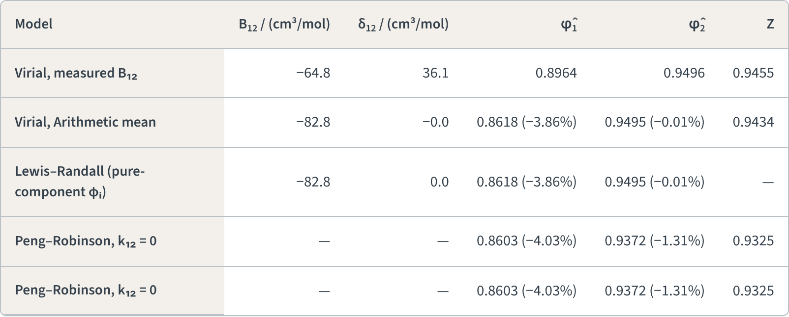

## Where this session sits {#course-map}

::: {.coursemap}
::: {.half}
[Before the midterm · 7 sessions]{.label}
[P1 · Framework]{.cm} [P2 · PVT and equations of state]{.cm} [P3 · Residual properties]{.cm} [P4 · Pure-component equilibrium and fugacity]{.cm} [P5 · Mixtures]{.cm .now} [P6 · Excess properties and activity]{.cm} [P7 · Choosing a property model]{.cm}
:::
::: {.half}
[After the midterm · 7 sessions]{.label}
[1 · VLE and flash]{.cm} [2 · Experimental VLE]{.cm} [3 · Liquid stability and LLE]{.cm} [4 · Solids and adsorption]{.cm} [5 · Chemical equilibrium]{.cm} [6 · Electrochemical equilibrium]{.cm} [7 · Choosing a model from evidence]{.cm}
:::
:::

::: {.bridge}
P1–P4 treated pure fluids. Every separation and reaction involves mixtures. Today: what one component contributes to a mixture (**partial molar properties**), the constraint that links them (**Gibbs–Duhem**), and the **fugacity of a component** in a gas mixture, with the ideal solution as the reference.
:::

## Why this matters: 50 mL + 50 mL ≠ 100 mL {#why}

:::: {.columns}
::: {.column width="56%"}
{.fig-pxy fig-alt="Excess molar volume of ethanol + water at 298.15 K: nine measured points between x = 0.10 and 0.90, all negative with a minimum of −1.1 cm3/mol near x = 0.4, a three-term Redlich–Kister fit, and the tangent at x = 0.3 whose intercepts give the partial molar volumes"}
:::
::: {.column width="42%" .why-notes}
Mix 50 mL of ethanol with 50 mL of water at 298.15 K. The measured densities give **96.6 mL**.

The excess volume is negative everywhere, down to −1.1 cm³/mol. A component's contribution to a mixture is not its pure-component property.

The same holds for fugacity: 2% CO₂ in methane at 60 bar has a fugacity coefficient **8% away** from that of pure CO₂ at the same T and P.

[Densities: Pires et al., J. Chem. Eng. Data 52 (2007) 1240. Cross virial coefficient: Katayama et al., J. Chem. Eng. Jpn. 13 (1980) 257. Lab P5.]{.source}
:::
::::

## By the end of today you can {#outcomes}

[Where you show it]{.where-head}

1. **Define** partial molar properties, compute them by the tangent-intercept rule, and apply the Gibbs–Duhem equation. [Concepts, Activity 1]{.where}
2. **Extract** partial molar volumes from measured densities, and say which values the data fix and which are extrapolated. [Demo, Lab P5 A]{.where}
3. **Compute** component fugacity coefficients from the virial equation and Peng–Robinson with mixing rules. [Activity 1, Lab P5]{.where}
4. **Judge** combining rules and the Lewis–Randall rule against measured cross virial coefficients. [Activity 2, Lab P5 B, C]{.where}

## The 180-minute route {#route}

::: {.route}
::: {.seg .concept style="flex:30"}
[0–30]{.t} **Essential concepts** [partial molar, Gibbs–Duhem, f̂ᵢ]{.d}
:::
::: {.seg .act style="flex:10"}
[30–40]{.t} **Activity 1** [V̄ᵢ and φ̂ᵢ by hand]{.d}
:::
::: {.seg .demo style="flex:20"}
[40–60]{.t} **Demo** [Lab P5]{.d}
:::
::: {.seg .break style="flex:10"}
[60–70]{.t} **Break**
:::
::: {.seg .act style="flex:70"}
[70–140]{.t} **Activity 2 · pair investigation** [fit order, B₁₂, Lewis–Randall]{.d}
:::
::: {.seg .wrap style="flex:40"}
[140–180]{.t} **Discussion and exit ticket** [answer the session question]{.d}
:::
:::

::: {.route-question}
[Session question]{.label} What does one component contribute to the properties of a mixture, and when can we replace that contribution by its pure-component value?
:::

::: {.beforeafter}
::: {}
[Before class · 20 min]{.label}
Read the [Session P5 pre-class note](note-p05.html){target="_blank"} and answer its three questions.
:::
::: {}
[After class · 40 min]{.label}
Finish Lab P5: both parts for the three gas pairs, then A–C in the Graduate view. Submit the study file with your name and ID.
:::
:::

::: {.selfstudy}
**Studying on your own?** Follow the same order. Turn on narration or captions at the bottom left, and pause at each activity slide.
:::

## Partial molar properties {#partial}

:::: {.columns}
::: {.column width="50%"}
For any extensive property M = nMm(T, P, x):

$$\bar M_i=\Big(\frac{\partial (nM)}{\partial n_i}\Big)_{T,P,n_{j\neq i}},\qquad M=\sum_i x_i\bar M_i$$

For a binary, the **tangent-intercept** rule:

$$\bar M_1=M+x_2\frac{dM}{dx_1},\qquad \bar M_2=M-x_1\frac{dM}{dx_1}$$

$\bar G_i = \mu_i$: the chemical potential is the partial molar Gibbs energy.
:::
::: {.column width="48%" .rule-notes}
A partial molar property is a **derivative** of the mixture property. It is not the property of one molecule and can even be negative.

[Ethanol + water, 298.15 K, x = 0.5]{.q} V̄ethanol = 57.88 cm³/mol (pure 58.68); V̄water = 16.71 (pure 18.07).

Mixing properties: ΔM = M − ΣxiMi* = Σxi(M̄i − Mi*). Here ΔV = VE because an ideal solution has ΔV = 0.
:::
::::

## The Gibbs–Duhem equation {#gibbs-duhem}

:::: {.columns}
::: {.column width="54%"}
{.fig-pxy fig-alt="Partial molar volumes of ethanol and water minus their pure values against ethanol mole fraction, for 2, 3 and 5 Redlich–Kister terms. The fits agree in the middle and differ near both ends, where there are no data; the ethanol curve at x → 0 ranges from −5.6 to −6.7 cm3/mol"}
:::
::: {.column width="44%" .concept-notes}
At fixed T and P:

$$\sum_i x_i\,d\bar M_i=0\qquad\text{(binary: } x_1d\bar M_1=-x_2d\bar M_2)$$

When one partial molar property rises, the other falls.

[What the densities fix]{.q} V̄ at x = 0.5 varies by 0.05 cm³/mol across 2–5 terms. V̄∞ of ethanol in water varies by **1.1 cm³/mol**: below x = 0.095 there are no data.

For μi this is the test of measured activity coefficients in Session 2 after the midterm.
:::
::::

## Fugacity of a component in a mixture {#fhat}

:::: {.columns}
::: {.column width="50%"}
Extending P4 to component i of a mixture:

$$d\mu_i=RT\,d\ln\hat f_i\quad(T\text{ fixed}),\qquad \hat\varphi_i=\frac{\hat f_i}{y_iP}$$

$$\ln\hat\varphi_i=\int_0^P(\bar Z_i-1)\frac{dP}{P},\qquad \bar Z_i=\frac{P\bar V_i}{RT}$$

Phase equilibrium of a mixture: **f̂iα = f̂iβ** for every component.
:::
::: {.column width="48%" .rule-notes}
ln φ̂i is a partial molar quantity: ln φ̂i = ∂(nGR/RT)/∂ni. So Σyi ln φ̂i = GR/RT of the mixture.

φ̂i → φi(pure) as yi → 1, and φ̂i → 1 as P → 0.

Session 1 after the midterm uses f̂iV = yiφ̂iP on the vapor side of VLE.
:::
::::

## The ideal solution and the Lewis–Randall rule {#ideal-solution}

:::: {.columns}
::: {.column width="50%"}
**Ideal solution:** each component's fugacity is proportional to its mole fraction:

$$\hat f_i^{id}=x_if_i\qquad\Rightarrow\qquad\hat\varphi_i^{id}=\varphi_i$$

Then ΔVmix = 0, ΔHmix = 0 and

$$\Delta G_{mix}=RT\sum_ix_i\ln x_i,\quad\Delta S_{mix}=-R\sum_ix_i\ln x_i$$
:::
::: {.column width="48%" .rule-notes}
fi is the fugacity of **pure i** at the T and P of the mixture. The rule f̂i = xifi is the **Lewis–Randall** rule.

It ignores the difference between unlike and like interactions. It is exact for mixtures of similar molecules, an ideal gas, and any component as xi → 1.

P6 measures the departure of a liquid from it with γi = f̂i/(xifi).
:::
::::

## Gas mixtures: the virial equation and B12 {#virial-mix}

:::: {.columns}
::: {.column width="52%"}
{.fig-pxy fig-alt="Cross second virial coefficients at 298.15 K for CO2 + methane, CO2 + ethane and methane + ethane: measured values −64.8, −121.8 and −92.9 cm3/mol, against the arithmetic mean, geometric mean, Pitzer–Prausnitz and Peng–Robinson rules, which are 10 to 37 percent too negative for the CO2 pairs"}
:::
::: {.column width="46%" .concept-notes}
$$B_{mix}=\sum_i\sum_jy_iy_jB_{ij}$$

$$\ln\hat\varphi_1=\frac{P}{RT}\big(B_{11}+y_2^2\delta_{12}\big),\quad\delta_{12}=2B_{12}-B_{11}-B_{22}$$

Lewis–Randall ⇔ δ12 = 0 ⇔ B12 = (B11 + B22)/2.

[Measured, 298.15 K]{.q} CO₂ + methane: B12 = −64.8 against the mean −82.8, so δ12 = +36.1 cm³/mol.
:::
::::

## Cubic equations for mixtures {#cubic-mix}

van der Waals one-fluid mixing rules: $a=\sum_i\sum_jy_iy_j\sqrt{a_ia_j}\,(1-k_{ij})$, $\;b=\sum_iy_ib_i$. For Peng–Robinson:

$$\ln\hat\varphi_i=\frac{b_i}{b}(Z-1)-\ln(Z-B)-\frac{A}{2\sqrt2B}\Big(\frac{2\sum_jy_ja_{ij}}{a}-\frac{b_i}{b}\Big)\ln\frac{Z+(1+\sqrt2)B}{Z+(1-\sqrt2)B}$$

:::: {.columns}
::: {.column width="52%"}
::: {.lever-box}
[k12 that reproduces the measured B12]{.label}

| Pair | Pitzer–Prausnitz | Peng–Robinson |
|---|---:|---:|
| CO₂ + methane | 0.039 | 0.205 |
| CO₂ + ethane | 0.096 | 0.223 |
| methane + ethane | −0.008 | 0.110 |
:::
:::
::: {.column width="46%" .rule-notes}
kij corrects the geometric mean for unlike attraction. One number per pair, usually fitted to mixture data.

PR's pure B are too negative (P2), so the k12 that matches B12 must also correct them. A k12 fitted to B12 is not the k12 fitted to VLE.
:::
::::

## Where the Lewis–Randall rule fails {#lr-fails}

:::: {.columns}
::: {.column width="54%"}
{.fig-pxy fig-alt="Fugacity coefficient of CO2 in methane at 298.15 K and 30 bar against CO2 mole fraction: with the measured B12 it falls from 0.90 to 0.86; Lewis–Randall is constant at 0.862; Pitzer–Prausnitz lies between; Peng–Robinson with k12 = 0 is lowest"}
:::
::: {.column width="44%" .concept-notes}
The error of Lewis–Randall is (P/RT)y2²δ12 in ln φ̂1: largest for a **dilute** component at **high pressure**.

[2% CO₂ in methane, 298.15 K]{.q} Lewis–Randall is 4.1% low at 30 bar and 8.0% low at 60 bar.

At y1 → 1 every model meets pure CO₂. Combining rules with k12 = 0 inherit the error of the mean.
:::
::::

## V̄ and φ̂ by hand {#activity-1 .activity}

[Activity 1 · 10 minutes · alone, then with a partner]{.act-label}

::: {.prompt}
(a) Ethanol (1) + water (2), 298.15 K: VE = x1x2[A0 + A1(x1 − x2) + A2(x1 − x2)²] with A = −4.313, 1.136, −1.274 cm³/mol. At x1 = 0.5 compute VE, dVE/dx1, and V̄i − Vi*. (b) 5% CO₂ in methane at 298.15 K and 30 bar: B11 = −122.9, B22 = −42.8, B12 = −64.8 cm³/mol. Compute δ12, φ̂CO₂ and the Lewis–Randall value.
:::

::: {.selfstudy}
**On your own:** pause here and write your answer. In place of a partner, compare it with the next slide and write one sentence on any difference and its cause.
:::

## Activity 1: check your answer {#activity-1-debrief}

:::: {.columns}
::: {.column width="50%"}
(a) At x1 = 0.5, x1 − x2 = 0:

VE = 0.25 A0 = **−1.078 cm³/mol**

dVE/dx1 = 0.25 × 2A1 = **0.568**

V̄1 − V1* = VE + x2dVE/dx1 = **−0.794**

V̄2 − V2* = VE − x1dVE/dx1 = **−1.362**
:::
::: {.column width="48%"}
::: {.lever-box}
[(b) CO₂ in methane, 30 bar]{.label}

δ12 = 2(−64.8) + 122.9 + 42.8 = **+36.1 cm³/mol**

P/RT = 1.210 × 10⁻³ mol/cm³

ln φ̂1 = 1.210 × 10⁻³ × (−122.9 + 0.9025 × 36.1) = −0.1093

φ̂1 = **0.896**; Lewis–Randall exp(B11P/RT) = **0.862**
:::
:::
::::

## Demonstration · Lab P5 {#demo-lab}

:::: {.columns}
::: {.column width="44%"}
1. **Ethanol + water**, three terms. Read the residuals and the partial molar volumes at x = 0.5.
2. Change to 2 and 5 terms. Watch V̄∞ and V̄ at x = 0.5.
3. **CO₂ + methane**, 30 bar, y₁ = 0.05. Compare the measured-B12 row with Lewis–Randall and PR.
4. Graduate view, **B**: the three pairs against the combining rules.

[Open Lab P5 in the Graduate view →](../preview-2027/mixture.html?mode=graduate){.lab-button target="_blank"}
:::
::: {.column width="54%"}
{.lab-shot fig-alt="Lab P5 table of component fugacity coefficients for 5 percent CO2 in methane at 30 bar: virial with the measured B12, the arithmetic-mean rule, Lewis–Randall and Peng–Robinson"}

::: {.expect}
[Lab P5 should report]{.label}
3 terms: V̄ at x = 0.5: 57.884, 16.706 cm³/mol · V̄∞ ethanol 51.96 · CO₂ + methane, y₁ = 0.05: φ̂₁ 0.8964, Lewis–Randall 0.8618
:::
:::
::::

## Four common mistakes {#mistakes}

::: {.mistakes}
::: {}
**Reading V̄i as the size of molecule i.** It is a derivative of the mixture volume. V̄ of ethanol at infinite dilution in water is about 6 cm³/mol smaller than pure ethanol.
:::
::: {}
**Reporting V̄∞ from a fit as data.** The densities end at x = 0.095. Across 2–5 terms V̄∞ moves by 1.1 cm³/mol.
:::
::: {}
**Lewis–Randall for a dilute gas component.** For 2% CO₂ in methane at 60 bar it is 8% low. It needs δ12P/RT ≪ 1.
:::
::: {}
**Using a kij outside the data it was fitted to.** PR needs k12 ≈ 0.2 to match B12 of CO₂ + methane; that value is not a VLE parameter.
:::
:::

## Break · 10 minutes {#break .breakslide}

::: {.break-next}
[Next]{.label}
Activity 2: a pair investigation in Lab P5, 70 minutes.

Before you leave your seat, check that Lab P5 opens on your device and that the first case is saved.
:::

## Activity 2 · fit order, B12 and Lewis–Randall {#activity-2 .activity}

[Activity 2 · 70 minutes · in pairs: one drives Lab P5, one checks by hand, then swap]{.act-label}

::: {.a2grid}
::: {}
[20 min · partial molar volumes]{.label}
Lab P5 A: fits with 1–5 terms. Which numbers are fixed by the data, and which by the form of the fit?
:::
::: {}
[15 min · cross coefficients]{.label}
Lab P5 B: the three pairs against four rules. Find the k12 each pair needs, and explain the pattern for CO₂.
:::
::: {}
[20 min · component fugacity]{.label}
Lab P5 C for CO₂ + methane: where is Lewis–Randall within 1%? Repeat with your k12 in PR.
:::
::: {}
[15 min · explain]{.label}
Two sentences with numbers answering the session question. Download the study file with your names and IDs.
:::
:::

::: {.selfstudy}
**On your own:** do both roles yourself: work in Lab P5, then check one partial molar volume by hand. Pause the slides while you work; the next slide lists what to hand in.
:::

## Activity 2 · what to hand in {#activity-2-check}

:::: {.columns}
::: {.column width="44%"}
1. Lab P5 study file with the three gas pairs, A–C, your name and student ID.
2. Your hand calculation of V̄i at x = 0.5 and φ̂CO₂.
3. Two sentences answering the session question with numbers.

[Graduate extension]{.label}
Lab P5 E: a Redlich–Kister fit written with an AI assistant, checked against the lab.
:::
::: {.column width="54%"}
::: {.lever-box}
[Check your results]{.label}

| Terms | RMS / (cm³/mol) | V̄ at x = 0.5 | V̄∞ ethanol |
|---|---:|---:|---:|
| 1 | 0.093 | 57.55, 16.94 | 54.17 |
| 2 | 0.043 | 57.84, 16.66 | 53.05 |
| 3 | 0.017 | 57.88, 16.71 | 51.96 |
| 5 | 0.015 | 57.89, 16.72 | 52.51 |

B12 rules with k12 = 0: 11–37% too negative for the CO₂ pairs; Pitzer–Prausnitz within 2% for methane + ethane.
:::
:::
::::

## Discussion: what did the mixtures show? {#discussion}

:::: {.columns}
::: {.column width="54%"}
{.fig-pxy fig-alt="The fugacity coefficient of CO2 in methane against composition again"}
:::
::: {.column width="44%" .concept-notes}
[Discuss in pairs, then with the class. On your own: write two or three sentences for each question.]{.q}

1. Why do the fits agree on V̄ at x = 0.5 but not at infinite dilution? What would you measure?
2. CO₂ + hydrocarbon pairs need k12 &gt; 0, methane + ethane does not. What does that say about unlike interactions?
3. Where in a natural-gas plant would the Lewis–Randall rule be unsafe?
:::
::::

## Summary {#summary}

::: {.summary3}
::: {}
[Partial molar]{.label}
M̄i = ∂(nM)/∂ni; M = ΣxiM̄i; tangent-intercept; ΣxidM̄i = 0. μi = Ḡi.
:::
::: {}
[Component fugacity]{.label}
dμi = RT d ln f̂i; φ̂i = f̂i/(yiP). Virial: one cross coefficient B12. Cubics: mixing rules with kij.
:::
::: {}
[Reference]{.label}
Ideal solution: f̂i = xifi (Lewis–Randall). Fails for a dilute component with δ12P/RT not small: 4–8% for CO₂ in methane.
:::
:::

**Session question:** a component contributes its partial molar property, which differs from the pure value whenever unlike interactions differ from like ones. Ethanol + water contract by 3.4%; for 2% CO₂ in methane at 60 bar the Lewis–Randall φ̂ is 8% low.

[Next session]{.label} P6: excess properties and activity coefficients, the liquid-phase departure from the ideal solution.

## Exit ticket · 5 minutes {#exit-ticket .activity}

[Exit ticket and feedback · alone · 5 minutes · anonymous]{.act-label}

:::: {.columns}
::: {.column width="64%"}
::: {.prompt}
For CO₂ + methane, B12 = −64.8 cm³/mol while (B11 + B22)/2 = −82.8 cm³/mol. Will the Lewis–Randall rule overestimate or underestimate the fugacity of dilute CO₂, and why does the error grow with pressure?
:::

Scan the code or open the link. The same form asks three short questions about today: pace, confidence and whether the lab worked.

No name or student ID is recorded. Wait for **"Response received."**
:::
::: {.column width="32%" .qr-col}
{.qr fig-alt="QR code for the Session P5 exit ticket and feedback form"}

[Open the Session P5 form](exit.html?p=5){target="_blank"}
:::
::::

## After class {#after-class}

::: {.summary3}
::: {}
[Hand in · this week]{.label}
Your Lab P5 study file with the three gas pairs, A–C, name and student ID. Upload it to **myCourseVille**, in the assignment for that lab.
:::
::: {}
[Prepare · Session P6]{.label}
Read the [Session P6 pre-class note](note-p06.html){target="_blank"}. About 20 minutes.
:::
::: {}
[Optional · graduate]{.label}
Lab P5 E: a Redlich–Kister fit written with an AI assistant, checked against the lab.
:::
:::

[Open Lab P5 in the Graduate view →](../preview-2027/mixture.html?mode=graduate#graduate-investigation){.lab-button target="_blank"}

[Starts at **4. Investigate what mixture data can support**. **A**: **Compare fit orders**. **B**: **Compare the rules**. **C**: **Map the component fugacity**.]{.howto}
