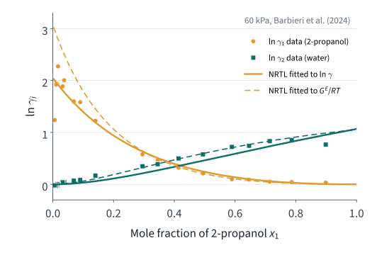
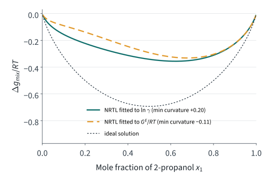
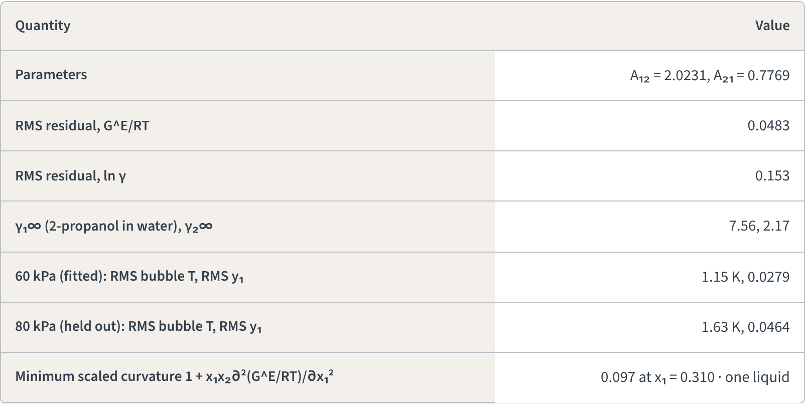

## Where this session sits {#course-map}

::: {.coursemap}
::: {.half}
[Before the midterm · 7 sessions]{.label}
[P1 · Framework]{.cm} [P2 · PVT and equations of state]{.cm} [P3 · Residual properties]{.cm} [P4 · Pure-component equilibrium and fugacity]{.cm} [P5 · Mixtures]{.cm} [P6 · Excess properties and activity]{.cm .now} [P7 · Choosing a property model]{.cm}
:::
::: {.half}
[After the midterm · 7 sessions]{.label}
[1 · VLE and flash]{.cm} [2 · Experimental VLE]{.cm} [3 · Liquid stability and LLE]{.cm} [4 · Solids and adsorption]{.cm} [5 · Chemical equilibrium]{.cm} [6 · Electrochemical equilibrium]{.cm} [7 · Choosing a model from evidence]{.cm}
:::
:::

::: {.bridge}
P5 defined the ideal solution, f̂i = xifi. Real liquids depart from it, often strongly. Today: **excess properties**, the **activity coefficient** that measures the departure, the standard states it refers to, and the models that represent it. Sessions 1–3 after the midterm use all of them.
:::

## Why this matters: one data set, two answers {#why}

:::: {.columns}
::: {.column width="56%"}
{.fig-pxy fig-alt="ln γ of 2-propanol and water at 60 kPa from measured VLE, with two NRTL fits: fitted to ln γ the dilute 2-propanol value tends to about 2.0 (γ∞ ≈ 7.7); fitted to G^E/RT it tends to about 3.1 (γ∞ ≈ 21)"}
:::
::: {.column width="42%" .why-notes}
2-propanol + water at 60 kPa. The same measured VLE, the same NRTL equation, two fitting objectives.

Fitted to ln γ: 2-propanol at infinite dilution in water has **γ∞ = 7.7**. Fitted to GE/RT: **γ∞ = 21**, and the model predicts a liquid split that does not exist.

Henry's constant, stripping and the stability of the liquid all follow from that choice.

[VLE: Barbieri et al., J. Chem. Thermodyn. 198 (2024) 107342. Lab P6.]{.source}
:::
::::

## By the end of today you can {#outcomes}

[Where you show it]{.where-head}

1. **Define** excess properties and the activity coefficient, and relate ln γi to GE/RT. [Concepts]{.where}
2. **Compute** γi and GE/RT from measured VLE with modified Raoult's law. [Activity 1, Lab P6]{.where}
3. **Fit and compare** Margules, van Laar, Wilson and NRTL, and convert between Raoult and Henry standard states. [Demo, Lab P6 B]{.where}
4. **Judge** a fitted model by held-out data, infinite dilution and stability, not only by its residuals. [Activity 2, Lab P6 A, C]{.where}

## The 180-minute route {#route}

::: {.route}
::: {.seg .concept style="flex:30"}
[0–30]{.t} **Essential concepts** [GE, γ, standard states, models]{.d}
:::
::: {.seg .act style="flex:10"}
[30–40]{.t} **Activity 1** [γ from one VLE point]{.d}
:::
::: {.seg .demo style="flex:20"}
[40–60]{.t} **Demo** [Lab P6]{.d}
:::
::: {.seg .break style="flex:10"}
[60–70]{.t} **Break**
:::
::: {.seg .act style="flex:70"}
[70–140]{.t} **Activity 2 · pair investigation** [objectives, Henry, stability]{.d}
:::
::: {.seg .wrap style="flex:40"}
[140–180]{.t} **Discussion and exit ticket** [answer the session question]{.d}
:::
:::

::: {.route-question}
[Session question]{.label} How do we measure and model the departure of a liquid mixture from the ideal solution, and what decides whether a fitted model can be trusted beyond its data?
:::

::: {.beforeafter}
::: {}
[Before class · 20 min]{.label}
Read the [Session P6 pre-class note](note-p06.html){target="_blank"} and answer its three questions.
:::
::: {}
[After class · 40 min]{.label}
Finish Lab P6: the five models and both objectives, then A–C in the Graduate view. Submit the study file with your name and ID.
:::
:::

::: {.selfstudy}
**Studying on your own?** Follow the same order. Turn on narration or captions at the bottom left, and pause at each activity slide.
:::

## Excess properties {#excess}

:::: {.columns}
::: {.column width="50%"}
The departure from the ideal solution at the same T, P and x:

$$M^E=M-M^{id},\qquad G^E=H^E-TS^E$$

For V and H the ideal-solution value is ΣxiMi*, so VE = ΔVmix and HE = ΔHmix.

$$\frac{\Delta g_{mix}}{RT}=\sum_ix_i\ln x_i+\frac{G^E}{RT}$$
:::
::: {.column width="48%" .rule-notes}
GE &gt; 0: positive deviation, the components prefer their own kind (2-propanol + water). GE &lt; 0: negative deviation, unlike pairs attract (acetone + chloroform).

[Ethanol + water, 298 K (P5)]{.q} VE reaches −1.1 cm³/mol.

Temperature dependence: ∂(GE/RT)/∂T = −HE/RT². Constant parameters assume HE ≈ 0.
:::
::::

## The activity coefficient {#gamma}

:::: {.columns}
::: {.column width="50%"}
$$\gamma_i=\frac{\hat f_i}{x_if_i^\circ}$$

$$\ln\gamma_i=\Big(\frac{\partial(nG^E/RT)}{\partial n_i}\Big)_{T,P,n_j}$$

$$\frac{G^E}{RT}=\sum_ix_i\ln\gamma_i,\qquad \sum_ix_i\,d\ln\gamma_i=0$$

At low pressure, with an ideal vapor (P4: φ̂ and Poynting within 1% at 60 kPa):

$$y_iP=x_i\gamma_iP_i^{sat}(T)$$
:::
::: {.column width="48%" .rule-notes}
ln γi is the partial molar property of GE/RT (P5), so the two ln γ are linked by Gibbs–Duhem.

[2-propanol + water, 60 kPa, x₁ = 0.14]{.q} y₁ = 0.477, T = 342.9 K, P₁sat = 60.1 kPa: γ₁ = 3.40, γ₂ = 1.18, GE/RT = 0.315.

Session 1 adds φ̂i and Poynting back for the γ–φ form.
:::
::::

## Standard states: Raoult and Henry {#standard}

:::: {.columns}
::: {.column width="50%"}
**Raoult** (pure liquid): fi° = fi(T, P); γi → 1 as xi → 1.

**Henry** (infinite dilution): f̂i → xiHi as xi → 0, with

$$H_i=\gamma_i^\infty f_i\approx\gamma_i^\infty P_i^{sat}$$

$$\gamma_i^*=\gamma_i/\gamma_i^\infty\to1\ \text{as}\ x_i\to0$$

**Molality** (electrolytes, Session 6): f̂i = miγi□Hi□.
:::
::: {.column width="48%" .rule-notes}
The standard state is a choice. f̂i does not depend on it; γi and fi° change together.

[2-propanol in water, 345 K]{.q} From the ln γ fits, γ₁∞ ≈ 7.6–7.9 and H₁ ≈ 500–520 kPa. From the GE fits, H₁ = 840–3100 kPa.

Henry's law suits a dilute solute or a supercritical gas, which has no pure liquid at T.
:::
::::

## Models for GE {#models}

::: {.lever-box}
| Model | GE/RT or ln γ1 | Parameters | Can it split? |
|---|---|---|---|
| Margules (1 or 2) | GE/RT = x1x2(A21x1 + A12x2); ln γ1∞ = A12 | A12, A21 | yes |
| van Laar | ln γ1 = A12(1 + A12x1/A21x2)−2 | A12, A21 | yes |
| Wilson | GE/RT = −Σxi ln(ΣxjΛij) | Λ12, Λ21 &gt; 0 | **no** |
| NRTL | local compositions, Gij = exp(−ατij) | τ12, τ21, α | yes |
| UNIQUAC, UNIFAC | combinatorial + residual; UNIFAC from groups | from structure | yes |
:::

[Every model gives ln γi that satisfy Gibbs–Duhem by construction, because both come from one GE. Measured γ need not, which is the basis of the consistency tests in Session 2.]{.howto}

## What you fit decides what you predict {#objective}

:::: {.columns}
::: {.column width="54%"}
::: {.lever-box}
[2-propanol + water, fitted at 60 kPa, predicted at 80 kPa]{.label}

| Model, objective | γ₁∞ | RMS y₁, 80 kPa | split? |
|---|---:|---:|---|
| Margules 2, ln γ | 7.6 | 0.046 | no |
| NRTL 0.3, ln γ | 7.7 | 0.047 | no |
| Wilson, ln γ | 7.9 | 0.051 | no |
| Margules 2, GE | 12.7 | 0.032 | **yes** |
| NRTL 0.3, GE | 21.4 | 0.036 | **yes** |
| Wilson, GE | 47.4 | 0.041 | no |
:::
:::
::: {.column width="44%" .concept-notes}
GE/RT vanishes at both ends, so a GE fit is decided by the middle and leaves the dilute ends free.

The GE fits predict the 80 kPa y₁ slightly better and are wrong about infinite dilution and stability.

The stated uncertainty in x (0.02–0.03) is as large as the dilute compositions, so these data leave γ₁∞ uncertain by tens of percent whatever the fit.
:::
::::

## Δgmix and stability {#stability}

:::: {.columns}
::: {.column width="54%"}
{.fig-pxy fig-alt="Δg_mix/RT of 2-propanol + water from two NRTL fits and the ideal solution: the fit to ln γ is convex everywhere; the fit to G^E/RT has a flatter, slightly concave region near x1 = 0.2, which implies a liquid split"}
:::
::: {.column width="44%" .concept-notes}
One liquid is locally stable where

$$1+x_1x_2\frac{\partial^2(G^E/RT)}{\partial x_1^2}>0$$

[NRTL, α = 0.3]{.q} Fitted to ln γ: minimum +0.20. Fitted to GE/RT: **−0.11 at x₁ = 0.20**, a split that the mixture does not show.

Wilson cannot go negative. Session 3 after the midterm treats stability and LLE in full.
:::
::::

## γ from one VLE point {#activity-1 .activity}

[Activity 1 · 10 minutes · alone, then with a partner]{.act-label}

::: {.prompt}
2-propanol (1) + water (2) at 60 kPa: x₁ = 0.4139, y₁ = 0.5347, T = 341.42 K. Antoine, log₁₀(P/bar) = A − B/(T + C): 2-propanol A = 4.861, B = 1357.427, C = −75.814; water A = 5.0768, B = 1659.793, C = −45.854. Compute Pisat, γ₁, γ₂ and GE/RT. Then compare γ₁ with the two-parameter Margules fit, A₁₂ = 2.023, A₂₁ = 0.777.
:::

::: {.selfstudy}
**On your own:** pause here and write your answer. In place of a partner, compare it with the next slide and write one sentence on any difference and its cause.
:::

## Activity 1: check your answer {#activity-1-debrief}

:::: {.columns}
::: {.column width="50%"}
P₁sat = **56.28 kPa**, P₂sat = **28.92 kPa** at 341.42 K

γ₁ = 0.5347 × 60/(0.4139 × 56.28) = **1.377**

γ₂ = 0.4653 × 60/(0.5861 × 28.92) = **1.647**

GE/RT = 0.4139 ln 1.377 + 0.5861 ln 1.647 = **0.425**
:::
::: {.column width="48%"}
::: {.lever-box}
[Margules at x₁ = 0.4139]{.label}

ln γ₁ = x₂²[A₁₂ + 2(A₂₁ − A₁₂)x₁] = 0.3435 × (2.023 − 1.031) = 0.341

γ₁ = **1.41** against 1.38 from the data (+2%).

A 0.02 error in x₁ changes the data γ₁ by 5%: the difference is within the measurement.
:::
:::
::::

## Demonstration · Lab P6 {#demo-lab}

:::: {.columns}
::: {.column width="44%"}
1. **Margules, two parameters**, ln γ objective. Read γ∞, the 80 kPa prediction and the curvature.
2. Switch the objective to GE/RT. Watch γ₁∞ and the curvature.
3. The GE/(RT x₁x₂) view: a straight line for Margules.
4. Graduate view, **A**: every model both ways.

[Open Lab P6 in the Graduate view →](../preview-2027/activity.html?mode=graduate){.lab-button target="_blank"}
:::
::: {.column width="54%"}
{.lab-shot fig-alt="Lab P6 fit summary for two-parameter Margules fitted to ln γ: parameters, residuals, infinite-dilution activity coefficients, bubble-point errors at 60 and 80 kPa and the minimum curvature"}

::: {.expect}
[Lab P6 should report]{.label}
Margules 2, ln γ: A₁₂ = 2.023, A₂₁ = 0.777 · γ∞ 7.56, 2.17 · RMS y₁ 0.028 (60 kPa), 0.046 (80 kPa) · curvature +0.097
:::
:::
::::

## Four common mistakes {#mistakes}

::: {.mistakes}
::: {}
**Judging a model by its residuals alone.** The GE fits have the smallest GE residuals and predict a split that does not exist.
:::
::: {}
**Reporting γ∞ from a fit as measured.** It is an extrapolation. Here it ranges from 7.6 to 47 depending on the model and the objective.
:::
::: {}
**Mixing standard states.** γi (Raoult) and γi* (Henry) differ by γi∞. Use the fi° that matches the γ.
:::
::: {}
**Vapor pressures outside their range.** The water Antoine fit ends at 363 K; the 80 kPa end points lie above it and are excluded.
:::
:::

## Break · 10 minutes {#break .breakslide}

::: {.break-next}
[Next]{.label}
Activity 2: a pair investigation in Lab P6, 70 minutes.

Before you leave your seat, check that Lab P6 opens on your device and that the first case is saved.
:::

## Activity 2 · objectives, Henry and stability {#activity-2 .activity}

[Activity 2 · 70 minutes · in pairs: one drives Lab P6, one checks by hand, then swap]{.act-label}

::: {.a2grid}
::: {}
[20 min · models and objectives]{.label}
Lab P6 A: five models, two objectives. Rank them by the 80 kPa prediction, then by γ∞ and stability. Do the rankings agree?
:::
::: {}
[15 min · Henry's law]{.label}
Lab P6 B: H₁ at 345 and 355 K. Which number would you give a stripping-column designer, and with what uncertainty?
:::
::: {}
[20 min · stability]{.label}
Lab P6 C: NRTL with α = 0.2, 0.3, 0.47. Which fits split, and what single measurement would settle it?
:::
::: {}
[15 min · explain]{.label}
Two sentences with numbers answering the session question. Download the study file with your names and IDs.
:::
:::

::: {.selfstudy}
**On your own:** do both roles yourself: work in Lab P6, then check one γ by hand. Pause the slides while you work; the next slide lists what to hand in.
:::

## Activity 2 · what to hand in {#activity-2-check}

:::: {.columns}
::: {.column width="44%"}
1. Lab P6 study file with the models, A–C, your name and student ID.
2. Your hand calculation of γ₁, γ₂ and GE/RT.
3. Two sentences answering the session question with numbers.

[Graduate extension]{.label}
Lab P6 E: a Margules fit written with an AI assistant, checked against the lab.
:::
::: {.column width="54%"}
::: {.lever-box}
[Check your results]{.label}

| | ln γ objective | GE objective |
|---|---:|---:|
| γ₁∞, two-parameter models | 7.6–7.9 | 12.7–47 |
| H₁ at 345 K / kPa | 500–520 | 840–3100 |
| RMS y₁ at 80 kPa | 0.046–0.051 | 0.032–0.041 |
| fits that split (of 4) | 0 | 3 |

NRTL fitted to GE splits for α = 0.2, 0.3 and 0.47.
:::
:::
::::

## Discussion: what did the activity data show? {#discussion}

:::: {.columns}
::: {.column width="54%"}
{.fig-pxy fig-alt="The two NRTL fits of ln γ again"}
:::
::: {.column width="44%" .concept-notes}
[Discuss in pairs, then with the class. On your own: write two or three sentences for each question.]{.q}

1. The GE fits predict 80 kPa better and stability worse. Which would you use for a column, and for a decanter?
2. Why can Wilson never predict a split, and when is that a strength?
3. What measurement would fix γ₁∞ of 2-propanol in water better than these VLE data?
:::
::::

## Summary {#summary}

::: {.summary3}
::: {}
[Definitions]{.label}
ME = M − Mid; γi = f̂i/(xifi°); ln γi = ∂(nGE/RT)/∂ni; Σxid ln γi = 0.
:::
::: {}
[Standard states]{.label}
Raoult: γ → 1 as x → 1. Henry: Hi = γi∞fi, γ* → 1 as x → 0. The fugacity is the same in both.
:::
::: {}
[Models and evidence]{.label}
Margules, van Laar, Wilson, NRTL. Judge them by held-out data, γ∞ and stability. The objective can change γ∞ threefold.
:::
:::

**Session question:** the departure is measured by γi from VLE and represented by a GE model. A model is trusted beyond its data only where independent evidence supports it: here the ln γ fits give γ₁∞ ≈ 7.7 and no split, as observed.

[Next session]{.label} P7: choosing a property model, and preparing for the midterm.

## Exit ticket · 5 minutes {#exit-ticket .activity}

[Exit ticket and feedback · alone · 5 minutes · anonymous]{.act-label}

:::: {.columns}
::: {.column width="64%"}
::: {.prompt}
Two NRTL fits to the same VLE data give γ∞ of 2-propanol in water of 7.7 and 21. Explain how the fitting objective can cause this, and name one check that would tell you which fit to trust.
:::

Scan the code or open the link. The same form asks three short questions about today: pace, confidence and whether the lab worked.

No name or student ID is recorded. Wait for **"Response received."**
:::
::: {.column width="32%" .qr-col}
{.qr fig-alt="QR code for the Session P6 exit ticket and feedback form"}

[Open the Session P6 form](exit.html?p=6){target="_blank"}
:::
::::

## After class {#after-class}

::: {.summary3}
::: {}
[Hand in · this week]{.label}
Your Lab P6 study file with the models, A–C, name and student ID. Upload it to **myCourseVille**, in the assignment for that lab.
:::
::: {}
[Prepare · Session P7]{.label}
Read the [Session P7 review guide](note-p07.html){target="_blank"}. About 30 minutes.
:::
::: {}
[Optional · graduate]{.label}
Lab P6 E: a Margules fit written with an AI assistant, checked against the lab.
:::
:::

[Open Lab P6 in the Graduate view →](../preview-2027/activity.html?mode=graduate#graduate-investigation){.lab-button target="_blank"}

[Starts at **4. Investigate what the activity data can support**. **A**: **Fit every model both ways**. **B**: **Compare the standard states**. **C**: **Test stability**.]{.howto}
