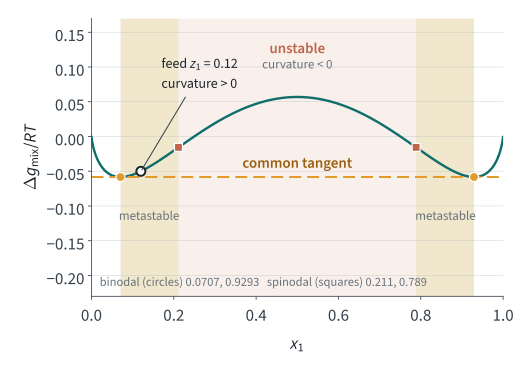
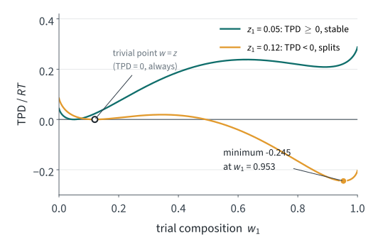
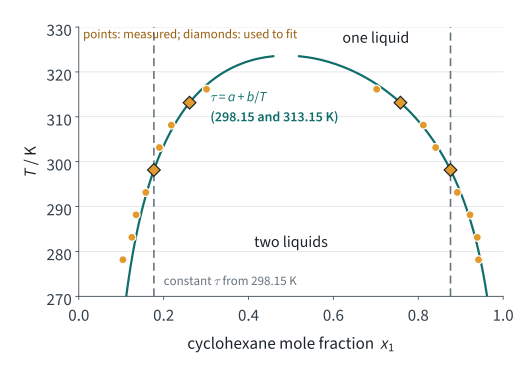
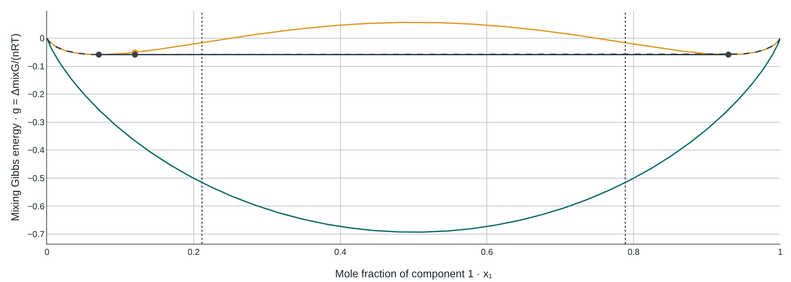

## Where this session sits {#course-map}

::: {.coursemap}
::: {.half .done}
[Before the midterm · 7 sessions]{.label}
[P1 · Framework]{.cm} [P2 · PVT and equations of state]{.cm} [P3 · Residual properties]{.cm} [P4 · Pure-component equilibrium and fugacity]{.cm} [P5 · Mixtures]{.cm} [P6 · Excess properties and activity]{.cm} [P7 · Choosing a property model]{.cm}
:::
::: {.half}
[After the midterm · 7 sessions]{.label}
[1 · VLE and flash]{.cm .past} [2 · Experimental VLE and consistency]{.cm .past} [3 · Liquid stability and LLE]{.cm .now} [4 · Solids and adsorption]{.cm} [5 · Chemical equilibrium]{.cm} [6 · Electrochemical equilibrium]{.cm} [7 · Choosing a model from evidence]{.cm}
:::
:::

::: {.bridge}
Session 2 ended with a model that fits VLE data well and predicts a liquid split that does not exist. Today: how to **test** whether one liquid is stable, and how to **fit** a model to liquids that really do split.
:::

## Why this matters: a split that is not there, and one that is {#why}

:::: {.columns}
::: {.column width="50%"}
::: {.lever-box}
[2-Propanol + water · NRTL weighted fit from Session 2]{.label}

τ₁₂ = 0.337, τ₂₁ = 2.848, α = 0.47

Predicts two liquids at x₁ = **0.088** and **0.237**.

The real mixture is fully miscible. A flash with this model would report a decanter that cannot work.
:::
:::
::: {.column width="48%"}
::: {.lever-box}
[Cyclohexane + methanol · measured]{.label}

Two liquids measured from 278 to 316 K. At 298.15 K: x₁ = **0.177** and **0.876**.

Nine tie lines from 278 to 316 K (Atik and Kerboub, 2008). Lab 05 uses them.
:::
:::
::::

Both answers come from the same function, Δgmix(x). Today is about reading it correctly, and about what data decide it.

[Data: Atik and Kerboub, J. Chem. Eng. Data 53 (2008) 1669–1671, via NIST ThermoML. 2-Propanol + water: Barbieri et al. (2024), Session 2.]{.source}

## From Sessions 1 and 2 to today {#recap}

::: {.chain}
::: {.link}
[Session 1]{.label}
A flash that returns one phase is not finished when K depends on x. **Test stability first.**
:::
::: {.link}
[Session 2]{.label}
VLE near the dilute end hardly constrains τ₂₁, yet the phase behavior **depends strongly on it**.
:::
::: {.link .today}
[Today]{.label}
Local and global stability, the tangent-plane test, and LLE data as the evidence that rules a split in or out.
:::
:::

## By the end of today you can {#outcomes}

[Where you show it]{.where-head}

1. **Separate** local from global stability, and classify a feed as stable, metastable or unstable. [Activity 1, Lab 04]{.where}
2. **Apply** the tangent-plane test and explain why it needs a search over all trial compositions. [Activity 1, Lab 05 E]{.where}
3. **Fit** NRTL to a measured tie line, and say what one tie line does and does not determine. [Activity 2, Lab 05]{.where}
4. **Test** a temperature dependence of τ on held-out tie lines. [Activity 2, Lab 05 A]{.where}
5. **Specify** a stability calculation for an AI assistant to code, and **verify** the code. [Activity 2, Lab 05 E]{.where}

## The 180-minute route {#route}

::: {.route}
::: {.seg .concept style="flex:30"}
[0–30]{.t} **Essential concepts** [Δgmix, stability, TPD, tie lines]{.d}
:::
::: {.seg .act style="flex:10"}
[30–40]{.t} **Activity 1** [stable or not?]{.d}
:::
::: {.seg .demo style="flex:20"}
[40–60]{.t} **Demo** [Lab 04]{.d}
:::
::: {.seg .break style="flex:10"}
[60–70]{.t} **Break**
:::
::: {.seg .act style="flex:70"}
[70–140]{.t} **Activity 2 · pair investigation** [Lab 05 fits and transfer, then your own code]{.d}
:::
::: {.seg .wrap style="flex:40"}
[140–180]{.t} **Discussion and exit ticket** [what decides a split]{.d}
:::
:::

::: {.route-question}
[Session question]{.label} A liquid passes every local test. When does it still split, and what evidence settles whether a model's split is real?
:::

::: {.beforeafter}
::: {}
[Before class · 15–20 min]{.label}
Read the [note on Gibbs energy of mixing and phase stability](note-s03.html){target="_blank"}. Answer its three questions.
:::
::: {}
[After class · 30–40 min]{.label}
Finish Lab 05 A–E and submit the study file with your name and ID.
:::
:::

::: {.selfstudy}
**Studying on your own?** Follow the same order. Turn on narration or captions at the bottom left, and pause at each activity slide.
:::

## The function that decides {#gmix}

:::: {.columns}
::: {.column width="56%"}
{.fig-pxy fig-alt="Gibbs energy of mixing for the one-constant Margules model with A equal to 3, with the common tangent touching at x one 0.0707 and 0.9293, spinodal points at 0.211 and 0.789, and the feed at 0.12 marked in the metastable region"}
:::
::: {.column width="42%" .concept-notes}
$$\frac{\Delta g_{\text{mix}}}{RT}=\sum_i x_i\ln x_i+\frac{G^E}{RT}$$

[Lowest G wins]{.q} At fixed T and P, a feed splits if a straight line between two compositions lies **below** the curve at the feed.

[Margules, A = 3]{.q} GE/RT = A x₁x₂. Binodal 0.0707 and 0.9293; spinodal 0.211 and 0.789.

The feed z₁ = 0.12 sits where the curve is still convex, but its Δgmix lies **above** the common tangent. Splitting into 0.0707 and 0.9293 lowers G.
:::
::::

## Local and global stability {#local-global}

:::: {.columns}
::: {.column width="52%"}
**Local:** stable against small changes when

$$\begin{aligned}&x_1x_2\,\frac{\partial^2(\Delta g_{\text{mix}}/RT)}{\partial x_1^2}\\&\quad=1+x_1x_2\frac{\partial^2 (G^E/RT)}{\partial x_1^2}>0\end{aligned}$$

Zero on the **spinodal**. For Margules: 1 − 2A x₁x₂.

**Global:** the two liquids of the **binodal** have equal chemical potentials:

$$x_i^{\alpha}\gamma_i^{\alpha}=x_i^{\beta}\gamma_i^{\beta}\qquad i=1,2$$
:::
::: {.column width="46%"}
::: {.lever-box}
[Three regions for a feed]{.label}

| Feed position | Curvature | State |
|---|---|---|
| outside the binodal | &gt; 0 | stable |
| binodal to spinodal | &gt; 0 | **metastable** |
| inside the spinodal | &lt; 0 | unstable |

A curvature test alone calls a metastable feed stable. Only a global test finds that it splits.
:::

α is the x₁-poor liquid and β the x₁-rich liquid, as in Labs 04 and 05. (NRTL's α, below, is a different quantity: the nonrandomness parameter.)
:::
::::

## The tangent-plane test {#tpd}

:::: {.columns}
::: {.column width="54%"}
{.fig-pxy fig-alt="Tangent-plane distance against trial composition for Margules A equal to 3: for the feed 0.05 it stays at or above zero; for the feed 0.12 it reaches a minimum of minus 0.245 at w one 0.953, while the trivial point w equal to z always gives zero"}
:::
::: {.column width="44%" .concept-notes}
$$\frac{\text{TPD}(\mathbf w)}{RT}=\sum_i w_i\big[\ln\!\big(w_i\gamma_i(\mathbf w)\big)-\ln\!\big(z_i\gamma_i(\mathbf z)\big)\big]$$

z is the feed and **w** a trial composition.

[Rule]{.q} TPD ≥ 0 for **every** trial w: stable. Any w with TPD &lt; 0: the feed splits, and w is a good first guess for the new phase (Michelsen, 1982).

[Trap]{.q} w = z always gives TPD = 0. A local search started at the feed stops there. Search the whole composition range, or from several starts.
:::
::::

## Which models can predict a split? {#models}

:::: {.columns}
::: {.column width="50%"}
**Wilson:** the curvature stays positive for any parameters, so it **cannot** describe LLE.

**NRTL, UNIQUAC:** can. That flexibility cuts both ways: a fit to VLE alone can produce a split that does not exist.

[Use LLE or mutual-solubility data when they exist. They are the direct evidence.]{.q}
:::
::: {.column width="48%"}
::: {.lever-box}
[2-Propanol + water · NRTL, [α]{.nt} = 0.47 · Session 2 fits at 60 kPa]{.label}

| Fit | τ₁₂ | τ₂₁ | min. curvature | prediction |
|---|---:|---:|---:|---|
| unweighted | 0.362 | 1.752 | 0.238 | one liquid |
| weighted | 0.337 | 2.848 | −0.030 | split, 0.088 / 0.237 |

The two fits differ mainly in τ₂₁, which dilute VLE rows hardly constrain. A single cloud-point measurement near x₁ = 0.15 would decide between them.
:::
:::
::::

## Stable, metastable or unstable? {#activity-1 .activity}

[Activity 1 · 10 minutes · alone, then with a partner]{.act-label}

::: {.prompt}
Margules, A = 3: binodal x₁ = 0.0707 and 0.9293. For z₁ = 0.05, 0.12 and 0.50, calculate the scaled curvature 1 − 2A z₁z₂ and classify each feed.
:::

Then: which feed does a curvature test alone get wrong? For each feed that splits, find the fraction of the x₁-rich liquid with the lever rule.

::: {.selfstudy}
**On your own:** pause here and write your answer. In place of a partner, compare it with the next slide and write one sentence on any difference and its cause.
:::

## Activity 1: check your answer {#activity-1-debrief}

:::: {.columns}
::: {.column width="56%"}
::: {.lever-box}
[Margules A = 3 · binodal 0.0707 / 0.9293]{.label}

| z₁ | curvature | min. TPD/RT (at w₁) | state | x₁-rich fraction |
|---:|---:|---|---|---:|
| 0.05 | 0.715 | 0 (trivial) | stable | — |
| 0.12 | 0.366 | −0.245 (0.953) | **metastable** | 0.057 |
| 0.50 | −0.500 | −0.115 (0.071) | unstable | 0.500 |
:::
:::
::: {.column width="42%" .rule-notes}
z₁ = 0.12 passes the curvature test and still splits. The lever rule gives (0.12 − 0.0707)/(0.9293 − 0.0707) = 0.057.

The Gibbs energy gained by splitting is small, 0.0082 RT per mole of feed. A metastable liquid can persist in practice until a second phase nucleates, but the equilibrium state has two liquids.
:::
::::

## From a tie line to parameters {#tie-line}

:::: {.columns}
::: {.column width="50%"}
Each measured tie line gives two equations, xiαγiα = xiβγiβ. With α fixed, they are two **constraints** on two τ. Check that an acceptable solution exists and that it is unique.

So a perfect fit to one tie line is not evidence that the model is right. It only shows that the equations had a solution.

At 298.15 K with α = 0.3: ln γ₁ = 1.651 and 0.052, x₁γ₁ = **0.9225** in both liquids; x₂γ₂ = **0.8914** in both.
:::
::: {.column width="48%"}
::: {.lever-box}
[Cyclohexane + methanol · 298.15 K · tie line 0.177 / 0.876]{.label}

| α | τ₁₂ | τ₂₁ | reproduces the tie line? |
|---:|---:|---:|---|
| 0.2 | 1.785 | 1.133 | exactly |
| 0.3 | 1.851 | 1.433 | exactly |
| 0.47 | 2.649 | 2.341 | no: best fit splits at 0.746 / 0.873 |

One tie line cannot identify α. Some α cannot reproduce it at all.
:::
:::
::::

## Does τ hold across temperature? {#tdep}

:::: {.columns}
::: {.column width="56%"}
{.fig-pxy fig-alt="Measured cyclohexane methanol binodal from 278 to 316 K with the constant tau prediction as two vertical lines at 0.177 and 0.876 and the tau equal a plus b over T curve through the measured points closing near 324 K"}
:::
::: {.column width="42%"}
::: {.lever-box}
[Held-out tie lines · [α]{.nt} = 0.3 · composition RMSE]{.label}

| τ(T) from | RMSE | within U |
|---|---:|---:|
| 298.15 K, constant | 0.077 | 0 of 8 |
| 298.15 K, τ ∝ 1/T | 0.056 | 1 of 8 |
| 298.15 and 313.15 K, a + b/T | 0.0097 | 4 of 7 |
:::

The a + b/T model closes the gap near 324 K, above the last measured tie line at 316.15 K. That is an extrapolation, not a measured upper critical solution temperature (UCST).
:::
::::

## Three phases: what is fixed? {#vlle}

:::: {.columns}
::: {.column width="50%"}
Two liquids and a vapor, binary:

$$F=C-\pi+2=2-3+2=1$$

At a chosen P, the three-phase T and **all three compositions** are fixed. Every feed between the two liquids gives the same three compositions.

The **amounts** are not fixed by P and z alone: two mass balances, three unknown amounts. One more specification is needed, such as heat duty or vapor fraction.
:::
::: {.column width="48%" .rule-notes}
Above or below the three-phase T at that P, only two phases remain.

Lab 06 works through this: the pressure sweep across P₃, the missing specification, and when the vapor composition lies inside the liquid gap (a heterogeneous azeotrope).

[Optional after class: Lab 06 A and B.]{.q}
:::
::::

## Demonstration · Lab 04 {#demo-lab}

:::: {.columns}
::: {.column width="44%"}
1. Margules, A = 3, **z₁ = 0.50**: unstable, two liquids.
2. Change to **z₁ = 0.12**: curvature still positive, TPD negative. Metastable.
3. Read the construction: the tangent lies below the curve at the feed.
4. Switch to NRTL, τ₁₂ = 0.337, τ₂₁ = 2.848, α = 0.47: the Session 2 weighted fit. Where is the split?

[Open Lab 04 in the Graduate view →](../preview-2027/stability.html?mode=graduate){.lab-button target="_blank"}
:::
::: {.column width="54%"}
{.lab-shot fig-alt="Lab 04 Gibbs-energy construction for Margules A equal to 3 with the feed at 0.12, the common tangent through 0.0707 and 0.9293, and the spinodal lines"}

::: {.expect}
[Lab 04 should report · A = 3, z₁ = 0.12]{.label}
Two liquids · x₁ = 0.0707 / 0.9293 · β fraction 0.0574 · metastable · TPD −0.2446 · gain 0.0082. NRTL weighted fit: split 0.088 / 0.237.
:::
:::
::::

## Four common mistakes {#mistakes}

::: {.mistakes}
::: {}
**Calling a feed stable from its curvature.** A metastable feed has positive curvature and still splits.
:::
::: {}
**Accepting the trivial solution.** xα = xβ satisfies the isoactivity equations for any composition.
:::
::: {}
**Searching TPD from the feed only.** w = z gives TPD = 0. The negative minimum may be on the other side of the diagram.
:::
::: {}
**Treating an exact tie-line fit as validation.** Two equations, two unknowns. Check on tie lines the fit did not use.
:::
:::

## AI writes code, you write the problem {#ai-code}

:::: {.columns}
::: {.column width="50%"}
[You decide]{.label}

- Tie line and α
- Equations, and how a trivial solution is rejected
- Starting values and search range
- What the result means, and what it does not show

[The assistant may]{.label}

Write and debug code that does exactly what your specification says. Not parameter values or conclusions.
:::
::: {.column width="48%" .rule-notes}
**Lab 05 step E** recomputes from the measured tie line and from your τ:

1. Isoactivity residual at the tie line
2. Same τ as the lab fit
3. Binodal solved again from your τ
4. Spinodal compositions
5. Minimum TPD at z₁ = 0.25, and where
6. The measured tie line is globally stable

Hand in the specification, the prompt, the final code and what you fixed.
:::
::::

## Break · 10 minutes {#break .breakslide}

::: {.break-next}
[Next]{.label}
Activity 2: a pair investigation in Lab 05, 70 minutes.

Before you leave your seat, check that Lab 05 opens on your device.
:::

## Activity 2 · what does one tie line tell you? {#activity-2 .activity}

[Activity 2 · 70 minutes · in pairs: one drives Lab 05, one checks by hand, then swap]{.act-label}

::: {.a2grid}
::: {}
[15 min · by hand]{.label}
At 298.15 K, α = 0.3, τ = 1.851 / 1.433: calculate ln γ₁ and ln γ₂ in both liquids, and show xiγi is equal.
:::
::: {}
[25 min · fits and transfer]{.label}
Fit 298.15 and 313.15 K; save each. In A, transfer constant τ and a + b/T to the other tie lines. In B, compare α.
:::
::: {}
[20 min · E your own code]{.label}
Write the specification. Use an AI assistant to write the code for (a)–(d), run it, and check it in E. Fix what disagrees.
:::
::: {}
[10 min · explain]{.label}
Two sentences with numbers: why does a perfect fit at 298.15 K predict 313.15 K so poorly? Download the study file with names and IDs.
:::
:::

::: {.selfstudy}
**On your own:** do both roles yourself: work in Lab 05, then check one value by hand before you trust it. Pause the slides while you work; the next slide lists what to hand in.
:::

## Activity 2 · what to hand in {#activity-2-check}

:::: {.columns}
::: {.column width="44%"}
1. Lab 05 study file with the two fits, A, B, D and E, your name and student ID.
2. The hand calculation of ln γ and xiγi in both liquids.
3. Two sentences that answer the activity question with numbers.

[Graduate extension]{.label}
Use C to perturb the 298.15 K tie line within its uncertainty. How far do τ₁₂ and τ₂₁ move, and does the predicted gap at 313.15 K stay within U?
:::
::: {.column width="54%"}
::: {.lever-box}
[Check your results · [α]{.nt} = 0.3]{.label}

| | 298.15 K | 313.15 K |
|---|---:|---:|
| τ₁₂ | 1.851 | 1.474 |
| τ₂₁ | 1.433 | 1.370 |
| spinodal x₁ | 0.315 / 0.764 | 0.361 / 0.662 |
| min. TPD at z₁ = 0.25 | −0.0596 at 0.900 | — |

Constant τ from 298.15 K predicts 0.177 / 0.876 at 313.15 K; measured 0.261 / 0.758. With a + b/T from both, the held-out RMSE is 0.0097.
:::
:::
::::

## What the code checks catch {#ai-debrief}

:::: {.columns}
::: {.column width="56%"}
::: {.lever-box}
[298.15 K, [α]{.nt} = 0.3 · a first-draft script: solvers started at generic guesses]{.label}

| | Lab | Script |
|---|---:|---:|
| τ₁₂, τ₂₁ | 1.851, 1.433 | 1.851, 1.433 |
| binodal x₁ | 0.177 / 0.876 | **0.519 / 0.519** |
| min. TPD at z₁ = 0.25 | −0.0596 at 0.900 | **0 at 0.250** |

The τ were right. The binodal solver, started at 0.4 / 0.6, returned the trivial solution. The TPD search, started at the feed, stopped at w = z.
:::
:::
::: {.column width="42%" .rule-notes}
[Fixes that made all checks agree]{.label}

- Start the binodal from opposite sides of the spinodal, and reject xα ≈ xβ
- Scan TPD over the whole range, then refine the lowest point

**Swapped τ₁₂ and τ₂₁** also fails: the isoactivity residual is 0.12, and E names the swap.

All checks agree only shows that the code solves your problem. Constant τ still fails at other temperatures.
:::
::::

## Discussion: what decides a split? {#discussion}

:::: {.columns}
::: {.column width="56%"}
{.fig-pxy fig-alt="Measured cyclohexane methanol binodal with the constant tau and a plus b over T predictions"}
:::
::: {.column width="42%" .concept-notes}
[Discuss in pairs, then with the class. On your own: write two or three sentences for each question.]{.q}

1. Both α = 0.2 and α = 0.3 reproduce the 298.15 K tie line exactly. What data would distinguish them?
2. The a + b/T model predicts the gap closes near 324 K. How much would you trust that, and what would you measure?
3. For 2-propanol + water, the weighted fit predicts a split at x₁ ≈ 0.15. Design the cheapest experiment that rules it out.
:::
::::

## Summary {#summary}

::: {.summary3}
::: {}
[Stability]{.label}
Curvature is a local test. A feed splits whenever some trial composition gives TPD &lt; 0; search the whole range.
:::
::: {}
[Tie lines]{.label}
One tie line gives two constraints on two parameters. A solution may not exist, or may not be unique. A fit to it is calibration, not validation.
:::
::: {}
[Evidence]{.label}
Check τ(T) on tie lines the fit did not use. Mutual-solubility data decide whether a predicted split is real.
:::
:::

**Session question:** z₁ = 0.12 at A = 3 passes the curvature test and still splits (TPD −0.245). A model fitted exactly at 298.15 K misses the other tie lines by 0.077 (RMS composition) with constant τ, and by 0.0097 with a + b/T calibrated at two temperatures.

[Next session]{.label} When does a solid appear, and where does a gas go on a surface? Solids and adsorption (Labs 10 and 11).

## Exit ticket · 5 minutes {#exit-ticket .activity}

[Exit ticket and feedback · alone · 5 minutes · anonymous]{.act-label}

:::: {.columns}
::: {.column width="64%"}
::: {.prompt}
A liquid feed has positive curvature of Δgmix. Is that enough to call it stable? Which test would you run, and what result would show that it splits?
:::

Scan the code or open the link. The same form asks three short questions about today: pace, confidence and whether the lab worked.

No name or student ID is recorded. Wait for **"Response received."**
:::
::: {.column width="32%" .qr-col}
{.qr fig-alt="QR code for the Session 3 exit ticket and feedback form"}

[Open the Session 3 form](exit.html?s=3){target="_blank"}
:::
::::

## After class {#after-class}

::: {.summary3}
::: {}
[Hand in · this week]{.label}
Your Lab 05 study file with the two fits, A, B, D and E, name and student ID. Upload it to **myCourseVille**, in the assignment for that lab.
:::
::: {}
[Prepare · Session 4]{.label}
Read the [Session 4 pre-class note](note-s04.html){target="_blank"}. About 20 minutes.
:::
::: {}
[Optional · graduate]{.label}
Lab 06 A and B: supply the missing specification for a three-phase state, and sweep P across P₃.
:::
:::

[Open Lab 05 in the Graduate view →](../preview-2027/lle-fit.html?mode=graduate#graduate-investigation){.lab-button target="_blank"}

[Starts at **4. Investigate what the fit can support**. **A**: first button **Predict the held-out tie lines**. **B**: **Compare α = 0.2, 0.3 and 0.47**. **E**: **Download the measured tie lines (CSV)**.]{.howto}
