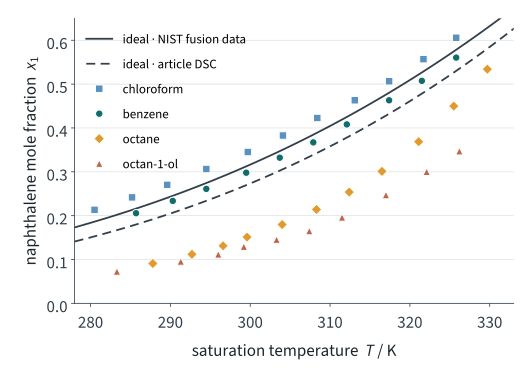
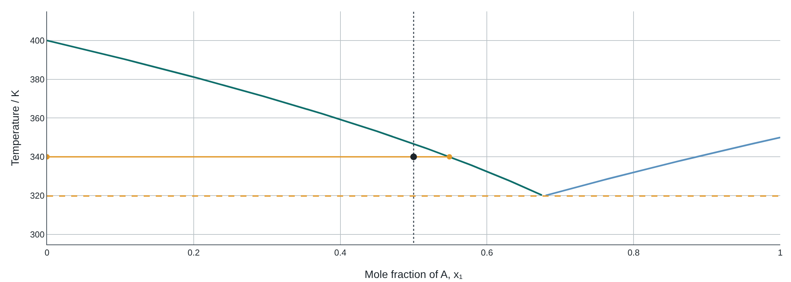
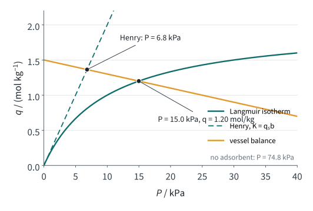
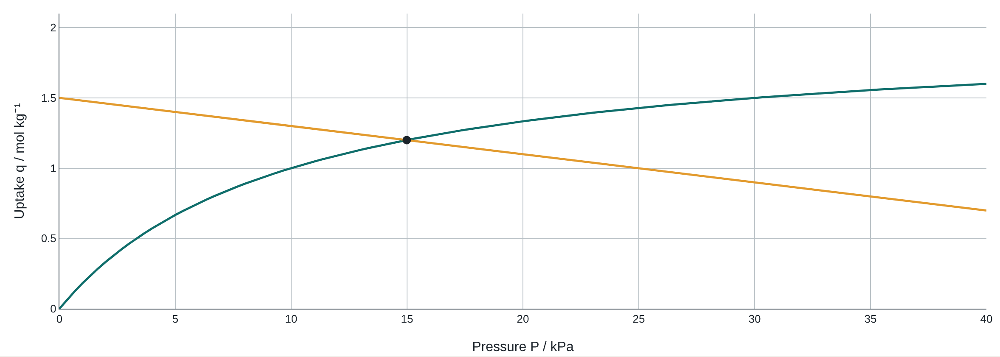

## Where this session sits {#course-map}

::: {.coursemap}
::: {.half .done}
[Before the midterm]{.label}
[Equations of state]{.cm} [Fugacity and chemical potential]{.cm} [Solution thermodynamics]{.cm}
:::
::: {.half}
[After the midterm · 7 sessions]{.label}
[1 · VLE and flash]{.cm .past} [2 · Experimental VLE and consistency]{.cm .past} [3 · Liquid stability and LLE]{.cm .past} [4 · Solids and adsorption]{.cm .now} [5 · Chemical equilibrium]{.cm} [6 · Electrochemical equilibrium]{.cm} [7 · Choosing a model from evidence]{.cm}
:::
:::

::: {.bridge}
Sessions 1–3 balanced fluid phases against each other. Today one phase is a **pure solid**: a crystal in a solution, or a surface that holds gas. Equal chemical potential still decides, and the solid gives a fixed reference.
:::

## Why this matters: one solid, four solvents {#why}

:::: {.columns}
::: {.column width="58%"}
{.fig-pxy fig-alt="Measured naphthalene solubility against temperature in chloroform, benzene, octane and octan-1-ol, with two ideal-solubility lines from two fusion data sets"}
:::
::: {.column width="40%" .why-notes}
Naphthalene at about 299.5 K dissolves to x₁ = **0.345** in chloroform, 0.298 in benzene, 0.151 in octane and **0.129** in octan-1-ol.

The ideal solubility depends only on the solid, yet two published fusion data sets put it at **0.27 or 0.31**.

A crystallizer design needs both: the solid's fusion data and the liquid's γ₁. An error in one is absorbed by the other when you fit.

[Data: Xu et al., J. Chem. Eng. Data 64 (2019) 3018–3027, via NIST ThermoML; molality converted to mole fraction. Lab 10 E uses them.]{.source}
:::
::::

## From fluid phases to a fixed solid {#recap}

::: {.chain}
::: {.link}
[Sessions 1–3]{.label}
Equal fugacity between fluid phases whose compositions are unknown.

$$x_i^{\alpha}\gamma_i^{\alpha}=x_i^{\beta}\gamma_i^{\beta}$$
:::
::: {.link .today}
[Today · solid–liquid]{.label}
The solid is pure: its fugacity depends on T only.

$$x_1\gamma_1f_1^{\text{l,pure}}=f_1^{\text{s}}$$
:::
::: {.link}
[Today · gas–surface]{.label}
The adsorbed amount follows an isotherm, and the vessel balance closes the problem.

$$n=\frac{PV}{RT}+m\,q(P,T)$$
:::
:::

## By the end of today you can {#outcomes}

[Where you show it]{.where-head}

1. **Derive** the solubility of a pure solid and state its assumptions. [Concepts, note]{.where}
2. **Infer** γ₁ from measured solubility, and show how much it depends on the fusion data. [Activity 1, Lab 10 E]{.where}
3. **Read** a eutectic diagram and apply the phase rule with solids. [Lab 10]{.where}
4. **Solve** a closed adsorption vessel, and extract an isosteric heat from isotherms. [Demo, Lab 11 A–B]{.where}
5. **Specify** an SLE fit for an AI assistant to code, and **verify** the code. [Activity 2, Lab 10 E]{.where}

## The 180-minute route {#route}

::: {.route}
::: {.seg .concept style="flex:30"}
[0–30]{.t} **Essential concepts** [solubility, fusion data, eutectic, isotherms]{.d}
:::
::: {.seg .act style="flex:10"}
[30–40]{.t} **Activity 1** [above or below ideal?]{.d}
:::
::: {.seg .demo style="flex:20"}
[40–60]{.t} **Demo** [Lab 11]{.d}
:::
::: {.seg .break style="flex:10"}
[60–70]{.t} **Break**
:::
::: {.seg .act style="flex:70"}
[70–140]{.t} **Activity 2 · pair investigation** [Lab 11 heat, then Lab 10 E with your own code]{.d}
:::
::: {.seg .wrap style="flex:40"}
[140–180]{.t} **Discussion and exit ticket** [what a fitted parameter absorbs]{.d}
:::
:::

::: {.route-question}
[Session question]{.label} When a model fits measured solubility well, which errors has its parameter quietly absorbed, and which predictions survive?
:::

::: {.beforeafter}
::: {}
[Before class · 15–20 min]{.label}
Read the [note on solids in liquids and gases on surfaces](note-s04.html){target="_blank"}. Answer its three questions.
:::
::: {}
[After class · 30–40 min]{.label}
Finish Lab 10 E and Lab 11 A–B, and submit both study files with your name and ID.
:::
:::

::: {.selfstudy}
**Studying on your own?** Follow the same order. Turn on narration or captions at the bottom left, and pause at each activity slide.
:::

## Solubility of a pure solid {#sle}

:::: {.columns}
::: {.column width="54%"}
A path through the melting point gives

$$\ln(x_1\gamma_1)=-\frac{\Delta_{\text{fus}}H}{R}\Big(\frac{1}{T}-\frac{1}{T_m}\Big)+\frac{\Delta C_p}{R}\Big(\frac{T_m}{T}-1-\ln\frac{T_m}{T}\Big)$$

With γ₁ = 1: the **ideal solubility**. It depends on the solid alone. Every solvent that differs from it does so through γ₁.
:::
::: {.column width="44%"}
::: {.lever-box}
[Assumptions, and when they fail]{.label}

| Assumption | Fails when |
|---|---|
| pure solid, no solid solution | similar molecules co-crystallize |
| one crystal form | a polymorph or solvate forms |
| ΔCp term neglected | T is far below Tm |

Today: naphthalene, 279–330 K, Tm ≈ 353 K. The ΔCp term is neglected throughout.
:::
:::
::::

## The fusion data set the baseline {#fusion}

:::: {.columns}
::: {.column width="50%"}
::: {.lever-box}
[Naphthalene · two sources]{.label}

| | Tm / K | ΔfusH / kJ mol⁻¹ | ideal x₁, 298.15 K |
|---|---:|---:|---:|
| NIST WebBook | 353.39 | 19.0 | **0.302** |
| Article, DSC | 355.04 ± 2.1 | 20.87 ± 2.1 | **0.260** |
:::

[NIST: triple point, average of 6 values; ΔfusH from Chirico, Knipmeyer et al. (2002). Article: Xu et al. (2019), expanded uncertainty at 95 %.]{.source}
:::
::: {.column width="48%" .rule-notes}
At 298.15 K, each 1 kJ/mol in ΔfusH moves ln x₁ by **0.063**.

The two sets differ by 1.9 kJ/mol and 1.65 K. The ideal solubility differs by 16 %.

That difference passes, unchanged, into every γ₁ you infer from a measured solubility. Choose the fusion data before you interpret γ₁, and say which you used.
:::
::::

## From measured solubility to γ₁ {#gamma}

:::: {.columns}
::: {.column width="50%"}
The data come as **molality**, m in mol per kg of solvent:

$$x_1=\frac{m}{m+1000/M_{\text{solvent}}}\qquad \gamma_1=\frac{x_1^{\text{id}}(T)}{x_1}$$

Octane, 296.6 K, m = 1.3217: x₁ = **0.1312**. With NIST fusion data, x₁id = 0.290, so γ₁ = **2.21**.

A model such as ln γ₁ = (W/RT)x₂² puts x₁ on both sides. **Solve** for x₁; do not evaluate γ₁ once.
:::
::: {.column width="48%"}
::: {.lever-box}
[Fitted W, least squares in ln x₁, all rows]{.label}

| Solvent | W (NIST) | W (DSC) | x₁ at 298.15 K |
|---|---:|---:|---:|
| octane | 2509 | 1973 | 0.144 / 0.145 |
| octan-1-ol | 2979 | 2475 | 0.119 / 0.120 |
| benzene | **+238** | **−522** | 0.287 / 0.289 |

W in J/mol. The prediction hardly moves with the fusion data; the parameter does.
:::
:::
::::

## Two solids: the eutectic {#eutectic}

:::: {.columns}
::: {.column width="56%"}
{.lab-shot fig-alt="Lab 10 phase diagram: liquidus of solid B from 400 K and of solid A from 350 K meeting at the eutectic, 319.79 K and x one 0.6774, with the feed at x one 0.5 and 340 K"}
:::
::: {.column width="42%" .concept-notes}
[Two liquidus curves]{.q} Each solid has its own solubility curve from the same equation. They meet at the **eutectic**: liquid with both solids.

[Phase rule]{.q} Binary at fixed P with three phases: F = 2 − 3 + 1 = 0. The eutectic T and composition are fixed.

[Lab 10, ideal liquid]{.q} Feed z₁ = 0.5: first crystals of B at 346.7 K; eutectic at 319.8 K, x₁ = 0.677. Teaching parameters, not a real pair.
:::
::::

## Above or below ideal? {#activity-1 .activity}

[Activity 1 · 10 minutes · alone, then with a partner]{.act-label}

::: {.prompt}
Naphthalene in benzene: m = 4.5226 mol/kg saturates at 294.5 K (M = 78.112 g/mol). Find x₁. Then find γ₁ with each fusion data set: NIST (353.39 K, 19.0 kJ/mol) and DSC (355.04 K, 20.87 kJ/mol).
:::

Is the deviation from ideal positive or negative? What would you report as the answer?

::: {.selfstudy}
**On your own:** pause here, write your answer, then go to the next slide.
:::

## Activity 1: check your answer {#activity-1-debrief}

:::: {.columns}
::: {.column width="52%"}
x₁ = 4.5226 / (4.5226 + 1000/78.112) = **0.2610**

| Fusion data | x₁id(294.5 K) | γ₁ | sign |
|---|---:|---:|---|
| NIST | 0.274 | **1.051** | positive |
| DSC | 0.234 | **0.896** | negative |

Fitting all ten rows: W = +238 J/mol (NIST) or −522 J/mol (DSC).
:::
::: {.column width="46%" .rule-notes}
The sign of the deviation is **not decided** by these data. It is decided by the fusion data, which differ by about their own stated uncertainty.

What you can report: naphthalene + benzene is close to ideal, |ln γ₁| ≤ 0.11 here, and the solubility at 298.15 K is 0.287–0.289 with either set.

To settle the sign, measure ΔfusH more precisely, or use a property that does not pass through the solid, such as HE of the liquid.
:::
::::

## A gas on a surface: the closed vessel {#vessel}

:::: {.columns}
::: {.column width="54%"}
{.fig-pxy fig-alt="Langmuir and Henry isotherms crossed by the straight vessel balance line, giving 15.0 kPa with Langmuir and 6.8 kPa with Henry"}
:::
::: {.column width="44%" .concept-notes}
$$q=\frac{q_sK_LP}{1+K_LP}\qquad n=\frac{PV}{RT}+m\,q(P)$$

[Lab 11 starting case]{.q} 1 L, 20 g, 0.03 mol, 300 K, qs = 2 mol/kg, KL = 0.1 kPa⁻¹: **P = 15.0 kPa**, q = 1.20 mol/kg, 80 % of the gas on the solid.

[Henry, KH = qsKL]{.q} Same slope at P → 0, but no saturation: 6.8 kPa. Without adsorbent: 74.8 kPa.
:::
::::

## Isosteric heat and temperature swing {#heat}

:::: {.columns}
::: {.column width="50%"}
At fixed loading q:

$$\Big(\frac{\partial\ln P}{\partial(1/T)}\Big)_q=-\frac{Q_{\text{st}}}{R}$$

**Heating the closed vessel** from 300 to 400 K (Qst = 25 kJ/mol): q falls from 1.20 to 0.64 mol/kg, P rises from 15.0 to 57.4 kPa, and 0.011 mol leaves the solid.
:::
::: {.column width="48%"}
::: {.lever-box}
[Lab 11 B · synthetic isotherms, true Qst = 25 kJ/mol]{.label}

| Isotherms used | Qst / kJ mol⁻¹ |
|---|---:|
| 300, 320, 340 K | 25.1 |
| 300, 340 K | 25.1, linearity untested |
| 340 K recorded as 342 K | **24.1** |

A 2 K error in one temperature moves the heat by 1 kJ/mol.
:::
:::
::::

## Demonstration · Lab 11 {#demo-lab}

:::: {.columns}
::: {.column width="44%"}
1. Starting case: read P, q and the share of gas on the solid.
2. Switch to **Henry**, KH = 0.2 mol kg⁻¹ kPa⁻¹: why does P halve?
3. A: fit Henry to q ≤ 0.8 mol/kg only, and use it in the vessel: **10.1 kPa**, not 15.0.
4. B: recover Qst from three isotherms, then with one T mislabeled.

[Open Lab 11 →](../preview-2027/adsorption.html){.lab-button target="_blank"}
:::
::: {.column width="54%"}
{.lab-shot fig-alt="Lab 11 chart of the isotherm and the vessel balance meeting at 14.99 kilopascals"}

::: {.expect}
[Lab 11 should report · starting case]{.label}
P = 14.99 kPa · q = 1.20 mol/kg · coverage θ = q/qs = 0.60 · 80 % adsorbed · 74.83 kPa without adsorbent · balance residual 0
:::
:::
::::

## Four common mistakes {#mistakes}

::: {.mistakes}
::: {}
**Using molality as a mole fraction.** m = 1.32 mol/kg in octane is x₁ = 0.131, not 1.32.
:::
::: {}
**ΔfusH in kJ/mol inside exp(−ΔH/RT).** The ideal solubility becomes about 1 for any T.
:::
::: {}
**Evaluating γ₁ once at infinite dilution.** γ₁ depends on x₁: solve the implicit equation.
:::
::: {}
**Using a Henry constant outside its fitted range.** It cannot saturate, so it predicts too much uptake.
:::
:::

## AI writes code, you write the problem {#ai-code}

:::: {.columns}
::: {.column width="50%"}
[You decide]{.label}

- Solvent and fusion data set
- Unit conversions and the SLE equation
- How x₁ is solved, and the objective
- What the result means, and what it does not show

[The assistant may]{.label}

Write and debug code that does exactly what your specification says. Not property values or conclusions.
:::
::: {.column width="48%" .rule-notes}
**Lab 10 step E** recomputes from the measured data:

1. Ideal solubility at 298.15 K
2. x₁ of a stated row, from its molality
3. γ₁ of that row
4. W at the minimum of Σ(Δ ln x₁)²
5. RMSE in ln x₁ at your W
6. Predicted x₁ at 298.15 K

It also refits with the other fusion data, for the discussion.
:::
::::

## Break · 10 minutes {#break .breakslide}

::: {.break-next}
[Next]{.label}
Activity 2: a pair investigation in Labs 11 and 10, 70 minutes.

Before you leave your seat, check that both labs open on your device.
:::

## Activity 2 · what does the parameter absorb? {#activity-2 .activity}

[Activity 2 · 70 minutes · in pairs: one drives the lab, one checks by hand, then swap]{.act-label}

::: {.a2grid}
::: {}
[15 min · by hand]{.label}
Octane, 296.6 K, m = 1.3217: x₁, then γ₁ with both fusion data sets.
:::
::: {}
[20 min · Lab 11 A–B]{.label}
Fit-range study, then Qst from three isotherms and with one T mislabeled. Save the study.
:::
::: {}
[25 min · Lab 10 E your own code]{.label}
One solvent, one fusion data set. Specify, ask an AI assistant for the code, run it, check it in E. Fix what disagrees.
:::
::: {}
[10 min · explain]{.label}
Two sentences with numbers: why does W change by hundreds of J/mol with the fusion data while x₁ at 298.15 K hardly moves?
:::
:::

::: {.selfstudy}
**On your own:** do both roles yourself. Pause the slides, work in the labs, then continue.
:::

## Activity 2 · what to hand in {#activity-2-check}

:::: {.columns}
::: {.column width="44%"}
1. Lab 10 study file with E; Lab 11 study file with A and B; names and student IDs.
2. The hand calculation for octane at 296.6 K.
3. Two sentences that answer the activity question with numbers.

[Graduate extension]{.label}
Fit octane with W = a + b/T in place of a constant. Does the RMSE in ln x₁ fall below 0.02, and does the 298.15 K prediction change?
:::
::: {.column width="54%"}
::: {.lever-box}
[Check your results · octane]{.label}

| | NIST | DSC |
|---|---:|---:|
| ideal x₁, 298.15 K | 0.3018 | 0.2595 |
| x₁ at 296.6 K | 0.1312 | 0.1312 |
| γ₁ at 296.6 K | 2.210 | 1.892 |
| W / (J mol⁻¹) | 2509 | 1973 |
| RMSE in ln x₁ | 0.044 | 0.060 |
| x₁ at 298.15 K | 0.1437 | 0.1450 |
:::
:::
::::

## What the code checks catch {#ai-debrief}

:::: {.columns}
::: {.column width="56%"}
::: {.lever-box}
[Octane, NIST fusion data · a first-draft script]{.label}

| | Lab | Script |
|---|---:|---:|
| ideal x₁, x₁ and γ₁ of the row | agree | agree |
| W / (J mol⁻¹) | 2509 | 2540 |
| RMSE in ln x₁ at the script's W | 0.045 | **0.028** |
| x₁ at 298.15 K, script's W | 0.142 | **0.108** |

The script fitted ln γ₁ in place of ln x₁ (+5.9 % in the objective), computed its RMSE with the measured x₁ inside γ₁, and predicted with γ₁ at x₂ = 1. The prediction was 24 % low.
:::
:::
::: {.column width="42%" .rule-notes}
[Fix that made all checks agree]{.label}

Solve ln x₁ + (W/RT)(1 − x₁)² = −(ΔfusH/R)(1/T − 1/Tm) for x₁ at every T, in the fit, the RMSE and the prediction.

The draft's RMSE looked **better** than the correct one. A small error from code that computed the wrong thing is not evidence.

All checks agree only shows that the code solves your problem. Constant W still leaves 0.044 in ln x₁ for octane.
:::
::::

## Discussion: what does a fitted parameter mean? {#discussion}

:::: {.columns}
::: {.column width="56%"}
{.fig-pxy fig-alt="Measured naphthalene solubility in four solvents with two ideal-solubility lines"}
:::
::: {.column width="42%" .concept-notes}
[Discuss in pairs, then with the class]{.q}

1. Benzene gives W = +238 or −522 J/mol. Would you put either value in a database? What would you write next to it?
2. You need x₁ at 320 K in a new solvent with no data. Which uncertainty dominates: fusion data or γ₁?
3. In Lab 11, a Henry fit to low-loading data gives 10.1 kPa in the vessel. What single measurement would have warned you?
:::
::::

## Summary {#summary}

::: {.summary3}
::: {}
[Solid–liquid]{.label}
ln(x₁γ₁) = −(ΔfusH/R)(1/T − 1/Tm). The fusion data set the ideal baseline; γ₁ carries the solvent.
:::
::: {}
[Gas–surface]{.label}
Isotherm plus vessel balance gives P and q. Qst comes from ln P against 1/T at fixed q, and is sensitive to T errors.
:::
::: {}
[Parameters]{.label}
A fitted W absorbs errors in the fusion data. Report it with the data it was fitted with; trust predictions inside the fitted range.
:::
:::

**Session question:** for naphthalene in benzene, two fusion data sets give W = +238 and −522 J/mol and the same x₁ = 0.287–0.289 at 298.15 K. The parameter absorbed the 16 % difference in ideal solubility; the interpolated prediction survived.

[Next session]{.label} How far does a reaction go, and what does a nonideal phase do to K? Chemical equilibrium (Lab 12).

## Exit ticket · 5 minutes {#exit-ticket .activity}

[Exit ticket and feedback · alone · 5 minutes · anonymous]{.act-label}

:::: {.columns}
::: {.column width="64%"}
::: {.prompt}
Two fusion data sets give W = +238 and −522 J/mol for naphthalene in benzene, and the same solubility at 298.15 K. What can you report about the liquid nonideality, and what can you not?
:::

Scan the code or open the link. The same form asks three short questions about today: pace, confidence and whether the lab worked.

No name or student ID is recorded. Wait for **"Response received."**
:::
::: {.column width="32%" .qr-col}
{.qr fig-alt="QR code for the Session 4 exit ticket and feedback form"}

[Open the Session 4 form](exit.html?s=4){target="_blank"}
:::
::::

## After class {#after-class}

::: {.summary3}
::: {}
[Hand in · this week]{.label}
Lab 10 study file with E, and Lab 11 study file with A and B. Names and student IDs.
:::
::: {}
[Prepare · Session 5]{.label}
Read the [Session 5 pre-class note](note-s05.html){target="_blank"}. About 20 minutes.
:::
::: {}
[Optional · graduate]{.label}
Lab 11 C: how much gas does heating release, and how does it depend on Q? Lab 10 C: sensitivity to the fusion data.
:::
:::

[Open Lab 10 →](../preview-2027/solids.html){.lab-button target="_blank"}
