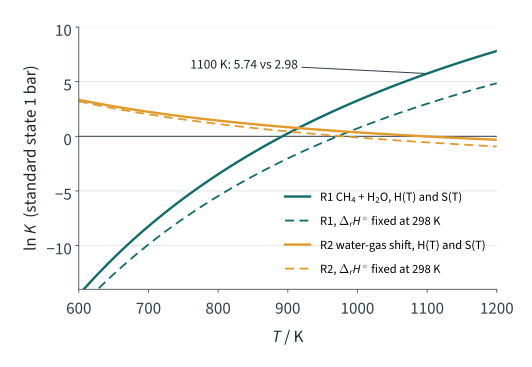
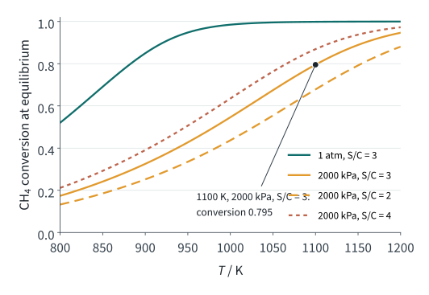
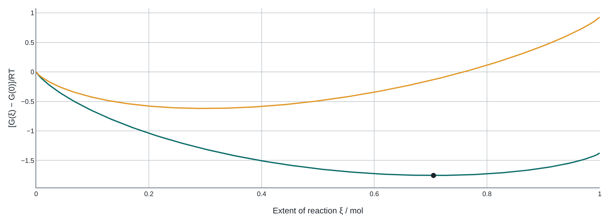

## Where this session sits {#course-map}

::: {.coursemap}
::: {.half .done}
[Before the midterm · 7 sessions]{.label}
[P1 · Framework]{.cm} [P2 · PVT and equations of state]{.cm} [P3 · Residual properties]{.cm} [P4 · Pure-component equilibrium and fugacity]{.cm} [P5 · Mixtures]{.cm} [P6 · Excess properties and activity]{.cm} [P7 · Choosing a property model]{.cm}
:::
::: {.half}
[After the midterm · 7 sessions]{.label}
[1 · VLE and flash]{.cm .past} [2 · Experimental VLE and consistency]{.cm .past} [3 · Liquid stability and LLE]{.cm .past} [4 · Solids and adsorption]{.cm .past} [5 · Chemical equilibrium]{.cm .now} [6 · Electrochemical equilibrium]{.cm} [7 · Choosing a model from evidence]{.cm}
:::
:::

::: {.bridge}
Sessions 1–4 moved molecules between phases. Today they change identity. The condition is still a minimum of G, now constrained by the **element balances**. The usual errors are in K(T), the standard state and the number of reactions.
:::

## Why this matters: a factor of 16 in K {#why}

:::: {.columns}
::: {.column width="58%"}
{.fig-pxy fig-alt="ln K against temperature from 600 to 1200 K for methane steam reforming and the water-gas shift, computed from NIST-JANAF H and S and from a constant reaction enthalpy at 298 K; at 1100 K ln K1 is 5.74 against 2.98"}
:::
::: {.column width="40%" .why-notes}
Steam methane reforming, the main industrial route to H₂:

R1 CH₄ + H₂O ⇌ CO + 3H₂ 
R2 CO + H₂O ⇌ CO₂ + H₂

At 1100 K, K₁ from tabulated H(T) and S(T) is **16 times** the van 't Hoff value with ΔrH° fixed at 298 K. At 2000 kPa that is the difference between 80 % and 50 % CH₄ conversion.

[Data: Chase (1998), NIST-JANAF Tables, Shomate coefficients via the NIST Chemistry WebBook. Lab 12 E uses them.]{.source}
:::
::::

## From phase equilibrium to reaction equilibrium {#recap}

::: {.chain}
::: {.link}
[Sessions 1–4]{.label}
Equal chemical potential of each species in every phase.

$$\mu_i^{\alpha}=\mu_i^{\beta}$$
:::
::: {.link .today}
[Today]{.label}
Zero Gibbs energy change along each independent reaction.

$$\sum_i\nu_{ij}\mu_i=0\ \Rightarrow\ \prod_i a_i^{\nu_{ij}}=K_j(T)$$
:::
::: {.link}
[Same thing]{.label}
Minimum of total G subject to the element balances.

$$\min G\ \text{ s.t. }\ \sum_i A_{ki}n_i=b_k$$
:::
:::

[νij: coefficient of species i in reaction j (products +). ai: activity of i. ni: moles of species i. Aki: atoms of element k in one molecule of i (the element matrix, not an activity). bk: moles of element k fed.]{.howto}

## By the end of today you can {#outcomes}

[Where you show it]{.where-head}

1. **Write** K with explicit standard states, and the pressure term that goes with them. [Concepts, Lab 12 C]{.where}
2. **Compute** K(T) from tabulated H and S, and size the error of a constant-ΔrH° estimate. [Activity 1, Lab 12 A]{.where}
3. **Count** independent reactions from the element matrix. [Concepts, note]{.where}
4. **Solve** a two-reaction equilibrium and judge when Kφ matters. [Activity 2, Lab 12 E]{.where}
5. **Specify** the calculation for an AI assistant to code, and **verify** the code. [Activity 2, Lab 12 E]{.where}

## The 180-minute route {#route}

::: {.route}
::: {.seg .concept style="flex:30"}
[0–30]{.t} **Essential concepts** [K and P°, K(T), independent reactions, Kφ]{.d}
:::
::: {.seg .act style="flex:10"}
[30–40]{.t} **Activity 1** [K₁ two ways]{.d}
:::
::: {.seg .demo style="flex:20"}
[40–60]{.t} **Demo** [Lab 12]{.d}
:::
::: {.seg .break style="flex:10"}
[60–70]{.t} **Break**
:::
::: {.seg .act style="flex:70"}
[70–140]{.t} **Activity 2 · pair investigation** [Lab 12 A and C, then E with your own code]{.d}
:::
::: {.seg .wrap style="flex:40"}
[140–180]{.t} **Discussion and exit ticket** [what fixes the composition]{.d}
:::
:::

::: {.route-question}
[Session question]{.label} Which inputs actually decide an equilibrium composition, and which mistakes change it by more than any model refinement?
:::

::: {.beforeafter}
::: {}
[Before class · 15–20 min]{.label}
Read the [note on chemical equilibrium](note-s05.html){target="_blank"}. Answer its three questions.
:::
::: {}
[After class · 30–40 min]{.label}
Finish Lab 12 A, C and E, and submit the study file with your name and ID.
:::
:::

::: {.selfstudy}
**Studying on your own?** Follow the same order. Turn on narration or captions at the bottom left, and pause at each activity slide.
:::

## K belongs to a standard state {#standard}

:::: {.columns}
::: {.column width="52%"}
$$\ln K=-\frac{\Delta_rG^\circ(T)}{RT}\qquad a_i=\frac{y_i\hat\varphi_iP}{P^\circ}$$

$$K=K_y\,K_\varphi\Big(\frac{P}{P^\circ}\Big)^{\Delta\nu}$$

$K_y=\prod_i y_i^{\nu_i}$, $K_\varphi=\prod_i\hat\varphi_i^{\nu_i}$ with $\hat\varphi_i$ the fugacity coefficient in the mixture (Session 1), and $\Delta\nu=\sum_i\nu_i$. K depends on T and on the standard states only. P must be divided by the **same** P° that defined ΔrG°.
:::
::: {.column width="46%"}
::: {.lever-box}
[R1 at 1100 K, S/C = 3, 2000 kPa ([Δν]{.nt} = +2)]{.label}

| Pressure term used | CH₄ conversion |
|---|---:|
| (2000/100)², correct for P° = 1 bar | **0.795** |
| term omitted, as if 1 bar | 0.996 |

S/C: mol H₂O fed per mol CH₄. Conversion: ξ₁, the extent of R1 per mol CH₄ fed.

Pressure lowers the conversion of a mole-increasing reaction. K itself does not change.
:::
:::
::::

## K at another temperature {#kT}

:::: {.columns}
::: {.column width="50%"}
van 't Hoff is exact:

$$\frac{\mathrm d\ln K}{\mathrm dT}=\frac{\Delta_rH^\circ(T)}{RT^2}$$

Holding ΔrH° at 298 K is the approximation. For R1, ΔrH° rises from 206.2 to 226.6 kJ/mol between 298 and 1100 K.

Safer: ΔrG°(T) = Σνi[Hi(T) − TSi(T)] from tabulated data.
:::
::: {.column width="48%"}
::: {.lever-box}
[ln K at 1100 K · NIST-JANAF]{.label}

| | H(T), S(T) | ΔrH° fixed | ratio of K |
|---|---:|---:|---:|
| R1 | 5.742 | 2.981 | 15.8 |
| R2 | −0.013 | −0.555 | 1.7 |

The error grows with |T − 298 K| and with ΔCp. It is not a rounding issue.
:::
:::
::::

## How many reactions? {#rank}

:::: {.columns}
::: {.column width="50%"}
Element matrix **A** (rows k = C, H, O; columns i = CH₄, H₂O, CO, CO₂, H₂):

$$\begin{pmatrix}1&0&1&1&0\\4&2&0&0&2\\0&1&1&2&0\end{pmatrix}$$

Rank 3, so 5 − 3 = **2** independent reactions, with extents ξ₁ and ξ₂. R1 and R2 are one choice. CH₄ + 2H₂O ⇌ CO₂ + 4H₂ is R1 + R2 and adds nothing.
:::
::: {.column width="48%" .rule-notes}
Any independent pair gives the same composition. So does a Gibbs minimization with the element balances as constraints.

Add solid carbon and the count rises to 3: carbon deposition, for example 2CO ⇌ C + CO₂, becomes possible. The extents method only finds what its reaction list allows.

[That is a modeling decision, not a coding one.]{.q}
:::
::::

## Is the gas ideal enough? {#kphi}

:::: {.columns}
::: {.column width="52%"}
$$K_\varphi=\prod_i\hat\varphi_i^{\nu_i}$$

At 1100 K and 2 MPa, every species is far above its critical temperature. The Pitzer virial correlation gives:

| | $\ln\hat\varphi_i$ |
|---|---:|
| CH₄ / H₂O | 0.0045 / −0.0030 |
| CO / CO₂ / H₂ | 0.0052 / 0.0045 / 0.0024 |
:::
::: {.column width="46%" .rule-notes}
ln Kφ = **0.011** for R1 and 0.005 for R2: the equilibrium factor changes by about 1 %. That is **not** a 1 % change in conversion: CH₄ conversion moves from 0.795 to 0.794, by 0.001. Both are smaller than the uncertainty from how close a real catalyst bed gets to equilibrium.

Not so in Week 7's example at 400 K and 2 MPa: Kφ = 1.06, which moves the extent by 2 %. Nor in ammonia synthesis at 20 MPa.

[Check Kφ before you use it or drop it.]{.q}
:::
::::

## K₁ two ways {#activity-1 .activity}

[Activity 1 · 10 minutes · alone, then with a partner]{.act-label}

::: {.prompt}
R1 at 298.15 K: ΔrH° = 206.17 kJ/mol, ΔrS° = 212.2 J/(mol K). Estimate ln K₁ at 1000 K with ΔrH° held constant.
:::

The tabulated value is ln K₁(1000 K) = 3.269. Which way is your estimate off, and why? With S/C = 3 at 1 atm, the tabulated K gives 98.5 % conversion; is your error important here?

::: {.selfstudy}
**On your own:** pause here and write your answer. In place of a partner, compare it with the next slide and write one sentence on any difference and its cause.
:::

## Activity 1: check your answer {#activity-1-debrief}

:::: {.columns}
::: {.column width="52%"}
ΔrG°(298.15) = 206.17 − 298.15 × 0.2122 = 142.9 kJ/mol, so ln K₁(298.15) = −57.64.

ln K₁(1000) ≈ −57.64 − (206 170/8.314)(1/1000 − 1/298.15) = **0.73**

Tabulated: 3.27. K is underestimated by a factor of 13, because ΔrH° grows with T.
:::
::: {.column width="46%" .rule-notes}
At 1 atm the error hardly matters: conversion is near 1 either way.

At 2000 kPa it decides the answer: at 1100 K the two K values give 0.795 and 0.498.

[The same error can be harmless in one design and decisive in another. Test it where you use it.]{.q}
:::
::::

## Pressure, steam and temperature {#conditions}

:::: {.columns}
::: {.column width="56%"}
{.fig-pxy fig-alt="Equilibrium methane conversion against temperature from 800 to 1200 K at 1 atm with steam to carbon 3, and at 2000 kPa with steam to carbon 2, 3 and 4"}
:::
::: {.column width="42%" .concept-notes}
[Pressure]{.q} At 1000 K, S/C = 3: 98.5 % at 1 atm, 54.6 % at 2000 kPa. Plants still run at 2–3 MPa, for downstream use, and pay with higher T.

[Steam]{.q} At 1100 K, 2000 kPa: S/C = 2, 3, 4 gives 0.678, 0.795, 0.869.

[Shift]{.q} R2 is exothermic. Its K falls with T, so CO₂ forms at lower T and CO at higher T.
:::
::::

## Demonstration · Lab 12 {#demo-lab}

:::: {.columns}
::: {.column width="44%"}
1. Starting case A₂ ⇌ 2A, 350 K, 100 kPa: ln K = 1.375, conversion 0.705.
2. Read G(ξ): the minimum is the equilibrium.
3. C: pressure × 10 gives 0.300; 4 mol inert gas at 100 kPa gives 0.870.
4. Load the real-data preset, N₂O₄ ⇌ 2NO₂, and compare.

[Open Lab 12 in the Graduate view →](../preview-2027/reaction.html?mode=graduate){.lab-button target="_blank"}
:::
::: {.column width="54%"}
{.lab-shot fig-alt="Lab 12 chart of the Gibbs energy along the extent of reaction, with the minimum at 0.705 at 100 kPa and a second curve at 1000 kPa"}

::: {.expect}
[Lab 12 should report · starting case]{.label}
ln K = 1.3745 · K = 3.953 · ξ = 0.7050 · y(A) = 0.827 · teal: 100 kPa, amber: 1000 kPa
:::
:::
::::

## Four common mistakes {#mistakes}

::: {.mistakes}
::: {}
**P in kPa with K defined at 1 bar.** The pressure term is off by 100Δν.
:::
::: {}
**ΔrH° held at 298 K over hundreds of kelvin.** ln K₁ at 1100 K: 2.98 instead of 5.74.
:::
::: {}
**One reaction too few.** The composition can only use the reactions you wrote down.
:::
::: {}
**Accepting the solver's output unchecked.** A start with CO = 0 or residuals in K, not ln K, can return an unconverged or negative answer.
:::
:::

## AI writes code, you write the problem {#ai-code}

:::: {.columns}
::: {.column width="50%"}
[You decide]{.label}

- How K depends on T, and its standard state
- The independent reactions and the balances
- Residual form, starting point, convergence test
- What the result means, and what it does not show

[The assistant may]{.label}

Write and debug code that does exactly what your specification says. Not property values or conclusions.
:::
::: {.column width="48%" .rule-notes}
**Lab 12 step E** recomputes from the NIST-JANAF data:

1. ln K₁ at your T
2. ln K₂ at your T
3. CH₄ conversion
4. Wet mole fractions
5. O/C ratio of your mixture

It names K from constant ΔrH°, P in kPa, a missing pressure term, and negative amounts.
:::
::::

## Break · 10 minutes {#break .breakslide}

::: {.break-next}
[Next]{.label}
Activity 2: a pair investigation in Lab 12, 70 minutes.

Before you leave your seat, check that Lab 12 opens on your device.
:::

## Activity 2 · what fixes the composition? {#activity-2 .activity}

[Activity 2 · 70 minutes · in pairs: one drives Lab 12, one checks by hand, then swap]{.act-label}

::: {.a2grid}
::: {}
[15 min · by hand]{.label}
Element matrix and its rank for the five SMR species. Then with solid carbon added. Name the extra reaction.
:::
::: {}
[20 min · Lab 12 A and C]{.label}
Carry K to other T with ΔCp = 0 and ≠ 0. Then pressure, inert gas and the 1 bar / 1 atm standard state. Save the study.
:::
::: {}
[25 min · E your own code]{.label}
SMR at 1100 K, 2000 kPa, S/C = 3, then a case of your own. Specify, ask an AI assistant for the code, run it, check it in E.
:::
::: {}
[10 min · explain]{.label}
Two sentences with numbers: which single input changes the 1100 K, 2000 kPa conversion most, and by how much?
:::
:::

::: {.selfstudy}
**On your own:** do both roles yourself: work in Lab 12, then check one value by hand before you trust it. Pause the slides while you work; the next slide lists what to hand in.
:::

## Activity 2 · what to hand in {#activity-2-check}

:::: {.columns}
::: {.column width="44%"}
1. Lab 12 study file with A, C and E, your name and student ID.
2. The element matrices and ranks, with and without carbon.
3. Two sentences that answer the activity question with numbers.

[Graduate extension]{.label}
Add Kφ from the Pitzer correlation to your code at 1100 K and 2000 kPa. How much does the conversion move? At what pressure would it move by 0.01?
:::
::: {.column width="54%"}
::: {.lever-box}
[Check your results · 1100 K, 2000 kPa, S/C = 3]{.label}

| | value |
|---|---:|
| ln K₁ / ln K₂ | 5.7422 / −0.0131 |
| CH₄ conversion | 0.7953 |
| y H₂ / CO / CO₂ / CH₄ | 0.4846 / 0.0844 / 0.0578 / 0.0366 |
| y H₂O | 0.3365 |

At 1000 K and 1 atm: conversion 0.9850, y H₂ 0.5623.
:::
:::
::::

## What the code checks catch {#ai-debrief}

:::: {.columns}
::: {.column width="56%"}
::: {.lever-box}
[1100 K, 2000 kPa, S/C = 3 · a first-draft script and two revisions]{.label}

| Version | ln K₁ | conversion | y CO₂ |
|---|---:|---:|---:|
| start ξ₁ = ξ₂ = 0.5 | 2.981 | 0.500 | 0.100, the start |
| residuals in K, not ln K | 2.981 | 0.996 | **−0.463** |
| ln K residuals | 2.981 | 0.498 | 0.043 |
| lab | 5.742 | **0.795** | 0.058 |

The first start put CO at zero and divided by it; the script printed the starting guess. The second did not converge and left the physical region.
:::
:::
::: {.column width="42%" .rule-notes}
[What made all checks agree]{.label}

- K from H(T) and S(T), not constant ΔrH°
- Residuals in ln K, every amount kept positive
- A start with every species present, and a convergence test

The third version converged cleanly and was still wrong by 0.30 in conversion. Convergence checks the solver, not the thermodynamics.
:::
::::

## Discussion: what fixes the composition? {#discussion}

:::: {.columns}
::: {.column width="56%"}
{.fig-pxy fig-alt="Equilibrium methane conversion against temperature at several pressures and steam ratios"}
:::
::: {.column width="42%" .concept-notes}
[Discuss in pairs, then with the class. On your own: write two or three sentences for each question.]{.q}

1. Rank these by their effect on the 1100 K, 2000 kPa conversion: K(T) method, Kφ, S/C from 3 to 4, P in kPa.
2. Your extents code cannot form carbon. How would you find out whether carbon deposits at S/C = 2?
3. A reactor outlet shows 70 % conversion where equilibrium says 79.5 %. What does that tell you, and what does it not?
:::
::::

## Summary {#summary}

::: {.summary3}
::: {}
[K]{.label}
ln K = −ΔrG°(T)/RT for stated standard states. P enters as P/P°, with the same P°.
:::
::: {}
[K(T)]{.label}
Use H(T) and S(T). Constant ΔrH° from 298 K misses ln K₁ at 1100 K by 2.8.
:::
::: {}
[Composition]{.label}
Count reactions from the element matrix. Check Kφ before dropping it. Check convergence and positivity before believing a solver.
:::
:::

**Session question:** at 1100 K, 2000 kPa and S/C = 3, the conversion is 0.795. K from constant ΔrH° gives 0.498, omitting the pressure term gives 0.996, raising S/C to 4 gives 0.869, and Kφ moves it by about 1 %.

[Next session]{.label} When does a reaction produce a voltage? Electrochemical equilibrium (Lab 13).

## Exit ticket · 5 minutes {#exit-ticket .activity}

[Exit ticket and feedback · alone · 5 minutes · anonymous]{.act-label}

:::: {.columns}
::: {.column width="64%"}
::: {.prompt}
Your SMR code converges and gives 50 % CH₄ conversion at 1100 K and 2000 kPa. The lab gives 79.5 %. Name two causes you would check first, and the evidence that would separate them.
:::

Scan the code or open the link. The same form asks three short questions about today: pace, confidence and whether the lab worked.

No name or student ID is recorded. Wait for **"Response received."**
:::
::: {.column width="32%" .qr-col}
{.qr fig-alt="QR code for the Session 5 exit ticket and feedback form"}

[Open the Session 5 form](exit.html?s=5){target="_blank"}
:::
::::

## After class {#after-class}

::: {.summary3}
::: {}
[Hand in · this week]{.label}
Your Lab 12 study file with A, C and E, name and student ID. Upload it to **myCourseVille**, in the assignment for that lab.
:::
::: {}
[Prepare · Session 6]{.label}
Read the [Session 6 pre-class note](note-s06.html){target="_blank"}. About 20 minutes.
:::
::: {}
[Optional · graduate]{.label}
Lab 12 B: which way will a sample react? Then add Kφ to your E code.
:::
:::

[Open Lab 12 in the Graduate view →](../preview-2027/reaction.html?mode=graduate#graduate-investigation){.lab-button target="_blank"}

[Starts at **4. Investigate the equilibrium evidence**. **A**: first button **Run the temperature study**. **C**: **Run the pressure study**. **E**: **Download the NIST-JANAF data (CSV)**.]{.howto}
