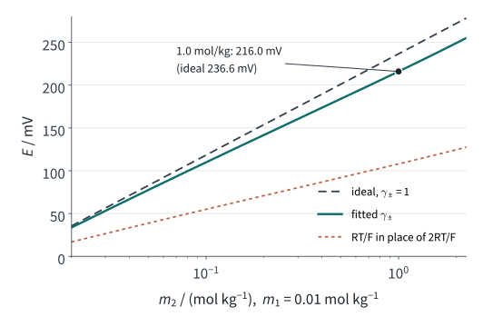
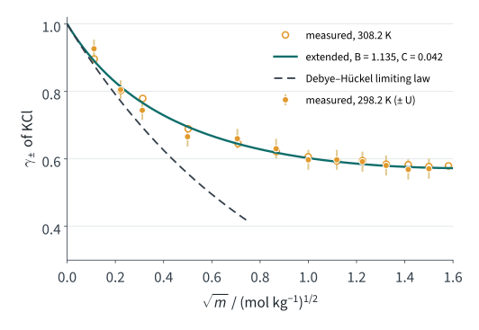

## Where this session sits {#course-map}

::: {.coursemap}
::: {.half .done}
[Before the midterm]{.label}
[Equations of state]{.cm} [Fugacity and chemical potential]{.cm} [Solution thermodynamics]{.cm}
:::
::: {.half}
[After the midterm · 7 sessions]{.label}
[1 · VLE and flash]{.cm .past} [2 · Experimental VLE and consistency]{.cm .past} [3 · Liquid stability and LLE]{.cm .past} [4 · Solids and adsorption]{.cm .past} [5 · Chemical equilibrium]{.cm .past} [6 · Electrochemical equilibrium]{.cm .now} [7 · Choosing a model from evidence]{.cm}
:::
:::

::: {.bridge}
Session 5 asked how far a reaction goes. Today a voltage holds the reaction at equilibrium, and the voltage **measures** ΔrG. That makes the cell one of the most precise instruments for activity coefficients, and one of the easiest to misread.
:::

## Why this matters: 21 mV from nonideality {#why}

:::: {.columns}
::: {.column width="58%"}
{.fig-pxy fig-alt="EMF of a KCl concentration-cell pair against the higher molality with the lower fixed at 0.01 mol per kg: ideal, with fitted activity coefficients giving 216.0 millivolts at 1.0 mol per kg against 236.6 ideal, and a line at half the value from using RT over F"}
:::
::: {.column width="40%" .why-notes}
Two cells Ag|AgCl|KCl(m)|K⁺-ISE (ion-selective electrode) at 0.01 and 1.0 mol/kg, in opposition:

ideal **236.6 mV**; with measured γ± **216.0 mV**.

21 mV is 9 % of the signal. For a battery it is the difference between two states of charge; for a sensor, a factor of 1.5 in concentration.

Writing RT/F where the salt needs 2RT/F halves the answer.

[Data: Nasiri-Lohehsara and Ghalami-Choobar, J. Chem. Eng. Data 63 (2018) 2660–2670, via NIST ThermoML. Lab 13 E uses them.]{.source}
:::
::::

## From reaction equilibrium to a cell {#recap}

::: {.chain}
::: {.link}
[Session 5]{.label}
Equilibrium of a reaction:

$$\Delta_rG=\Delta_rG^\circ+RT\ln\prod_i a_i^{\nu_i}=0$$
:::
::: {.link .today}
[Today]{.label}
The same reaction balanced by electrical work:

$$\Delta_rG=-nFE$$
:::
::: {.link}
[Nernst]{.label}
$$E=E^\circ-\frac{RT}{nF}\ln\prod_i a_i^{\nu_i}$$

Molality scale, m° = 1 mol/kg.
:::
:::

## By the end of today you can {#outcomes}

[Where you show it]{.where-head}

1. **Write** the Nernst equation for a cell with explicit activities and standard states. [Concepts, Lab 13]{.where}
2. **Use** mean ionic activities, and say why single-ion activities are not measured. [Activity 1]{.where}
3. **Fit** an extended Debye–Hückel model to measured γ± and state its range. [Activity 2, Lab 13 E]{.where}
4. **Obtain** ΔrS and ΔrH from dE/dT, and judge whether data can resolve them. [Lab 13 B, discussion]{.where}
5. **Specify** the calculation for an AI assistant to code, and **verify** the code. [Activity 2, Lab 13 E]{.where}

## The 180-minute route {#route}

::: {.route}
::: {.seg .concept style="flex:30"}
[0–30]{.t} **Essential concepts** [Nernst, γ±, Debye–Hückel, dE/dT]{.d}
:::
::: {.seg .act style="flex:10"}
[30–40]{.t} **Activity 1** [the factor 2]{.d}
:::
::: {.seg .demo style="flex:20"}
[40–60]{.t} **Demo** [Lab 13]{.d}
:::
::: {.seg .break style="flex:10"}
[60–70]{.t} **Break**
:::
::: {.seg .act style="flex:70"}
[70–140]{.t} **Activity 2 · pair investigation** [Lab 13 A–B, then E with your own code]{.d}
:::
::: {.seg .wrap style="flex:40"}
[140–180]{.t} **Discussion and exit ticket** [what a voltage can tell you]{.d}
:::
:::

::: {.route-question}
[Session question]{.label} A cell voltage is a direct measure of ΔrG. Which parts of it come from concentration, which from nonideality, and which can the data actually resolve?
:::

::: {.beforeafter}
::: {}
[Before class · 15–20 min]{.label}
Read the [note on electrochemical equilibrium](note-s06.html){target="_blank"}. Answer its three questions.
:::
::: {}
[After class · 30–40 min]{.label}
Finish Lab 13 A, B and E, and submit the study file with your name and ID.
:::
:::

::: {.selfstudy}
**Studying on your own?** Follow the same order. Turn on narration or captions at the bottom left, and pause at each activity slide.
:::

## Mean ionic activity {#mean}

:::: {.columns}
::: {.column width="52%"}
Every measurable quantity involves a neutral combination of ions, so single-ion activities are not measured. For a 1:1 salt:

$$a_{\text{KCl}}=a_{\text{K}^+}a_{\text{Cl}^-}=(m\gamma_\pm)^2$$

A cell that responds to KCl therefore gives

$$E=\frac{RT}{F}\ln\frac{a_{\text{KCl},2}}{a_{\text{KCl},1}}=\frac{2RT}{F}\ln\frac{m_2\gamma_{\pm,2}}{m_1\gamma_{\pm,1}}$$
:::
::: {.column width="46%" .rule-notes}
For a 2:1 salt such as CaCl₂, a = (m)(2m)²γ±³ = 4m³γ±³: the power is the number of ions.

The pair of cells in opposition cancels E°: only the ratio of activities is measured.

A **liquid junction** between the two solutions would add a potential set by ion mobilities. The cell pair avoids it; Lab 13's teaching cell neglects it.
:::
::::

## Debye–Hückel and its range {#dh}

:::: {.columns}
::: {.column width="56%"}
{.fig-pxy fig-alt="Mean ionic activity coefficient of KCl against the square root of molality at 298.2 and 308.2 K with uncertainty bars, the Debye-Hueckel limiting law falling well below the data above 0.05 mol per kg, and the extended fit"}
:::
::: {.column width="42%" .concept-notes}
$$\log_{10}\gamma_\pm=-A|z_+z_-|\sqrt I\qquad I=\tfrac12\sum_i m_iz_i^2$$

[A = 0.509]{.q} (kg/mol)1/2 at 298 K, **log₁₀ basis**; 1.172 on the ln basis.

[Limiting law]{.q} At 1.0 mol/kg it gives 0.310; the data give 0.597.

[Extended]{.q} ln γ± = −A√m/(1 + B√m) + Cm: B = 1.135, C = 0.042, RMSE 0.022 in ln γ±, close to the data's ±0.03.
:::
::::

## Temperature: entropy and heat {#temperature}

:::: {.columns}
::: {.column width="50%"}
$$\Delta_rS=nF\frac{\partial E}{\partial T},\qquad \Delta_rH=-nF\Big(E-T\frac{\partial E}{\partial T}\Big)$$

**Ideal concentration cell:** E ∝ T, so ΔrH = 0. All the electrical work, 22.8 kJ per mole of KCl at 0.2366 V, is heat drawn from the surroundings.

With real γ±, ∂ln γ±/∂T adds partial molar enthalpies.
:::
::: {.column width="48%"}
::: {.lever-box}
[KCl, same model fitted at each T]{.label}

| | 298.2 K | 308.2 K |
|---|---:|---:|
| B | 1.135 | 1.145 |
| C | 0.042 | 0.045 |
| γ± at 1 mol/kg | 0.603 | 0.606 |

Difference 0.004; uncertainty of each value ±0.03. These data **cannot** resolve ∂ln γ±/∂T. Calorimetry (heats of dilution) can.
:::
:::
::::

## Where it matters: batteries and sensors {#batteries}

:::: {.columns}
::: {.column width="50%"}
[Concentration overpotential]{.label}

During discharge, the electrolyte near each electrode changes concentration. The equilibrium part of the loss is a concentration cell inside the battery. With γ± from data, not γ = 1, it changes by 9 % in the KCl example and by 37 % in the Week 7 example.

[Week 7 example]{.label}

γ 0.40 and 0.17 reduced a 29.6 mV cell to 18.6 mV: 63 % of the ideal value.
:::
::: {.column width="48%" .rule-notes}
[Sensors]{.label}

An ion-selective electrode reads activity, not concentration. A calibration in dilute standards, read at high ionic strength, misreports concentration unless γ is carried through.

[Lab 13 C]{.label}

How much work before the cell is flat: the discharge study integrates E as the two concentrations approach each other.
:::
::::

## The factor 2 {#activity-1 .activity}

[Activity 1 · 10 minutes · alone, then with a partner]{.act-label}

::: {.prompt}
From the measured KCl data at 298.2 K: γ± = 0.9267 at 0.0124 mol/kg and 0.5974 at 1.0003 mol/kg. Compute the EMF of the cell pair at 298.15 K, ideal and with these γ±.
:::

Then: where does the 2 in 2RT/F come from? How large is the uncertainty in E from ±0.03 in each γ±?

::: {.selfstudy}
**On your own:** pause here, write your answer, then go to the next slide.
:::

## Activity 1: check your answer {#activity-1-debrief}

:::: {.columns}
::: {.column width="52%"}
2RT/F = 0.05139 V at 298.15 K.

Ideal: 0.05139 ln(1.0003/0.0124) = **225.6 mV**

With γ±: 0.05139 ln(1.0003 × 0.5974 / (0.0124 × 0.9267)) = **203.0 mV**

The 2 comes from (mγ±)²: two ions per formula unit.
:::
::: {.column width="46%" .rule-notes}
Uncertainty from γ± alone: 0.05139 × √[(0.03/0.597)² + (0.03/0.927)²] ≈ **3 mV**.

That is larger than the effect of a 10 K temperature change on γ± in these data. Precision, not the model, sets what the cell can tell you.

[The fitted model gives 216.0 mV for exactly 0.01 and 1.0 mol/kg.]{.q}
:::
::::

## Demonstration · Lab 13 {#demo-lab}

:::: {.columns}
::: {.column width="50%"}
1. Starting case M²⁺ concentration cell, 0.01 and 1.0 mol/L, γ = 1: **59.2 mV**.
2. A: Debye–Hückel limiting law at I = 3 mol/L gives **−34.7 mV**, the wrong sign; extended gives 29.9 mV.
3. B: E ∝ T, ΔrS = 38.3 J/(mol K), ΔrH = 0.
4. C: discharge until flat, 160 J for 0.1 L.

[Open Lab 13 →](../preview-2027/electrochemistry.html){.lab-button target="_blank"}
:::
::: {.column width="48%" .rule-notes}
The limiting law at I = 3 is not a small error. It reverses the cell. A law outside its range does not degrade gracefully.

The teaching cell uses n = 2 for M²⁺/M and molar concentration with c° = 1 mol/L. Step E switches to measured KCl data on the molality scale.
:::
::::

## Four common mistakes {#mistakes}

::: {.mistakes}
::: {}
**RT/F for a 1:1 salt.** aKCl = (mγ±)². Without the square, E is half.
:::
::: {}
**A = 0.509 used with ln.** It is a log₁₀ constant; on the ln basis it is 1.172.
:::
::: {}
**The limiting law at high ionic strength.** At I = 3 mol/L it reversed Lab 13's cell.
:::
::: {}
**Reading dE/dT from data that cannot resolve it.** A difference of 0.004 in γ± against ±0.03 is noise.
:::
:::

## AI writes code, you write the problem {#ai-code}

:::: {.columns}
::: {.column width="50%"}
[You decide]{.label}

- The model, its basis and the units of A, B, C
- Which rows, and the objective
- The cell reaction and the activity of KCl
- What the result means, and what it does not show

[The assistant may]{.label}

Write and debug code that does exactly what your specification says. Not property values or conclusions.
:::
::: {.column width="48%" .rule-notes}
**Lab 13 step E** recomputes from the measured γ±:

1. Limiting-law γ± at 0.0124 mol/kg
2. Fitted B and C
3. RMSE in ln γ±
4. γ± at 1.0 mol/kg
5. Ideal cell EMF
6. EMF with your γ±

It also fits the 308.2 K data, for the discussion.
:::
::::

## Break · 10 minutes {#break .breakslide}

::: {.break-next}
[Next]{.label}
Activity 2: a pair investigation in Lab 13, 70 minutes.

Before you leave your seat, check that Lab 13 opens on your device.
:::

## Activity 2 · what can a voltage tell you? {#activity-2 .activity}

[Activity 2 · 70 minutes · in pairs: one drives Lab 13, one checks by hand, then swap]{.act-label}

::: {.a2grid}
::: {}
[15 min · by hand]{.label}
Ionic strength of 0.1 mol/kg KCl, CaCl₂ and MgSO₄. Limiting-law γ± for each. Which would you trust?
:::
::: {}
[20 min · Lab 13 A–B]{.label}
Activity forms at 0.01 and 1.0; then E, ΔS and ΔH from 278 to 338 K. Save the study.
:::
::: {}
[25 min · E your own code]{.label}
KCl at 298.2 K. Specify, ask an AI assistant for the code, run it, check it in E. Fix what disagrees.
:::
::: {}
[10 min · explain]{.label}
Two sentences with numbers: how much of the 236.6 mV ideal EMF survives nonideality, and how well do you know it?
:::
:::

::: {.selfstudy}
**On your own:** do both roles yourself. Pause the slides, work in Lab 13, then continue.
:::

## Activity 2 · what to hand in {#activity-2-check}

:::: {.columns}
::: {.column width="44%"}
1. Lab 13 study file with A, B and E, your name and student ID.
2. The ionic strengths and limiting-law γ± by hand.
3. Two sentences that answer the activity question with numbers.

[Graduate extension]{.label}
Fit the extended form to both temperatures with B(T) and C(T) linear in T. Is the slope of C distinguishable from zero given the stated U?
:::
::: {.column width="54%"}
::: {.lever-box}
[Check your results · KCl, 298.2 K]{.label}

| | value |
|---|---:|
| ionic strength, 0.1 mol/kg KCl / CaCl₂ / MgSO₄ | 0.1 / 0.3 / 0.4 |
| limiting-law γ± at 0.0124 mol/kg (KCl) | 0.8776 |
| B / C (ln basis) | 1.1346 / 0.0424 |
| RMSE in ln γ± | 0.0221 |
| γ± at 1.0 mol/kg | 0.6025 |
| EMF 0.01 / 1.0 mol/kg: ideal / fitted | 236.64 / 215.99 mV |
:::
:::
::::

## What the code checks catch {#ai-debrief}

:::: {.columns}
::: {.column width="56%"}
::: {.lever-box}
[KCl, 298.2 K · a first-draft script]{.label}

| | Lab | Script |
|---|---:|---:|
| limiting-law γ±, B, γ± at 1 mol/kg | agree | agree |
| C | 0.0424 | 0.0184 |
| EMF, ideal | 236.6 mV | **118.3 mV** |
| EMF with γ± | 216.0 mV | **108.0 mV** |

The script fitted on the log₁₀ basis, so its C was Cln/ln 10: same fit, different units. It then wrote the cell with n = 1 and a = mγ±, missing the square: every EMF was half.
:::
:::
::: {.column width="42%" .rule-notes}
[Fix that made all checks agree]{.label}

aKCl = (mγ±)², so E = (2RT/F) ln(m₂γ₂/m₁γ₁). Report C with its basis.

The fit was right and the chemistry was wrong. A fitting routine cannot know how many ions the salt has.

All checks agree only shows the code solves your problem. The model is still untested above 2.25 mol/kg and at other T.
:::
::::

## Discussion: what can a voltage tell you? {#discussion}

:::: {.columns}
::: {.column width="56%"}
{.fig-pxy fig-alt="Mean ionic activity coefficient of KCl with the limiting law and the extended fit"}
:::
::: {.column width="42%" .concept-notes}
[Discuss in pairs, then with the class]{.q}

1. At 0.0124 mol/kg the data give 0.927 ± 0.027 and the limiting law 0.878. Do you question the lowest row or the law?
2. You need ∂ln γ±/∂T for KCl at 1 mol/kg to ±10 %. Design the measurement.
3. A battery model uses γ = 1. At what electrolyte concentration would you start to worry, and how would you check?
:::
::::

## Summary {#summary}

::: {.summary3}
::: {}
[Cell]{.label}
ΔrG = −nFE. The Nernst equation is reaction equilibrium with electrical work, in activities on a stated scale.
:::
::: {}
[Activities]{.label}
Only neutral combinations are measured: aKCl = (mγ±)². The limiting law is a dilute limit; fit an extended form to data and state its range.
:::
::: {}
[Temperature]{.label}
ΔS = nF dE/dT, ΔH from E and dE/dT. Check that the data resolve the derivative before reporting it.
:::
:::

**Session question:** of the 236.6 mV ideal EMF, nonideality removes 20.6 mV, known to about ±3 mV from the γ± data. A 10 K change in temperature moves γ± by less than that uncertainty, so these data cannot give the entropy contribution of nonideality.

[Next session]{.label} Choosing a model from evidence: synthesis of Sessions 1–6 and exam preparation.

## Exit ticket · 5 minutes {#exit-ticket .activity}

[Exit ticket and feedback · alone · 5 minutes · anonymous]{.act-label}

:::: {.columns}
::: {.column width="64%"}
::: {.prompt}
A KCl concentration cell between 0.01 and 1.0 mol/kg measures 0.216 V; the ideal value is 0.237 V. What does the 21 mV tell you, and what would it take to turn it into a temperature derivative of γ±?
:::

Scan the code or open the link. The same form asks three short questions about today: pace, confidence and whether the lab worked.

No name or student ID is recorded. Wait for **"Response received."**
:::
::: {.column width="32%" .qr-col}
{.qr fig-alt="QR code for the Session 6 exit ticket and feedback form"}

[Open the Session 6 form](exit.html?s=6){target="_blank"}
:::
::::

## After class {#after-class}

::: {.summary3}
::: {}
[Hand in · this week]{.label}
Your Lab 13 study file with A, B and E, name and student ID.
:::
::: {}
[Prepare · Session 7]{.label}
Read the [review guide](note-s07.html){target="_blank"}. Session 7 is synthesis and exam preparation.
:::
::: {}
[Optional · graduate]{.label}
Lab 13 C: how much work before the cell is flat? Then repeat E with B and C linear in T.
:::
:::

[Open Lab 13 →](../preview-2027/electrochemistry.html){.lab-button target="_blank"}
